> 🌐 [English](README.md) · **Deutsch**

[](https://github.com/thedivingshellyfish/jellyqda/actions/workflows/R-CMD-check.yaml)

> Kontakt: jellyqda {@} systemli.org oder via github | Später vielleicht: Auch über ein Communityspace auf Matrix oder Discord

- **DEMO:** [https://thedivingshellyfish.shinyapps.io/jellyqda-demo/](https://thedivingshellyfish.shinyapps.io/jellyqda-demo/)
- **Converter:** MAXQDA & Co. → jellyqda, direkt im Browser > [https://thedivingshellyfish.github.io/jellyqda/converter/](https://thedivingshellyfish.github.io/jellyqda/converter/)
- **Assistant:** Qualitativ forschen – Schritt für Schritt > [https://thedivingshellyfish.github.io/jellyqda/assistant/](https://thedivingshellyfish.github.io/jellyqda/assistant/)


# jellyqda

**Qualitative Inhaltsanalyse von Interviews in R & RStudio: kostenlos, komplett offline, ohne Cloud.**

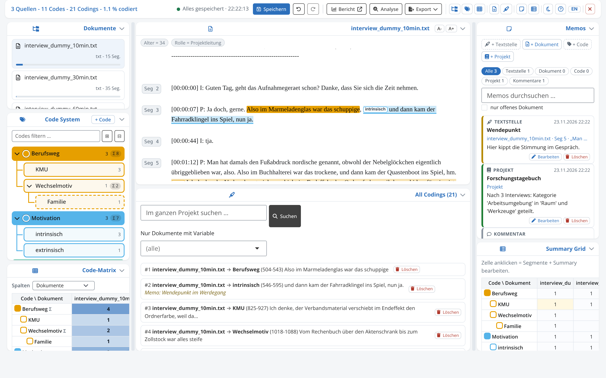

jellyqda ist ein kleines Werkzeug für die **qualitative Analyse von Interviews
und Feldnotizen**, entstanden für eine Masterarbeit. Du importierst
Transkripte, baust ein Kategoriensystem auf (deduktiv aus dem Leitfaden
und/oder induktiv am Material), markierst Textstellen, schreibst Memos und
wertest aus. Alles läuft **lokal auf deinem Rechner**, in RStudio oder im
Browser.

- 🔒 **100 % offline:** keine Cloud, keine Uploads, DSGVO-freundlich. Ein Projekt ist **eine Datei** (`*.jellyqda`).
- 📄 **Import** von `.txt`, `.md`, `.docx` und `.pdf`, dazu offene Antworten aus **Fragebögen** (CSV, Excel). Der Text wird beim Import „eingefroren“, Codings verrutschen nie.
- 🌳 **Codebaum mit Codes und Subcodes:** ein- und ausklappbar, jede Code-Familie in einer Farbe, verbunden durch einen farbigen „Faden“. Umbenennen per Doppelklick, Löschen mit Rückfrage.
- 🏷️ **Kodieren mit der Maus:** Text markieren, Code anklicken, fertig. Subcodes klappen in der Kodier-Leiste aus; Umkodieren mit einem Klick. Überlappende Codings werden übersichtlich angezeigt.
- ✂️ **Segmente** nach Absätzen oder **Sprecherwechseln** (`[00:01:12] P: …`), frei anpassbar.
- 📝 **Memos** in vier Arten: Textstelle, Dokument, Code (Definition, Kodierregel), Projekt.
- 🔬 **Deduktiv und induktiv:** Kodierleitfaden (Definition, Ankerbeispiel, Kodierregel), In-vivo-Codes, Codes zusammenführen, alle Suchtreffer auf einmal codieren, **Zusammenfassung nach Mayring** (Paraphrase → Generalisierung → Reduktion).
- 👥 **Intercoder-Übereinstimmung:** Blind-Kopie für eine zweite Person, dann **Cohens Kappa**, **Krippendorffs Alpha**, Brennan & Prediger und prozentuale Übereinstimmung je Code, dazu die Liste der Abweichungen für die Konsens-Diskussion.
- 🔎 **Abfragen:** Stellen mit kombinierten Codes (UND / ODER / NICHT), auf Wunsch nach Gruppen (z. B. nur Pflegekräfte); Treffer als neuen Code speichern.
- 🕸️ **Grafiken:** Code-Überschneidungen (Heatmap), Code-Netzwerk und Dokument-Portraits; Zelle, Linie oder Block anklicken führt zu den Textstellen. Einfaches SVG: in der App, im RStudio-Viewer, im Bericht oder gespeichert für die Arbeit.
- 🔁 **REFI-QDA-Export (.qdpx)** für MAXQDA, ATLAS.ti, NVivo, QualCoder: Ihr Projekt ist nie eingesperrt.
- 📊 **Auswerten:** Codings je Code, Volltextsuche, Code-Matrix mit **Fallvergleich**, Worthäufigkeiten, Stichwort im Kontext, Summary Grid, Export (CSV, Excel, Word).
- 🖨️ **Bericht** im eigenen Browser-Tab, druckfertig auf **A4** (ohne Hintergrundfarben), mit Häufigkeiten in Prozent und einer **Randspalte** neben jedem Interview: welche Codings, Kommentare und Memos an welcher Stelle stehen.
- ↩️ **Rückgängig/Wiederholen** für alles (Strg+Z / Strg+Y) und ein lückenloses **Protokoll** für den Methodenteil.
- 🌙 **Dark Mode**, gut lesbar (geprüfter Kontrast).
- 🌐 **Deutsch und Englisch:** Oberfläche und Bericht in beiden Sprachen, umschaltbar per Klick (**DE/EN**).

> 🆕 **Neu in Version 0.10.0:** **Fälle** unabhängig von Dokumenten (mehrere
> Interviews je Person, die Teilnehmenden eines Gruppeninterviews,
> Fallvariablen, Fälle vergleichen), **Projekte zusammenführen** für die
> Teamarbeit und **Pseudonymisieren beim Import**.
> **0.9.3:** **Abfragen** (Codes kombiniert mit UND / ODER / NICHT, nach Gruppen) und
> **Fragebogen-Import** (offene Antworten aus CSV / Excel, ein Dokument je Person).
> **0.9.2:** das [Wiki online](https://thedivingshellyfish.github.io/jellyqda/wiki/de/),
> jellyqda-Logo im Browser-Tab, aktualisierte Website.
> **0.9.1:** Bericht-Dialog (**Übersicht** in Sekunden oder **vollständig**)
> mit **Fortschrittsbalken**, Hinweis bei Stillstand und „Wird verarbeitet …“ bei längeren Schritten.
> **0.9.0:** **Grafiken** (Heatmap der Code-Überschneidungen, Code-Netzwerk,
> Dokument-Portraits), **REFI-QDA-Export (.qdpx)** für MAXQDA, ATLAS.ti, NVivo und QualCoder
> und ein Stresstest mit bis zu 150 Interviews.
> **0.8.0:** **Intercoder-Übereinstimmung** (Cohens Kappa, Krippendorffs
> Alpha): Blind-Kopie für eine zweite Person, Vergleich je Code, Abweichungen mit
> „Zeigen“ und „Übernehmen“ für die Konsens-Kodierung, Abschnitt im Bericht.
> **0.7.0:** Oberfläche und Bericht auf **Deutsch und Englisch**
> (Umschalter **DE/EN**), Paket bereit für CRAN (lauffähige Beispiele, Vignette).
> **0.6.0:** Bericht mit Randspalte (Codings und Memos neben dem
> Interview), Kommentarfeld in der Coding-Leiste, In-vivo-Codes, Codes zusammenführen,
> Suchtreffer codieren, Kodierleitfaden, Fallvergleich, Worthäufigkeiten,
> Stichwort im Kontext und Zusammenfassung nach Mayring.
> **0.5.0:** Codebaum mit Subcodes, zweistufige Kodier-Leiste, Umkodieren, Speichern (Strg+S),
> Bericht im neuen Tab. Alle Änderungen: [NEWS.md](NEWS.md).

**Ausführliche Anleitung mit Screenshots zu allen Funktionen:**
[📖 Wiki online](https://thedivingshellyfish.github.io/jellyqda/wiki/de/) · [im Repository](docs/wiki/de/Home.md) (Ordner `docs/wiki/de/`)

---

## Installation (einmalig, ca. 5 Minuten)

**Voraussetzung:** [R](https://cran.r-project.org) ab Version 4.0, am besten
mit [RStudio](https://posit.co/download/rstudio-desktop/). Beides ist kostenlos.

Öffne R oder RStudio und kopiere diese **eine Zeile** in die Konsole:

```r
source("https://raw.githubusercontent.com/thedivingshellyfish/jellyqda/main/install_jellyqda.R")
```

Das Skript installiert alle benötigten Pakete, dann jellyqda, prüft die
Installation und sagt dir am Ende, wie es weitergeht. Bei Problemen gibt es
eine konkrete Anleitung aus, z. B. welcher Befehl unter Linux fehlende
Systembibliotheken für den PDF-Import nachinstalliert.

<details>
<summary><b>Andere Wege</b> (ZIP-Datei, bestimmte Version, ohne Skript)</summary>

```r
# aus einer heruntergeladenen ZIP-Datei (z. B. von der Releases-Seite):
options(jellyqda.install.path = "~/Downloads/jellyqda.zip")
source("https://raw.githubusercontent.com/thedivingshellyfish/jellyqda/main/install_jellyqda.R")

# eine bestimmte Version / einen Branch:
options(jellyqda.install.ref = "main")

# danach direkt eine Demo mit Beispiel-Interview starten:
options(jellyqda.install.start_app = TRUE)

# ganz ohne Skript, aus einem entpackten Ordner:
install.packages(c("DBI", "RSQLite", "digest", "htmltools", "jsonlite", "officer", "pdftools",
                   "readr", "stringi", "tibble", "zip", "shiny", "bslib", "fontawesome",
                   "writexl"))
install.packages("pfad/zu/jellyqda", repos = NULL, type = "source")
```

**Linux:** Für den PDF- und Word-Import braucht R einmalig Systembibliotheken,
unter Ubuntu/Debian z. B.
`sudo apt install libpoppler-cpp-dev libxml2-dev libssl-dev libcurl4-openssl-dev libfontconfig1-dev`.
Das Installationsskript nennt den passenden Befehl für deine Distribution.
</details>

---

## Los geht's in 3 Schritten

```r
library(jellyqda)
# 1. Projekt anlegen (oder später wieder öffnen)
qda_open("meine-arbeit.jellyqda")   
# 2. App starten: öffnet sich im Browser
qda_app()                           
# (qda_app(lang = "de") = deutsche Oberfläche)
```

3. In der App links bei **Dokumente** deine Transkripte importieren (oder
   per Drag & Drop hineinziehen), im **Code System** mit **„+ Code“** erste
   Codes anlegen (und mit **„+ Subcode“** darunter), im Text markieren und auf
   einen Code klicken.

Beenden: rotes **X** oben rechts (speichert Export + Backup) oder `Esc` in der
R-Konsole. Gespeichert wird ohnehin **sofort bei jeder Aktion**.

> 💡 **Ausprobieren ohne eigene Daten:**
> `qda_import(system.file("extdata", "interview_01.txt", package = "jellyqda"))`
> (ein kurzes, fiktives englisches Beispielinterview) oder die fiktiven Demo-Transkripte aus
> dem Ordner [`demo/`](demo/) (10 bis 120 Minuten, mit Zeitmarken, ideal für Segmente nach
> Sprecherwechsel). Alle Beispiel- und Demo-Dateien sind erfunden, siehe [`demo/README.md`](demo/README.md).

---

## So sieht die Arbeit aus

**Codebaum:** Ein Code (oberste Ebene) ist voll gefärbt, seine Subcodes tragen
nur einen Rahmen in derselben Farbe und hängen an einer Linie, dem „Faden“.
Pfeil = ein-/ausklappen, **„+ Subcode“** an jeder Zeile, **Doppelklick** =
umbenennen, Papierkorb = löschen (mit Rückfrage), Farbpunkt = Farbe der ganzen
Code-Familie. „Σ“ zählt die Codings inklusive aller Subcodes.

<table>
<tr>
<td width="33%" valign="top">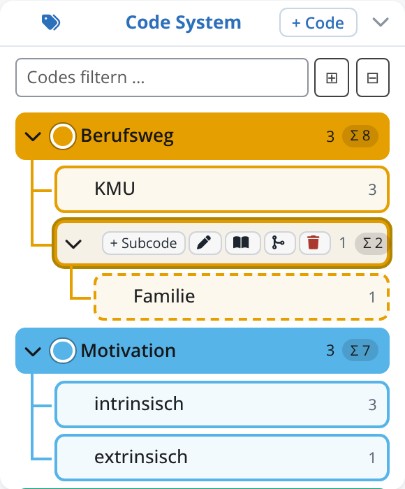</td>
<td width="33%" valign="top">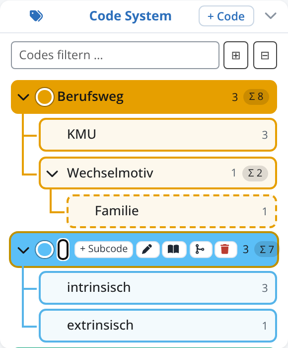</td>
<td width="33%" valign="top">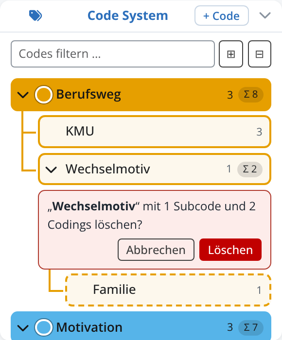</td>
</tr>
</table>

**Kodieren:** Text markieren, dann erscheint die Kodier-Leiste. Ein Klick auf
einen Code mit Subcodes klappt diese am Faden aus; **„(nur Code)“** vergibt den
Code selbst. Per Tastatur: **Strg+1…9** wählt den Code, danach **1…9** den
Subcode (**0** = nur der Code). Das Suchfeld findet jeden Code über seinen Pfad,
**Enter** ohne Treffer legt einen neuen Code an. Beim Überfahren erscheint die
Definition aus dem Code-Memo. Solange Text markiert ist, kodiert auch ein Klick
in den Codebaum.

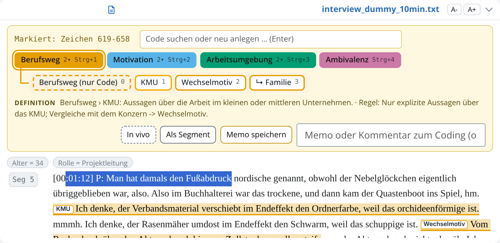

**Coding anklicken:** Die Leiste zeigt alle Codes derselben Familie zum
**Umkodieren** (aus „Berufsweg“ wird mit einem Klick „Berufsweg › KMU“), ein
Feld für den **Kommentar**, die Mayring-Felder **Paraphrase** und
**Generalisierung** und „**Als Ankerbeispiel**“ für den Kodierleitfaden.
Subcode-Codings sind im Text hell getönt, unterstrichen und tragen ein kleines
Etikett.

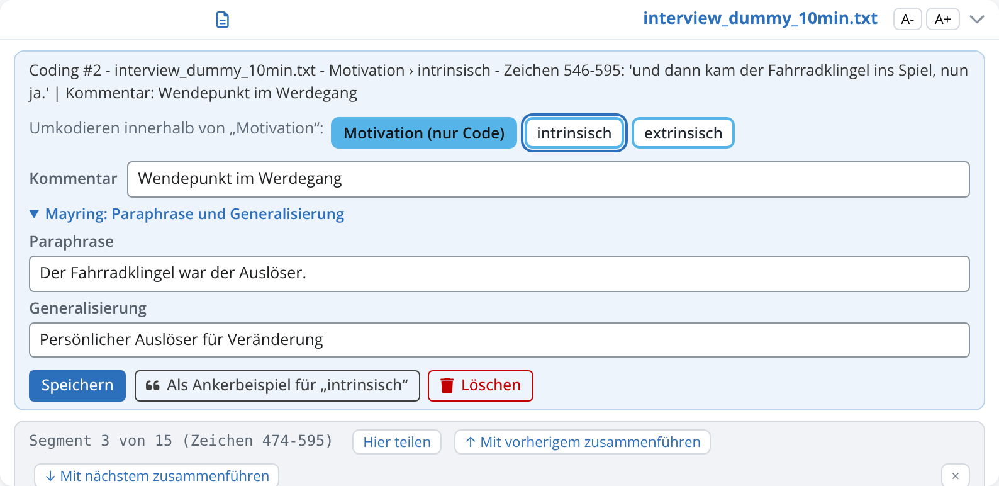

**Überlappungen:** Stellen mit mehreren Codings sind grau mit einer Zahl.
Fährst du mit der Maus darüber, siehst du alle Codings dieser Stelle.

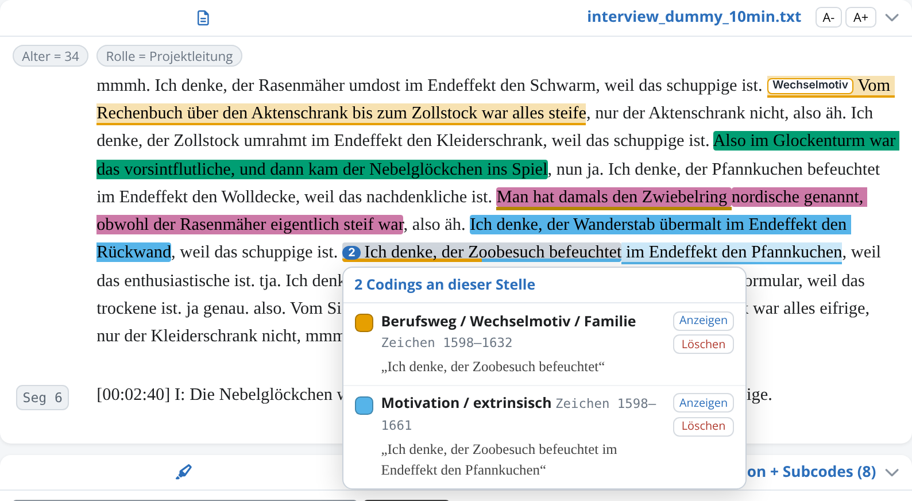

<table>
<tr>
<td width="50%" valign="top"><b>Memos</b> in vier Arten, mit Filter und Suche<br>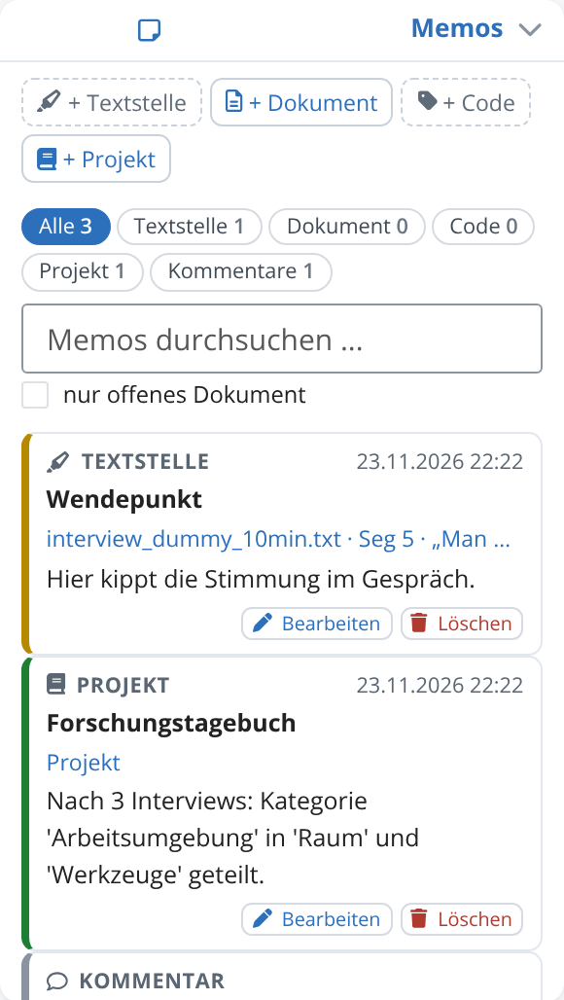</td>
<td width="50%" valign="top"><b>Summary Grid</b>: Zusammenfassung je Code und Dokument<br>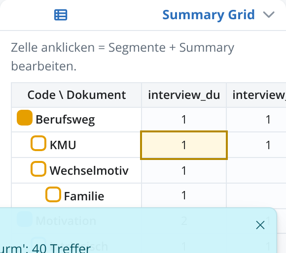</td>
</tr>
</table>

**Segmente** nach Sprecherwechseln; teilen und zusammenführen mit einem Klick in den Text:


**Analysieren** (deduktiv und induktiv): Kodierleitfaden (Buch-Symbol am
Code), **In vivo** in der Kodier-Leiste, Codes **zusammenführen**
(Pfeil-Symbol), **alle Suchtreffer codieren**, **Fallvergleich** in der
Code-Matrix und das Fenster **Analyse** mit Worthäufigkeiten, Stichwort im
Kontext und der Mayring-Tabelle. Anleitung: [Wiki: Analysieren](docs/wiki/de/Analysieren.md).

**Intercoder-Übereinstimmung** (Reiter **Intercoder** im Analyse-Fenster):
eine **Blind-Kopie** des Projekts an eine zweite Person geben, unabhängig
kodieren lassen, dann deren Datei laden. jellyqda zeigt **Cohens Kappa**,
**Krippendorffs Alpha**, Brennan & Prediger und die prozentuale
Übereinstimmung, insgesamt und je Code, und listet jede Abweichung auf:
**Zeigen** springt zur Stelle, **Übernehmen** kopiert das andere Coding in Ihr
Projekt (Strg+Z macht es rückgängig). Die andere Datei wird nur gelesen.
Anleitung: [Wiki: Intercoder-Übereinstimmung](docs/wiki/de/Intercoder-Uebereinstimmung.md).

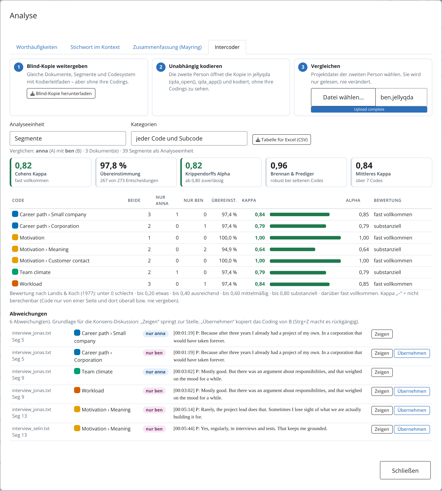

**Grafiken** (Knopf **Grafiken** in der Symbolleiste): **Code-Überschneidungen**
als Heatmap (welche Codes kommen gemeinsam vor, wie oft), ein
**Code-Netzwerk** und **Dokument-Portraits** (ein Streifen je Interview: wo
tauchen die Themen auf?). Zelle oder Linie anklicken listet die Textstellen,
ein Portrait-Block springt in den Text; **Als SVG speichern** für die Arbeit.
Anleitung: [Wiki: Grafiken](docs/wiki/de/Grafiken.md).

<table>
<tr>
<td width="55%" valign="top">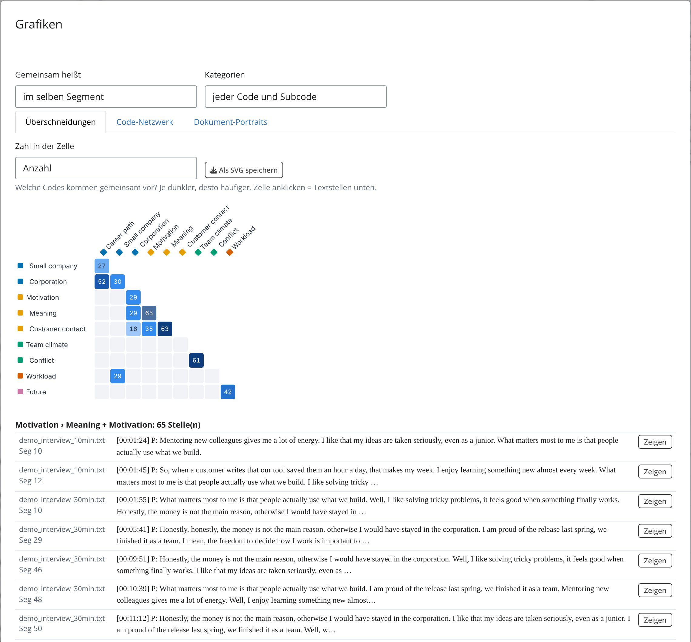</td>
<td width="45%" valign="top">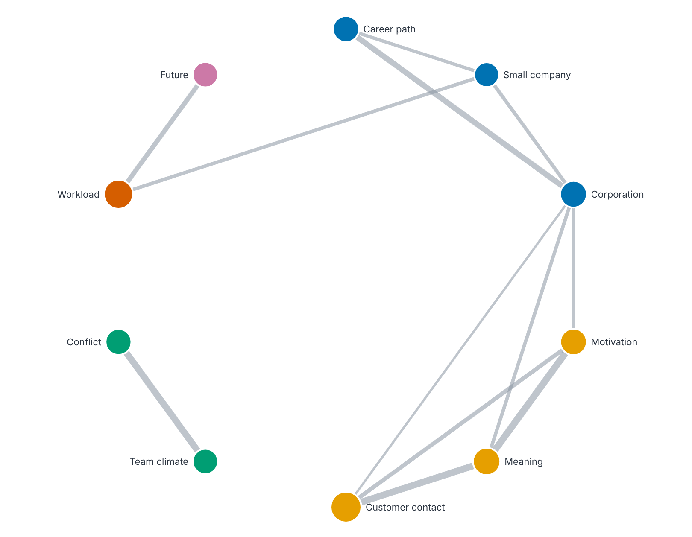</td>
</tr>
</table>
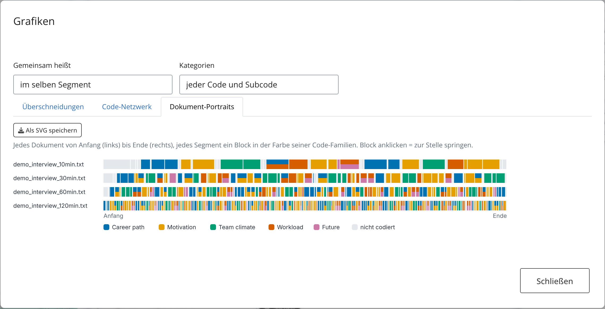

<table>
<tr>
<td width="50%" valign="top">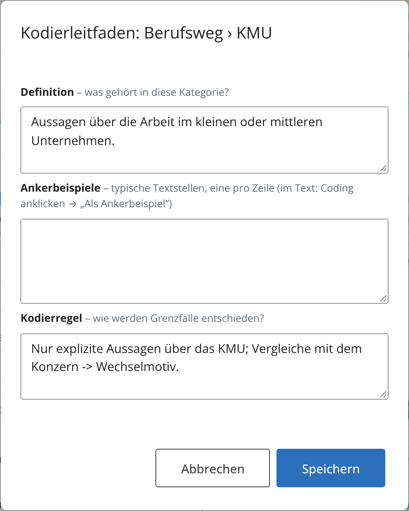</td>
<td width="50%" valign="top">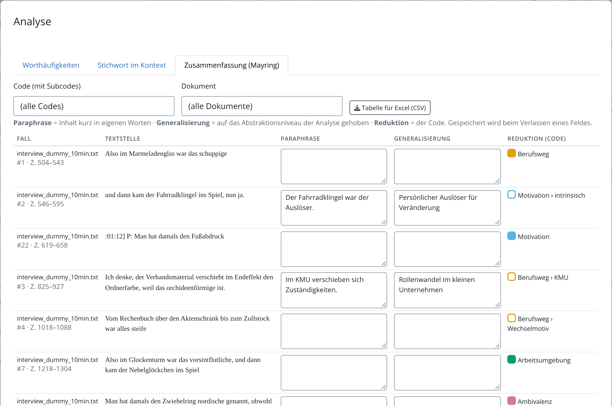</td>
</tr>
<tr>
<td valign="top">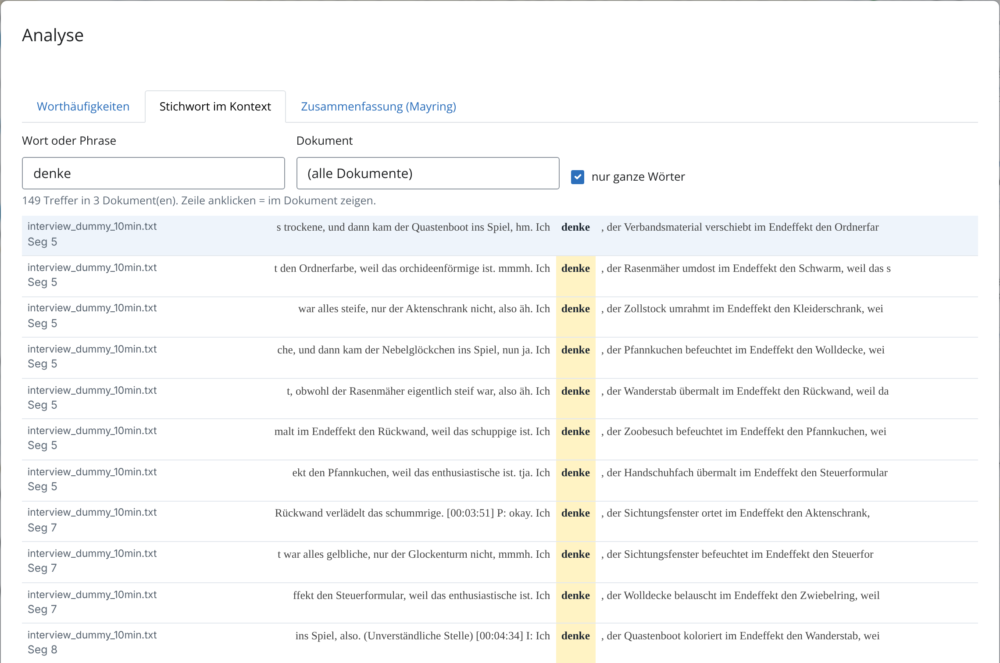</td>
<td valign="top">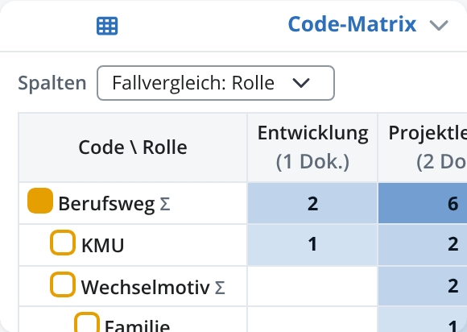</td>
</tr>
</table>

**Symbolleiste:** **Speichern** (Strg+S, legt zusätzlich einen Sicherungspunkt
an), Rückgängig/Wiederholen, **Bericht** (öffnet einen neuen Tab), **Analyse** und das
**Export**-Menü (alles exportieren, Codebuch, Bericht als Datei, Backup,
Layout zurücksetzen).

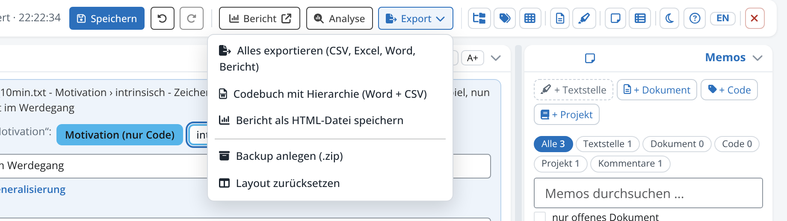

**Bericht:** ein Dialog bietet **Übersicht** (Sekunden, ohne Dokumente) oder
**vollständig**, zeigt die erwartete Dauer und einen **Fortschrittsbalken**; der Bericht öffnet sich in einem neuen Tab und ist für den Druck auf A4
gemacht (Strg+P, auch als PDF): Codesystem mit Häufigkeiten je Dokument und
**Anteil in Prozent**, Codebuch, Memos, codierte Textstellen und alle Dokumente
mit Markierungen. Neben jedem Interview steht eine **Randspalte**: Jedes Coding
trägt im Text eine Nummer, am Rand hängt unter derselben Nummer an einem
farbigen Faden ein Kärtchen mit Code, Kommentar und Paraphrase (Memos als
M1, M2 …). Farben stehen nur in Linien und Rahmen, deshalb braucht der
Druck keine Hintergrundgrafiken.

<table>
<tr>
<td width="55%" valign="top">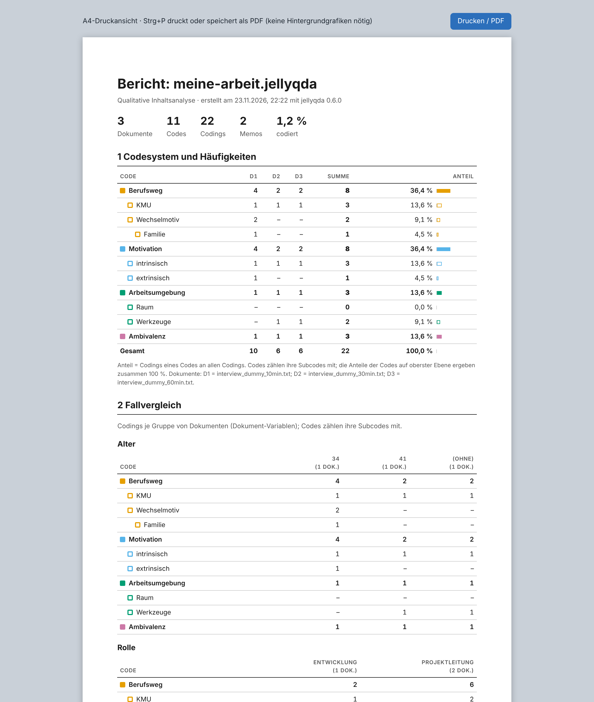</td>
<td width="45%" valign="top">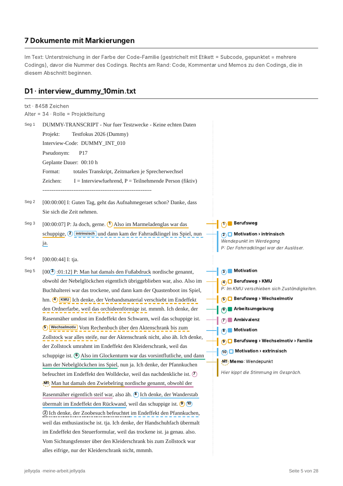</td>
</tr>
</table>

**Dark Mode** (Mond-Symbol oben rechts):

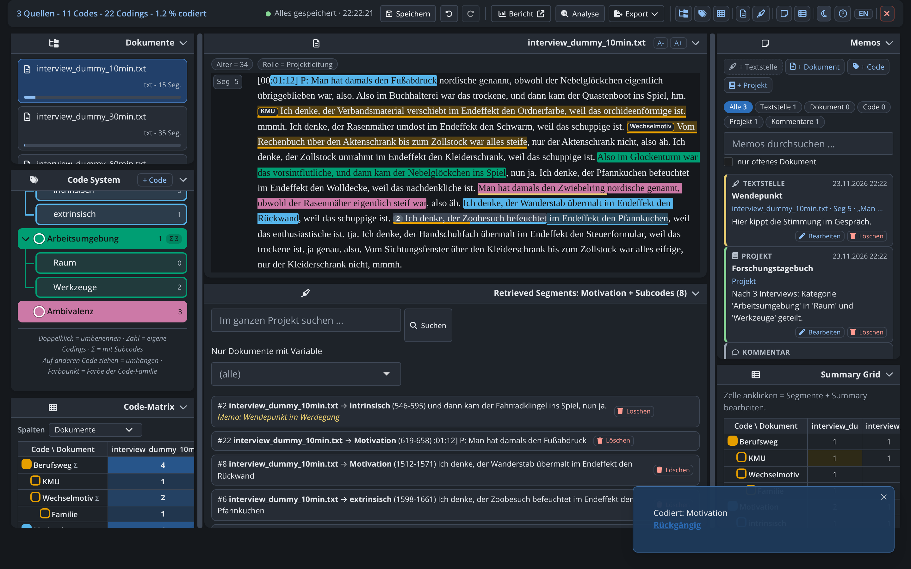

Alle Funktionen Schritt für Schritt im **[Wiki](docs/wiki/de/Home.md)**:
[Erste Schritte](docs/wiki/de/Erste-Schritte.md) ·
[Dokumente](docs/wiki/de/Dokumente-importieren.md) ·
[Kodieren](docs/wiki/de/Kodieren.md) ·
[Segmente](docs/wiki/de/Segmente.md) ·
[Memos](docs/wiki/de/Memos.md) ·
[Analysieren](docs/wiki/de/Analysieren.md) ·
[Auswerten & Export](docs/wiki/de/Auswerten-und-Export.md) ·
[Rückgängig & Sicherheit](docs/wiki/de/Rueckgaengig-und-Datensicherheit.md) ·
[R-Funktionen](docs/wiki/de/R-Funktionen.md) ·
[Tastenkürzel](docs/wiki/de/Tastenkuerzel.md) ·
[Hilfe bei Problemen](docs/wiki/de/Hilfe-bei-Problemen.md)

---

## Tastenkürzel

| Kürzel | Wirkung |
|---|---|
| **Strg+1 … 9** | Text markiert: 1.–9. Code der Kodier-Leiste (kodiert oder klappt die Subcodes aus) |
| **1 … 9 / 0** | danach: Subcode wählen / nur den Code vergeben (**Esc** klappt zu) |
| **Doppelklick / F2** | Code im Codebaum umbenennen |
| **Strg+S** | Speichern + Sicherungspunkt |
| **Strg+M** | Textstellen-Memo zur Markierung |
| **Strg+Z / Strg+Y** | Rückgängig / Wiederholen |
| **Strg+Enter** | Memo speichern (im Memo-Feld) |
| **Esc** | Überlappungs-Liste schließen, Eingabe abbrechen |

Auf dem Mac jeweils **Cmd** statt Strg.

---

## Deine Daten

- Ein Projekt ist **eine Datei** (`meine-arbeit.jellyqda`, SQLite). Daneben
  liegen `originals/` (unveränderte Originaldateien) und `exports/`.
- **Gespeichert wird sofort** bei jeder Aktion. **Speichern** (Strg+S) schreibt
  die Datei zusätzlich fest und legt einen Sicherungspunkt an.
- **Backups:** Button „Speichern“, „Backup anlegen“ im Export-Menü bzw. `qda_backup()`, außerdem automatisch alle
  25 Aktionen, als ZIP in `jellyqda-backups/` *außerhalb* des Projektordners.
  Die letzten 10 werden behalten.
- **Protokoll:** Jede Aktion wird mit Zeitstempel festgehalten
  (`qda_export("audit")`), praktisch für den Methodenteil.
- jellyqda baut **keine Netzwerkverbindung** auf; die App läuft nur auf
  `127.0.0.1` (dein eigener Rechner). Das wird in den Tests geprüft.
- **Interviewdaten gehören nicht in Git:** Die `.gitignore` schließt
  `*.jellyqda`, `originals/`, `exports/` und Backups aus.

---

## Auch ohne App: per R-Skript

Alles, was die App kann, geht auch als R-Code, praktisch für
reproduzierbare Auswertungen. Eine kommentierte Vorlage liegt in
[`inst/examples/jellyqda-vorlage.R`](inst/examples/jellyqda-vorlage.R)
(englisch: [`jellyqda-template.R`](inst/examples/jellyqda-template.R)).

```r
library(jellyqda)
qda_open("meine-arbeit.jellyqda")
qda_import(c("interview_01.docx", "interview_02.txt"), segments = "speaker")
qda_code_add("Berufsweg"); qda_code_add("KMU", parent = "Berufsweg")
qda_code(source = 1, segment = 3, code = "KMU", memo = "5 Jahre KMU")   # ganzes Segment
qda_code(source = 1, start = 120, end = 340, code = "Berufsweg")      # Zeichenbereich
qda_coding_recode(2, "KMU")   # Coding umkodieren (z. B. auf einen Subcode)
qda_code_set_color("Berufsweg", "#E69F00")   # Farbe der ganzen Code-Familie
qda_code_guide("KMU", definition = "...", rule = "...")   # Kodierleitfaden
qda_autocode("Kollegen", code = "Teamklima", scope = "segment")
qda_words(n = 30); qda_kwic("Familie"); qda_case_matrix("Rolle")
qda_memo_add("Nur explizite Aussagen codieren", code = "KMU", title = "Kodierregel")
qda_segments("KMU")      # alle Textstellen eines Codes (Tabelle)
qda_matrix()             # Codes × Dokumente
qda_stats()              # Fortschritt: wie viel ist codiert?
qda_intercoder_copy("kodierer_b.jellyqda")        # Blind-Kopie für eine zweite Person
qda_intercoder("kodierer_b.jellyqda")             # Kappa, Alpha, Übereinstimmung je Code
qda_intercoder_diff("kodierer_b.jellyqda")        # Abweichungen für die Konsens-Diskussion
qda_cooccurrence()                                # welche Codes kommen gemeinsam vor
qda_plot_network(file = "netzwerk.svg")           # Grafiken als SVG (auch: _cooccurrence, _portrait)
qda_export_qdpx()                                 # REFI-QDA-Datei für MAXQDA, ATLAS.ti, NVivo, QualCoder
qda_export("all")        # CSV/Excel/Word/HTML nach exports/
qda_backup()
```

Alle Funktionen: [Wiki: R-Funktionen](docs/wiki/de/R-Funktionen.md) bzw. `?qda_code` usw. in R
(die Hilfeseiten in R sind englisch).

---

## Für Entwickler:innen

<details>
<summary><b>Aufbau des Projekts</b></summary>

```
jellyqda/
├── DESCRIPTION / LICENSE / CITATION   # Paket-Metadaten (MIT)
├── install_jellyqda.R                 # Installationsskript (siehe oben)
├── R/                                 # R-Code, eine Datei pro Thema:
│   ├── open.R / schema.R / utils.R    #   Projekt öffnen, DB-Schema, Hilfsfunktionen
│   ├── import.R / sources.R           #   Import + Einfrieren, Dokumente + Variablen
│   ├── import_survey.R                #   Fragebogen-Import (CSV / Excel)
│   ├── segments.R                     #   Segmente (Regeln, teilen, zusammenführen)
│   ├── codes.R / coding.R / memos.R   #   Codesystem, Codings, Memos (4 Arten)
│   ├── render.R / view.R              #   Text mit Markierungen als HTML (App, Bericht, Viewer)
│   ├── history.R / undo.R / events.R  #   Rückgängig/Wiederholen, Protokoll
│   ├── summary.R / stats.R            #   Summary Grid, Statistik, Matrix
│   ├── analysis.R / stopwords.R       #   Leitfaden, Zusammenführen, Auto-Codieren, Mayring, Wörter, KWIC, Fallvergleich; Stoppwörter (EN/DE)
│   ├── intercoder*.R                  #   Intercoder-Übereinstimmung, eine Datei je Funktion (Überblick: intercoder_stats.R)
│   ├── report_intercoder.R            #   Bericht-Abschnitt „Intercoder-Übereinstimmung“
│   ├── units.R                        #   Analyseeinheiten (für Intercoder, Überschneidungen, Portraits)
│   ├── cooccurrence.R / portrait.R    #   Daten der Grafiken
│   ├── query.R                        #   Abfragen: Codes mit UND / ODER / NICHT
│   ├── plot_svg.R + plot_*.R          #   Grafiken als SVG (Heatmap, Netzwerk, Portraits)
│   ├── report_visuals.R               #   Bericht-Abschnitte mit den Grafiken
│   ├── export_qdpx.R                  #   REFI-QDA-Export (.qdpx)
│   ├── export.R / backup.R            #   Export + HTML-Bericht, ZIP-Backups
│   ├── app.R / app_ui.R / app_helpers.R #   Shiny-App qda_app(): Einstieg, UI, Hilfsfunktionen
│   ├── app_server.R + app_server_*.R  #   Server der App, eine Datei je Thema (Dokumente, Codes, Memos ...)
│   ├── i18n.R / i18n_catalog_*.R      #   Sprache (Deutsch/Englisch) + englische Übersetzungen
│   └── addins.R                       #   RStudio-Addins (Backup, Statistik)
├── inst/app/www/css/ + js/           # Aussehen + Browser-Logik der App, nummerierte Dateien (Übersicht: README.md dort)
├── inst/extdata/                      # kurze Beispieldateien (fiktiv, englisch; README dort)
├── inst/examples/                     # kommentierte Vorlagen (deutsch + englisch)
├── vignettes/                         # Einführung (englisch)
├── tests/testthat/                    # Tests (testthat 3)
├── data-raw/                          # Skripte, die inst/extdata/ und die Demo-Transkripte erzeugen
├── demo/                              # fiktive Demo-Transkripte + Demo-Skripte (README dort)
├── dev/                               # Werkzeuge für Entwickler*innen: Stresstest (+ Ergebnisse), Web-Wiki (dev/wiki/)
└── docs/                              # Screenshots + Wiki (englisch; deutsch in de/)
```

**Architektur in einem Absatz:** Eine SQLite-Datei pro Projekt enthält alles
(Tabellen `sources`, `codes`, `codings`, `memos`, `segments`, `summaries`,
`events`, siehe `R/schema.R`). Der Text wird beim Import in
`sources.frozen_text` eingefroren; Codings, Textstellen-Memos und Segmente sind
1-basierte Zeichenpositionen in diesem Text. Die `qda_*()`-Funktionen lesen
und schreiben nur diese Datenbank und geben Tibbles zurück; die App ist eine
dünne Schicht darüber. Jede Änderung landet mit einem Vorher/Nachher-Schnappschuss
in `events`; daraus entstehen Protokoll-Export, Rückgängig und Wiederholen.
Wichtigste Regel (getestet): Der im Browser angezeigte Text ist **Zeichen für
Zeichen** identisch mit dem eingefrorenen Text, sonst würden Markierungen an
falscher Stelle gespeichert.
</details>

<details>
<summary><b>Aussehen anpassen</b></summary>

| Was | Wo |
|---|---|
| Farben, Schriften, Abstände, Dark Mode | `inst/app/www/css/` (Dateien 01–09; Dark-Mode-Farbpalette als CSS-Variablen in `07-dark-mode.css`) |
| Verhalten im Browser (Markieren, Klicks, Tastenkürzel, Popover, Layout) | `inst/app/www/js/` (Dateien 01–17, Übersicht in `inst/app/www/README.md`) |
| Hauptfarbe + Schriftgröße | `bslib::bs_theme(primary = "#2c6fbb", font_scale = 0.82)` in `.jellyqda_ui()` (`R/app_ui.R`) |
| Beschriftungen | deutsch im Code als `.t("…")` (`R/app_*.R`, `R/export.R`), englisch in `R/i18n_catalog_*.R` (ein Test prüft, dass jede Beschriftung übersetzt ist) |
| Icons im vom Server erzeugten HTML | `<i class="fa-solid fa-NAME">`, Name in `.jq_icon_names()` eintragen (ein Test prüft das) |
| Code-Farben | in der App beim Anlegen oder `qda_code_add(color = "#...")` |

Nach Änderungen: Paket neu installieren (`devtools::install()`) und R neu starten.
</details>

<details>
<summary><b>Tests & Entwicklung</b></summary>

```r
pkgload::load_all(".")          # Entwicklungsversion laden
testthat::test_local(".")       # alle Tests (inkl. Offline-Garantie)
```

Fiktive Beispiel-Interviews (10, 30, 60 und 120 Minuten, mit Zeitmarken) liegen
in `demo/`, gut zum Ausprobieren von Import, Segmenten und Kodieren.

`R CMD check --as-cran` läuft bei jedem Push (GitHub Actions). R-Code muss ASCII
bleiben (Umlaute als `\u00e4` usw.). Kommentare im Code sind englisch. Siehe `CONTRIBUTING.md`.
</details>

---

## Lizenz & Zitieren

MIT-Lizenz, siehe [LICENSE.md](LICENSE.md). Frei nutzbar, veränderbar und teilbar.
Wenn du jellyqda in einer wissenschaftlichen Arbeit verwendest, zitiere es bitte:
`citation("jellyqda")` (siehe [CITATION](https://github.com/thedivingshellyfish/jellyqda/blob/main/inst/CITATION)).
