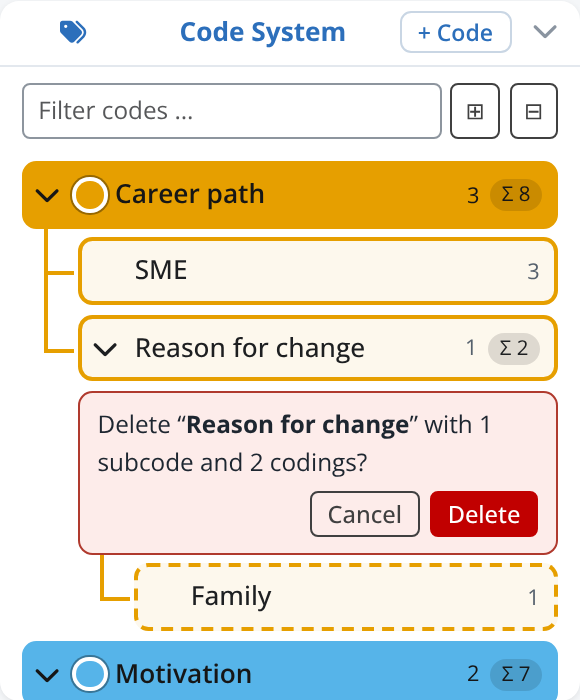
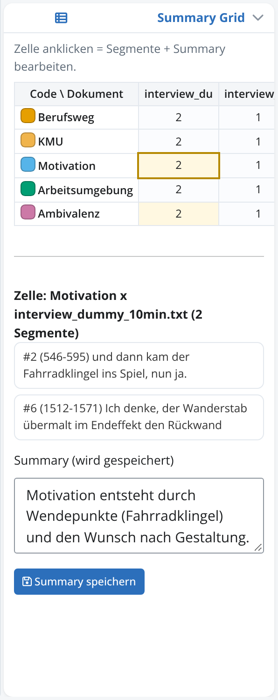
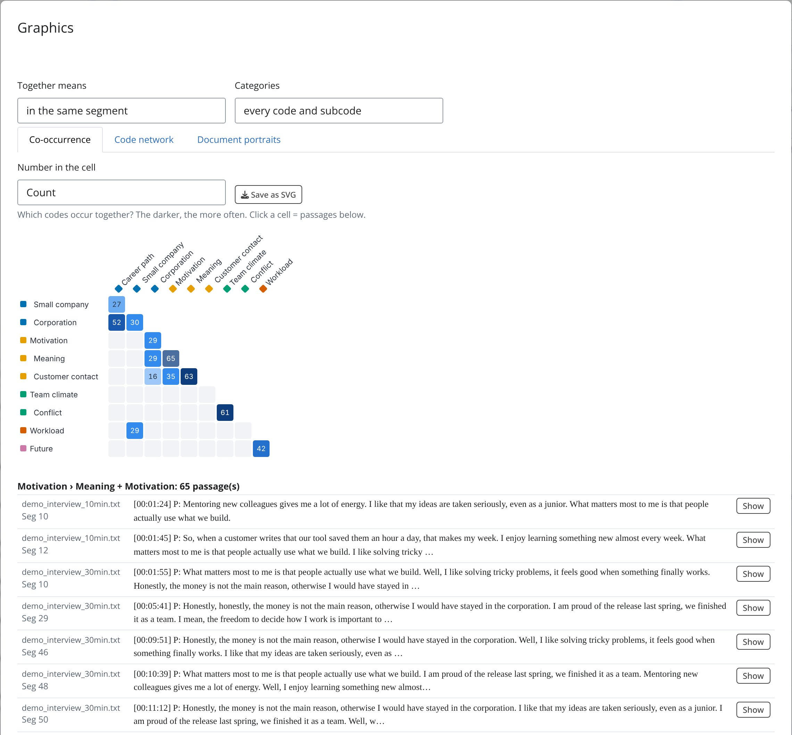
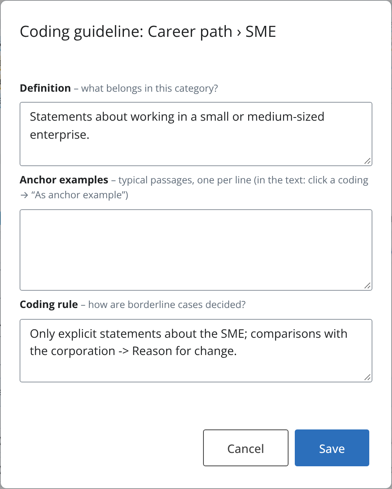
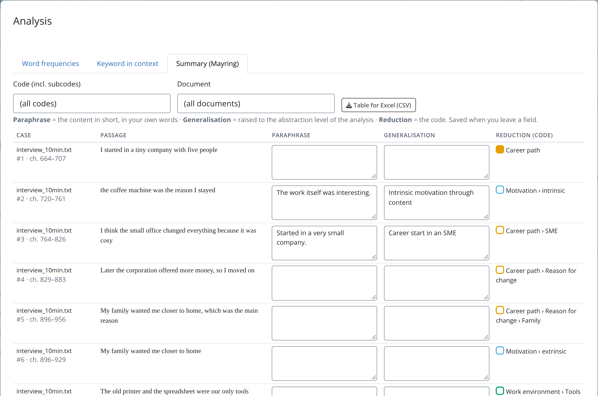
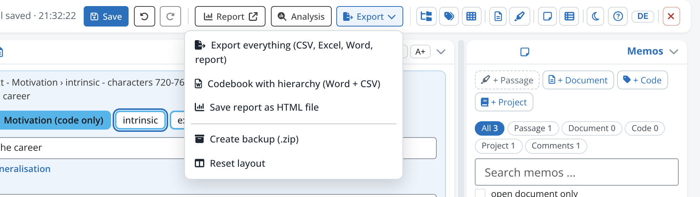
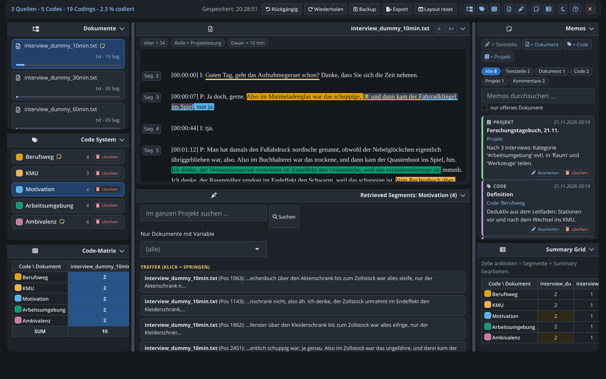

> 🌐 **English** · [Deutsch](README.de.md)

[](https://github.com/thedivingshellyfish/jellyqda/actions/workflows/R-CMD-check.yaml) 

> Contact: jellyqda {@} systemli.org or in github | Later, maybe: a community space on Matrix or Discord

- **DEMO:** [https://thedivingshellyfish.shinyapps.io/jellyqda-demo/](https://thedivingshellyfish.shinyapps.io/jellyqda-demo/)
- **Converter:** MAXQDA & co. → jellyqda, right in your browser > [https://thedivingshellyfish.github.io/jellyqda/converter/](https://thedivingshellyfish.github.io/jellyqda/converter/)
- **Assistant:** Qualitative research – step by step > [https://thedivingshellyfish.github.io/jellyqda/assistant/](https://thedivingshellyfish.github.io/jellyqda/assistant/)

# jellyqda

**Qualitative content analysis of interviews in R & RStudio: free, completely offline, no cloud.**


jellyqda is a small tool for the **qualitative analysis of interviews and
field notes**, originally written for a master's thesis. You import
transcripts, build a category system (deductively from your interview guide
and/or inductively from the material), mark passages, write memos and
analyse. Everything runs **locally on your computer**, in RStudio or in the
browser, with an **English and a German** user interface.

- 🔒 **100 % offline:** no cloud, no uploads, GDPR-friendly. A project is **one file** (`*.jellyqda`).
- 📄 **Import** of `.txt`, `.md`, `.docx` and `.pdf`. The text is "frozen" on import, so codings never drift.
- 🌳 **Code tree with codes and subcodes:** collapsible, each code family in one colour, connected by a coloured "thread". Rename by double click, delete with confirmation.
- 🏷️ **Coding with the mouse:** mark text, click a code, done. Subcodes unfold in the coding bar; re-code with one click. Overlapping codings are shown clearly.
- ✂️ **Segments** by paragraphs or **speaker turns** (`[00:01:12] P: …`), freely adjustable.
- 📝 **Memos** of four kinds: passage, document, code (definition, coding rule), project; plus comments on codings.
- 🔬 **Deductive and inductive:** coding guideline (definition, anchor example, coding rule), in-vivo codes, merging codes, coding all search hits at once, **summary after Mayring** (paraphrase → generalisation → reduction).
- 👥 **Intercoder agreement:** a blind copy for a second coder, then **Cohen's kappa**, **Krippendorff's alpha**, Brennan & Prediger and percent agreement per code, plus the list of disagreements for the consensus discussion.
- 🕸️ **Graphics:** code co-occurrence (heatmap), code network and document portraits; click a cell, line or block to read the passages. Plain SVG: in the app, the RStudio Viewer, the report, or saved for your thesis.
- 🔁 **REFI-QDA export (.qdpx)** for MAXQDA, ATLAS.ti, NVivo, QualCoder: your project is never locked in.
- 📊 **Analysis:** codings per code, full-text search, code matrix with **case comparison**, word frequencies, keyword in context, summary grid, export (CSV, Excel, Word).
- 🖨️ **Report** in its own browser tab, print-ready on **A4** (no background colours), with frequencies in percent and a **margin column** next to every interview showing which codings, comments and memos are where.
- ↩️ **Undo/redo** for everything (Ctrl+Z / Ctrl+Y) and a complete **audit trail** for your methods section.
- 🌐 **English and German:** user interface and report in both languages, switchable with one click (**DE/EN**).
- 🌙 **Dark mode**, easy to read (checked contrast).

> 🆕 **New in version 0.9.1:** report dialog (**overview** in seconds or **complete**) with a
> **progress bar**, a hint if nothing moves, and "Working …" for longer steps.
> **0.9.0:** **graphics** (code co-occurrence heatmap, code network,
> document portraits), **REFI-QDA export (.qdpx)** for MAXQDA, ATLAS.ti, NVivo and QualCoder,
> and a stress test with up to 150 interviews.
> **0.8.0:** **intercoder agreement** (Cohen's kappa, Krippendorff's
> alpha): blind copy for a second coder, comparison per code, disagreements with
> "show" and "take over" for consensus coding, section in the report.
> **0.7.0:** user interface and report in **English and German**
> (switch **DE/EN**), package ready for CRAN (runnable examples, vignette).
> **0.6.0:** report with margin column, comment field, in-vivo codes, merging codes,
> coding search hits, coding guideline, case comparison, word frequencies, keyword in
> context and Mayring summary. **0.5.0:** code tree with subcodes, two-step coding bar,
> re-coding, save button, report in a new tab. All changes: [NEWS.md](NEWS.md).

**Detailed guide with screenshots for every function:**
[📖 Wiki](docs/wiki/Home.md) (folder `docs/wiki/`; German: [`docs/wiki/de/`](docs/wiki/de/Home.md))

---

## Installation (once, about 5 minutes)

**Requirement:** [R](https://cran.r-project.org) version 4.0 or newer, ideally
with [RStudio](https://posit.co/download/rstudio-desktop/). Both are free.

Open R or RStudio and copy this **one line** into the console:

```r
source("https://raw.githubusercontent.com/thedivingshellyfish/jellyqda/main/install_jellyqda.R")
```

The script installs all required packages, then jellyqda, checks the
installation and tells you how to continue. If something goes wrong it prints
concrete instructions, e.g. which command installs missing system libraries
for PDF import on Linux.

<details>
<summary><b>Other ways</b> (ZIP file, particular version, without the script)</summary>

```r
# from a downloaded ZIP file (e.g. from the releases page):
options(jellyqda.install.path = "~/Downloads/jellyqda.zip")
source("https://raw.githubusercontent.com/thedivingshellyfish/jellyqda/main/install_jellyqda.R")

# a particular branch or tag:
options(jellyqda.install.ref = "main")

# start a demo with an example interview right afterwards:
options(jellyqda.install.start_app = TRUE)

# without the script, from an unpacked folder:
install.packages(c("DBI", "RSQLite", "digest", "htmltools", "jsonlite", "officer", "pdftools",
                   "readr", "stringi", "tibble", "zip", "shiny", "bslib", "fontawesome",
                   "writexl"))
install.packages("path/to/jellyqda", repos = NULL, type = "source")
```

**Linux:** for PDF and Word import R needs system libraries once, on
Ubuntu/Debian e.g.
`sudo apt install libpoppler-cpp-dev libxml2-dev libssl-dev libcurl4-openssl-dev libfontconfig1-dev`.
The installation script names the right command for your distribution.
</details>

---

## Get going in 3 steps

```r
library(jellyqda)
# 1. create the project (or open it again later)
qda_open("my-thesis.jellyqda")   
# 2. start the app: it opens in the browser
qda_app()                       
# (qda_app(lang = "en") = English interface)
```

3. In the app, import your transcripts under **Documents** on the left (or
   drag and drop them), create first codes in the **Code system** with
   **"+ Code"** (and subcodes with **"+ Subcode"**), mark text and click a
   code.

Quit: red **X** at the top right (saves an export + backup) or `Esc` in the
R console. Every action is saved **immediately** anyway.

> 💡 **Try it without your own data:**
> `qda_import(system.file("extdata", "interview_01.txt", package = "jellyqda"))`
> (a short, fictional English example interview) or the fictional demo transcripts in the
> [`demo/`](demo/) folder (10 to 120 minutes, with time stamps, ideal for segments by speaker
> turns). All example and demo files are invented, see [`demo/README.md`](demo/README.md).

---

## What working with it looks like

**Code tree:** a code (top level) is shown in full colour, its subcodes only
carry a border in the same colour and hang on a line, the "thread". Arrow =
expand/collapse, **"+ Subcode"** on every row, **double click** = rename, bin =
delete (with confirmation), colour dot = colour of the whole code family. "Σ"
counts the codings including all subcodes.

<table>
<tr>
<td width="33%" valign="top"></td>
<td width="33%" valign="top"></td>
<td width="33%" valign="top"></td>
</tr>
</table>

**Coding:** mark text and the coding bar appears. A click on a code with
subcodes unfolds them on the thread; **"(code only)"** assigns the code itself.
With the keyboard: **Ctrl+1…9** chooses the code, then **1…9** the subcode
(**0** = code only). The search field finds every code by its path, **Enter**
without a hit creates a new code. Hovering shows the definition and coding
rule. While text is marked, a click in the code tree codes it as well.


**Click a coding:** the bar shows all codes of the same family for
**re-coding** (from "Career path" to "Career path › SME" with one click), a
**comment** field, the Mayring fields **paraphrase** and **generalisation**,
and "**As anchor example**" for the coding guideline. Subcode codings are
lightly tinted in the text, underlined and carry a small label.


**Overlaps:** places with several codings are grey with a number. Hovering
shows all codings of this place.


<table>
<tr>
<td width="50%" valign="top"><b>Memos</b> of four kinds, with filter and search<br></td>
<td width="50%" valign="top"><b>Summary grid</b>: summary per code and document<br></td>
</tr>
</table>

**Segments** by speaker turns; split and merge with a click into the text:


**Analysis** (deductive and inductive): coding guideline (book icon on a
code), **In vivo** in the coding bar, **merging** codes (arrow icon), **coding
all search hits**, **case comparison** in the code matrix and the **Analysis**
window with word frequencies, keyword in context and the Mayring table.
Guide: [Wiki: Analysis](docs/wiki/Analysis.md).

**Intercoder agreement** (tab **Intercoder** in the analysis window): hand a
**blind copy** of the project to a second person, let them code
independently, then load their file. jellyqda shows **Cohen's kappa**,
**Krippendorff's alpha**, Brennan & Prediger and percent agreement, overall and
per code, and lists every disagreement: **Show** jumps to the passage, **Take
over** copies the other coding into your project (Ctrl+Z undoes it). The other
file is only read. Guide: [Wiki: Intercoder agreement](docs/wiki/Intercoder-agreement.md).


**Graphics** (toolbar button **Graphics**): **code co-occurrence** as a heatmap
(which codes occur together, and how often), a **code network** and
**document portraits** (one strip per interview: where do the themes come
up?). Click a cell or a line to list the passages, click a portrait block to
jump to the text; **Save as SVG** for your thesis. Guide:
[Wiki: Graphics](docs/wiki/Graphics.md).

<table>
<tr>
<td width="55%" valign="top"></td>
<td width="45%" valign="top"></td>
</tr>
</table>


<table>
<tr>
<td width="50%" valign="top"></td>
<td width="50%" valign="top"></td>
</tr>
<tr>
<td valign="top"></td>
<td valign="top"></td>
</tr>
</table>

**Toolbar:** **Save** (Ctrl+S, additionally creates a restore point),
undo/redo, **Report** (opens a new tab), **Analysis**, the **Export** menu
(export everything, codebook, report as a file, backup, reset layout) and
**DE/EN** to switch the language.



**Report:** a dialog lets you choose **overview** (seconds, without the documents) or
**complete**, shows a **progress bar** and the expected time; the report opens in a new tab and is made for printing on A4 (Ctrl+P, also
as PDF): code system with frequencies per document and **share in percent**,
case comparison, codebook with coding guideline, memos, coded passages,
Mayring table and all documents with marks. Next to every interview there is
a **margin column**: every coding carries a number in the text, and in the
margin a card with the same number hangs on a coloured thread, showing code,
comment and paraphrase (memos as M1, M2 …). Colours only appear as lines and
borders, so printing needs no background graphics.

<table>
<tr>
<td width="55%" valign="top"></td>
<td width="45%" valign="top"></td>
</tr>
</table>

**Dark mode** (moon icon at the top right):



Every function step by step in the **[wiki](docs/wiki/Home.md)**:
[First steps](docs/wiki/First-steps.md) ·
[Documents](docs/wiki/Importing-documents.md) ·
[Coding](docs/wiki/Coding.md) ·
[Segments](docs/wiki/Segments.md) ·
[Memos](docs/wiki/Memos.md) ·
[Analysis](docs/wiki/Analysis.md) ·
[Evaluation & export](docs/wiki/Evaluation-and-export.md) ·
[Undo & data safety](docs/wiki/Undo-and-data-safety.md) ·
[R functions](docs/wiki/R-functions.md) ·
[Keyboard shortcuts](docs/wiki/Keyboard-shortcuts.md) ·
[Troubleshooting](docs/wiki/Troubleshooting.md)

---

## Keyboard shortcuts

| Shortcut | Effect |
|---|---|
| **Ctrl+1 … 9** | text marked: 1st–9th code of the coding bar (codes or unfolds the subcodes) |
| **1 … 9 / 0** | then: choose the subcode / assign only the code (**Esc** folds up) |
| **Double click / F2** | rename a code in the code tree |
| **Ctrl+S** | save + restore point |
| **Ctrl+M** | passage memo for the marked text |
| **Ctrl+Z / Ctrl+Y** | undo / redo |
| **Ctrl+Enter** | save memo (in the memo field) |
| **Esc** | close the overlap list, cancel an input |

On the Mac use **Cmd** instead of Ctrl.

---

## Your data

- A project is **one file** (`my-thesis.jellyqda`, SQLite). Next to it are
  `originals/` (unchanged original files) and `exports/`.
- **Every action is saved immediately.** **Save** (Ctrl+S) additionally
  writes the file to disk and creates a restore point.
- **Backups:** "Save" button, "Create backup" in the export menu or
  `qda_backup()`, plus automatically every 25 actions, as a ZIP in
  `jellyqda-backups/` *outside* the project folder. The last 10 are kept.
- **Audit trail:** every action is recorded with a time stamp
  (`qda_export("audit")`), handy for the methods section.
- jellyqda makes **no network connection**; the app only runs on
  `127.0.0.1` (your own computer). The tests check this.
- **Interview data do not belong in git:** the `.gitignore` excludes
  `*.jellyqda`, `originals/`, `exports/` and backups.

---

## Without the app: as an R script

Everything the app can do also works as R code, handy for reproducible
analyses. A commented template is in
[`inst/examples/jellyqda-template.R`](inst/examples/jellyqda-template.R)
(German: [`jellyqda-vorlage.R`](inst/examples/jellyqda-vorlage.R)); an
introduction is in the vignette: `vignette("jellyqda")`.

```r
library(jellyqda)
qda_open("my-thesis.jellyqda")
qda_import(c("interview_01.docx", "interview_02.txt"), segments = "speaker")
qda_code_add("Career path"); qda_code_add("SME", parent = "Career path")
qda_code(source = 1, segment = 3, code = "SME", memo = "5 years in an SME")   # whole segment
qda_code(source = 1, start = 120, end = 340, code = "Career path")          # character range
qda_coding_recode(2, "SME")                      # re-code (e.g. to a subcode)
qda_code_set_color("Career path", "#E69F00")     # colour of the whole code family
qda_code_guide("SME", definition = "...", rule = "...")   # coding guideline
qda_autocode("colleague", code = "Team climate", scope = "segment")
qda_words(n = 30); qda_kwic("family"); qda_case_matrix("role")
qda_memo_add("Only code explicit statements", code = "SME", title = "Coding rule")
qda_segments("SME")      # all passages of a code (table)
qda_matrix()             # codes × documents
qda_stats()              # progress: how much is coded?
qda_intercoder_copy("coder_b.jellyqda")           # blind copy for a second coder
qda_intercoder("coder_b.jellyqda")                # kappa, alpha, agreement per code
qda_intercoder_diff("coder_b.jellyqda")           # disagreements for the consensus talk
qda_cooccurrence()                                # which codes occur together
qda_plot_network(file = "network.svg")            # graphics as SVG (also: _cooccurrence, _portrait)
qda_export_qdpx()                                 # REFI-QDA file for MAXQDA, ATLAS.ti, NVivo, QualCoder
qda_language("en")       # language of app and report ("en" or "de")
qda_export("all")        # CSV/Excel/Word/HTML into exports/
qda_backup()
```

All functions: [Wiki: R functions](docs/wiki/R-functions.md) or `?qda_code` etc. in R.

---

## For developers

<details>
<summary><b>Project structure</b></summary>

```
jellyqda/
├── DESCRIPTION / LICENSE / CITATION   # package metadata (MIT)
├── install_jellyqda.R                 # installation script (see above)
├── R/                                 # R code, one file per topic:
│   ├── open.R / schema.R / utils.R    #   open projects, database schema, helpers
│   ├── import.R / sources.R           #   import + freezing, documents + variables
│   ├── segments.R                     #   segments (rules, split, merge)
│   ├── codes.R / coding.R / memos.R   #   code system, codings, memos (4 kinds)
│   ├── render.R / view.R              #   text with marks as HTML (app, report, viewer)
│   ├── history.R / undo.R / events.R  #   undo/redo, audit trail
│   ├── summary.R / stats.R            #   summary grid, statistics, matrix
│   ├── analysis.R / stopwords.R       #   guideline, merging, auto-coding, Mayring, words, KWIC, case comparison; stop words (EN/DE)
│   ├── intercoder*.R                  #   intercoder agreement, one file per function (overview: intercoder_stats.R)
│   ├── report_intercoder.R            #   report section "Intercoder agreement"
│   ├── units.R                        #   units of analysis (shared by intercoder, co-occurrence, portraits)
│   ├── cooccurrence.R / portrait.R    #   data of the graphics
│   ├── plot_svg.R + plot_*.R          #   graphics as SVG (heatmap, network, portraits)
│   ├── report_visuals.R               #   report sections with the graphics
│   ├── export_qdpx.R                  #   REFI-QDA export (.qdpx)
│   ├── export.R / backup.R            #   export + HTML report, ZIP backups
│   ├── app.R / app_ui.R / app_helpers.R #   shiny app qda_app(): entry point, UI, helpers
│   ├── app_server.R + app_server_*.R  #   app server, one file per topic (documents, codes, memos ...)
│   ├── i18n.R / i18n_catalog.R        #   language (English/German) + English translations
│   └── addins.R                       #   RStudio addins (backup, statistics)
├── inst/app/www/css/ + js/           # look + browser logic of the app, numbered files (overview: README.md there)
├── inst/extdata/                      # short example files (fictional, English; README there)
├── inst/examples/                     # commented templates (English + German)
├── vignettes/                         # introduction
├── tests/testthat/                    # tests (testthat 3), one file per topic
├── data-raw/                          # scripts that generate inst/extdata/ and the demo transcripts
├── demo/                              # fictional demo transcripts + demo scripts (README there)
├── dev/                               # developer tools: stress test (+ results)
└── docs/                              # screenshots + wiki (English; German in de/)
```

**Architecture in one paragraph:** one SQLite file per project holds
everything (tables `sources`, `codes`, `codings`, `memos`, `segments`,
`summaries`, `events`, see `R/schema.R`). On import the text is frozen into
`sources.frozen_text`; codings, passage memos and segments are 1-based
character positions in this text. The `qda_*()` functions only read and write
this database and return tibbles; the app is a thin layer on top. Every change
is stored with a before/after snapshot in `events`; audit-trail export, undo
and redo are built from it. The most important rule (tested): the text shown in
the browser is identical to the frozen text **character by character**,
otherwise marks would be stored at the wrong place.
</details>

<details>
<summary><b>Customising the look and the texts</b></summary>

| What | Where |
|---|---|
| colours, fonts, spacing, dark mode | `inst/app/www/css/` (files 01–09; dark mode palette as CSS variables in `07-dark-mode.css`) |
| behaviour in the browser (marking, clicks, shortcuts, popover, layout) | `inst/app/www/js/` (files 01–17, overview in `inst/app/www/README.md`) |
| main colour + font size | `bslib::bs_theme(primary = "#2c6fbb", font_scale = 0.82)` in `.jellyqda_ui()` (`R/app_ui.R`) |
| labels | German in the code as `.t("…")` (`R/app_*.R`, `R/export.R`), English in `R/i18n_catalog.R`; a test checks that every label is translated |
| icons in server-generated HTML | `<i class="fa-solid fa-NAME">`, add the name to `.jq_icon_names()` (a test checks this) |
| code colours | in the app when creating codes, or `qda_code_add(color = "#...")` |

After changes: reinstall the package (`devtools::install()`) and restart R.
</details>

<details>
<summary><b>Tests & development</b></summary>

```r
pkgload::load_all(".")          # load the development version
testthat::test_local(".")       # all tests (incl. the offline guarantee and translations)
```

Fictional example interviews (10, 30, 60 and 120 minutes, with time stamps)
are in `demo/`, good for trying out import, segments and coding.

`R CMD check --as-cran` runs on every push (GitHub Actions). R code must stay
ASCII (umlauts as `ä` etc.); code comments are in English. See
`CONTRIBUTING.md`.
</details>

---

## Licence & citation

MIT licence, see [LICENSE.md](LICENSE.md). Free to use, change and share.
If you use jellyqda in academic work, please cite it:
`citation("jellyqda")` (see [CITATION](inst/CITATION)).
