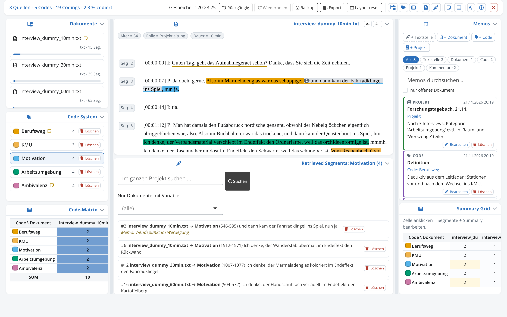
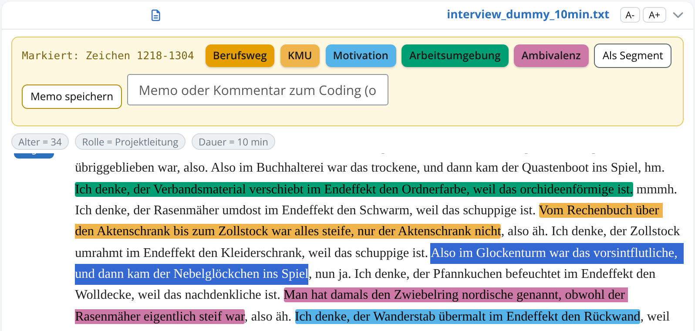
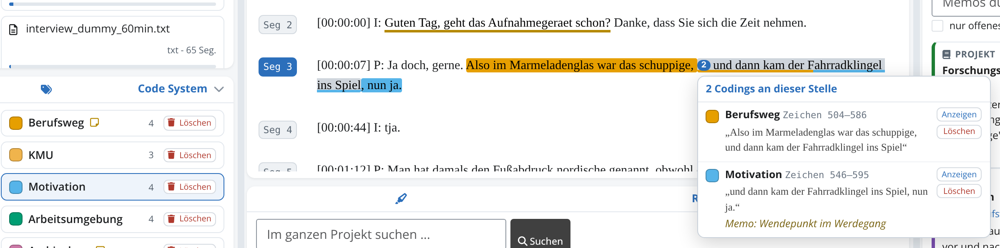
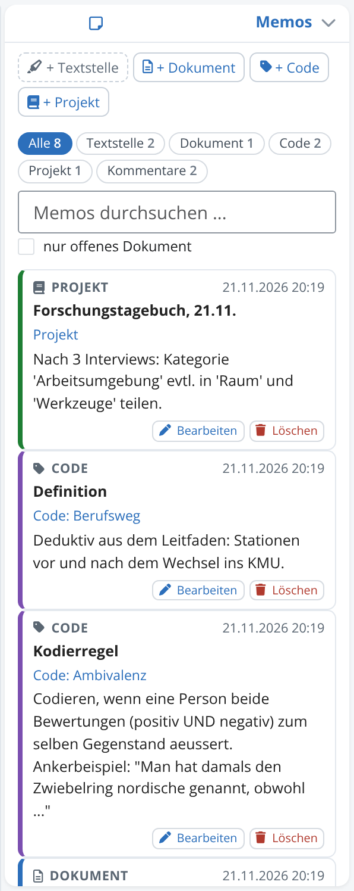
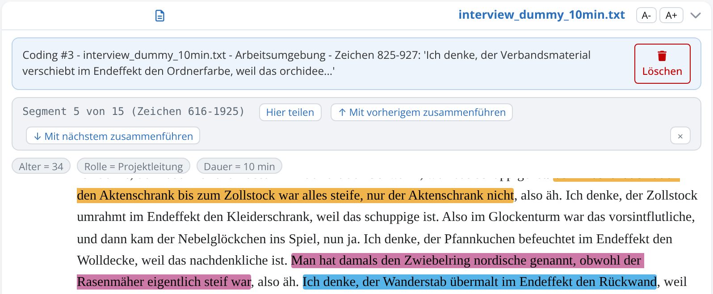

[](https://github.com/thedivingshellyfish/jellyqda/actions/workflows/R-CMD-check.yaml)

# jellyqda

**Qualitative Inhaltsanalyse von Interviews in R & RStudio: kostenlos, komplett offline, ohne Cloud.**



> **English summary:** jellyqda is a small R package and local web app for
> qualitative coding of interview transcripts (deductive and inductive). All
> data stays in one local SQLite file per project, nothing ever leaves your
> computer. Install with one line (see below), then `qda_app()`. The UI is
> German; the R API and function docs are English.

jellyqda ist ein kleines Werkzeug für die **qualitative Analyse von Interviews
und Feldnotizen**, entstanden für eine Masterarbeit. Du importierst
Transkripte, baust ein Kategoriensystem auf (deduktiv aus dem Leitfaden
und/oder induktiv am Material), markierst Textstellen, schreibst Memos und
wertest aus. Alles läuft **lokal auf deinem Rechner**, in RStudio oder im
Browser.

- 🔒 **100 % offline:** keine Cloud, keine Uploads, DSGVO-freundlich. Ein Projekt ist **eine Datei** (`*.jellyqda`).
- 📄 **Import** von `.txt`, `.md`, `.docx` und `.pdf`. Der Text wird beim Import „eingefroren“, Codings verrutschen nie.
- 🏷️ **Kodieren mit der Maus:** Text markieren, Code anklicken, fertig. Überlappende Codings werden übersichtlich angezeigt.
- ✂️ **Segmente** nach Absätzen oder **Sprecherwechseln** (`[00:01:12] P: …`), frei anpassbar.
- 📝 **Memos** in vier Arten: Textstelle, Dokument, Code (Definition, Kodierregel), Projekt.
- 📊 **Auswerten:** Codings je Code, Volltextsuche, Code-Matrix, Summary Grid, Export (CSV, Excel, Word, HTML-Bericht).
- ↩️ **Rückgängig/Wiederholen** für alles (Strg+Z / Strg+Y) und ein lückenloses **Protokoll** für den Methodenteil.
- 🌙 **Dark Mode**, gut lesbar (geprüfter Kontrast).

**Ausführliche Anleitung mit Screenshots zu allen Funktionen:**
[📖 Wiki](https://github.com/thedivingshellyfish/jellyqda/wiki) (auch offline im Ordner [`docs/wiki/`](docs/wiki/Home.md))

---

## Installation (einmalig, ca. 5 Minuten)

**Voraussetzung:** [R](https://cran.r-project.org) ab Version 4.0, am besten
mit [RStudio](https://posit.co/download/rstudio-desktop/). Beides ist kostenlos.

Öffne R oder RStudio und kopiere diese **eine Zeile** in die Konsole:

```r
source("https://raw.githubusercontent.com/thedivingshellyfish/jellyqda/main/install_jellyqda.R")
```

Das Skript installiert alle benötigten Pakete, dann jellyqda, prüft die
Installation und sagt dir am Ende, wie es weitergeht. Bei Problemen gibt es
eine konkrete Anleitung aus, z. B. welcher Befehl unter Linux fehlende
Systembibliotheken für den PDF-Import nachinstalliert.

<details>
<summary><b>Andere Wege</b> (ZIP-Datei, bestimmte Version, ohne Skript)</summary>

```r
# aus einer heruntergeladenen ZIP-Datei (z. B. von der Releases-Seite):
options(jellyqda.install.path = "~/Downloads/jellyqda.zip")
source("https://raw.githubusercontent.com/thedivingshellyfish/jellyqda/main/install_jellyqda.R")

# eine bestimmte Version / einen Branch:
options(jellyqda.install.ref = "v0.4.0")

# danach direkt eine Demo mit Beispiel-Interview starten:
options(jellyqda.install.start_app = TRUE)

# ganz ohne Skript, aus einem entpackten Ordner:
install.packages(c("DBI", "RSQLite", "digest", "htmltools", "jsonlite", "officer", "pdftools",
                   "readr", "stringi", "tibble", "zip", "shiny", "bslib", "colourpicker", "fontawesome",
                   "writexl"))
install.packages("pfad/zu/jellyqda", repos = NULL, type = "source")
```

**Linux:** Für den PDF- und Word-Import braucht R einmalig Systembibliotheken,
unter Ubuntu/Debian z. B.
`sudo apt install libpoppler-cpp-dev libxml2-dev libssl-dev libcurl4-openssl-dev libfontconfig1-dev`.
Das Installationsskript nennt den passenden Befehl für deine Distribution.
</details>

---

## Los geht's in 3 Schritten

```r
library(jellyqda)
qda_open("meine-arbeit.jellyqda")   # 1. Projekt anlegen (oder später wieder öffnen)
qda_app()                           # 2. App starten: öffnet sich im Browser
```

3. In der App links bei **Dokumente** deine Transkripte importieren (oder
   per Drag & Drop hineinziehen), im **Code System** erste Codes anlegen, im
   Text markieren und auf einen Code klicken.

Beenden: rotes **X** oben rechts (speichert Export + Backup) oder `Esc` in der
R-Konsole. Gespeichert wird ohnehin **sofort bei jeder Aktion**.

> 💡 **Ausprobieren ohne eigene Daten:**
> `qda_import(system.file("extdata", "interview_01.txt", package = "jellyqda"))`
> oder die fiktiven Transkripte aus dem Ordner [`demo/`](demo/) (mit Zeitmarken, ideal für
> Segmente nach Sprecherwechsel).

---

## So sieht die Arbeit aus

**Kodieren:** Text markieren, dann erscheint die Aktionsleiste mit allen Codes
(oder **Strg+1…9**). Daneben: Kommentar zum Coding, Textstellen-Memo, „Als Segment“.



**Überlappungen:** Stellen mit mehreren Codings sind grau mit einer Zahl.
Fährst du mit der Maus darüber, siehst du alle Codings dieser Stelle.



<table>
<tr>
<td width="50%" valign="top"><b>Memos</b> in vier Arten, mit Filter und Suche<br></td>
<td width="50%" valign="top"><b>Summary Grid</b>: Zusammenfassung je Code und Dokument<br></td>
</tr>
</table>

**Segmente** nach Sprecherwechseln; teilen und zusammenführen mit einem Klick in den Text:



**Dark Mode** (Mond-Symbol oben rechts):


Alle Funktionen Schritt für Schritt: **[Wiki](https://github.com/thedivingshellyfish/jellyqda/wiki)**:
[Erste Schritte](docs/wiki/Erste-Schritte.md) ·
[Dokumente](docs/wiki/Dokumente-importieren.md) ·
[Kodieren](docs/wiki/Kodieren.md) ·
[Segmente](docs/wiki/Segmente.md) ·
[Memos](docs/wiki/Memos.md) ·
[Auswerten & Export](docs/wiki/Auswerten-und-Export.md) ·
[Rückgängig & Sicherheit](docs/wiki/Rueckgaengig-und-Datensicherheit.md) ·
[R-Funktionen](docs/wiki/R-Funktionen.md) ·
[Tastenkürzel](docs/wiki/Tastenkuerzel.md) ·
[Hilfe bei Problemen](docs/wiki/Hilfe-bei-Problemen.md)

---

## Tastenkürzel

| Kürzel | Wirkung |
|---|---|
| **Strg+1 … 9** | markierten Text mit dem 1.–9. Code kodieren |
| **Strg+M** | Textstellen-Memo zur Markierung |
| **Strg+Z / Strg+Y** | Rückgängig / Wiederholen |
| **Strg+Enter** | Memo speichern (im Memo-Feld) |
| **Esc** | Überlappungs-Liste schließen |

Auf dem Mac jeweils **Cmd** statt Strg.

---

## Deine Daten

- Ein Projekt ist **eine Datei** (`meine-arbeit.jellyqda`, SQLite). Daneben
  liegen `originals/` (unveränderte Originaldateien) und `exports/`.
- **Backups:** Button „Backup“ bzw. `qda_backup()`, außerdem automatisch alle
  25 Aktionen, als ZIP in `jellyqda-backups/` *außerhalb* des Projektordners.
  Die letzten 10 werden behalten.
- **Protokoll:** Jede Aktion wird mit Zeitstempel festgehalten
  (`qda_export("audit")`), praktisch für den Methodenteil.
- jellyqda baut **keine Netzwerkverbindung** auf; die App läuft nur auf
  `127.0.0.1` (dein eigener Rechner). Das wird in den Tests geprüft.
- **Interviewdaten gehören nicht in Git:** Die `.gitignore` schließt
  `*.jellyqda`, `originals/`, `exports/` und Backups aus.

---

## Auch ohne App: per R-Skript

Alles, was die App kann, geht auch als R-Code, praktisch für
reproduzierbare Auswertungen. Eine kommentierte Vorlage liegt in
[`inst/examples/jellyqda-vorlage.R`](inst/examples/jellyqda-vorlage.R).

```r
library(jellyqda)
qda_open("meine-arbeit.jellyqda")
qda_import(c("interview_01.docx", "interview_02.txt"), segments = "speaker")
qda_code_add("Berufsweg"); qda_code_add("KMU", parent = "Berufsweg")
qda_code(source = 1, segment = 3, code = "KMU", memo = "5 Jahre KMU")   # ganzes Segment
qda_code(source = 1, start = 120, end = 340, code = "Berufsweg")      # Zeichenbereich
qda_memo_add("Nur explizite Aussagen codieren", code = "KMU", title = "Kodierregel")
qda_segments("KMU")      # alle Textstellen eines Codes (Tabelle)
qda_matrix()             # Codes × Dokumente
qda_stats()              # Fortschritt: wie viel ist codiert?
qda_export("all")        # CSV/Excel/Word/HTML nach exports/
qda_backup()
```

Alle Funktionen: [Wiki: R-Funktionen](docs/wiki/R-Funktionen.md) bzw. `?qda_code` usw. in R.

---

## Für Entwickler:innen

<details>
<summary><b>Aufbau des Projekts</b></summary>

```
jellyqda/
├── DESCRIPTION / LICENSE / CITATION   # Paket-Metadaten (MIT)
├── install_jellyqda.R                 # Installationsskript (siehe oben)
├── R/                                 # R-Code, eine Datei pro Thema:
│   ├── open.R / schema.R / utils.R    #   Projekt öffnen, DB-Schema, Hilfsfunktionen
│   ├── import.R / sources.R           #   Import + Einfrieren, Dokumente + Variablen
│   ├── segments.R                     #   Segmente (Regeln, teilen, zusammenführen)
│   ├── codes.R / coding.R / memos.R   #   Codesystem, Codings, Memos (4 Arten)
│   ├── render.R / view.R              #   Text mit Markierungen als HTML (App, Bericht, Viewer)
│   ├── history.R / undo.R / events.R  #   Rückgängig/Wiederholen, Protokoll
│   ├── summary.R / stats.R            #   Summary Grid, Statistik, Matrix
│   ├── export.R / backup.R            #   Export + HTML-Bericht, ZIP-Backups
│   ├── app.R                          #   Shiny-App qda_app(): UI + Server
│   └── addins.R                       #   RStudio-Addins (Backup, Statistik)
├── inst/app/www/jellyqda.css|js       # Aussehen + Browser-Logik der App (kommentiert)
├── inst/extdata/                      # Beispieldaten (fiktiv)
├── inst/examples/jellyqda-vorlage.R   # kommentierte Vorlage (deutsch)
├── tests/testthat/                    # Tests (testthat 3)
└── docs/                              # Screenshots + Wiki-Seiten
```

**Architektur in einem Absatz:** Eine SQLite-Datei pro Projekt enthält alles
(Tabellen `sources`, `codes`, `codings`, `memos`, `segments`, `summaries`,
`events`, siehe `R/schema.R`). Der Text wird beim Import in
`sources.frozen_text` eingefroren; Codings, Textstellen-Memos und Segmente sind
1-basierte Zeichenpositionen in diesem Text. Die `qda_*()`-Funktionen lesen
und schreiben nur diese Datenbank und geben Tibbles zurück; die App ist eine
dünne Schicht darüber. Jede Änderung landet mit einem Vorher/Nachher-Schnappschuss
in `events`; daraus entstehen Protokoll-Export, Rückgängig und Wiederholen.
Wichtigste Regel (getestet): Der im Browser angezeigte Text ist **Zeichen für
Zeichen** identisch mit dem eingefrorenen Text, sonst würden Markierungen an
falscher Stelle gespeichert.
</details>

<details>
<summary><b>Aussehen anpassen</b></summary>

| Was | Wo |
|---|---|
| Farben, Schriften, Abstände, Dark Mode | `inst/app/www/jellyqda.css` (Abschnitte 1–7; Dark-Mode-Farbpalette als CSS-Variablen) |
| Verhalten im Browser (Markieren, Klicks, Tastenkürzel, Popover, Layout) | `inst/app/www/jellyqda.js` (Abschnitte 1–14) |
| Hauptfarbe + Schriftgröße | `bslib::bs_theme(primary = "#2c6fbb", font_scale = 0.82)` in `.jellyqda_ui()` (`R/app.R`) |
| Beschriftungen | `R/app.R` (UI-Elemente und Texte im Server-Teil) |
| Icons im vom Server erzeugten HTML | `<i class="fa-solid fa-NAME">`, Name in `.jq_icon_names()` eintragen (ein Test prüft das) |
| Code-Farben | in der App beim Anlegen oder `qda_code_add(color = "#...")` |

Nach Änderungen: Paket neu installieren (`devtools::install()`) und R neu starten.
</details>

<details>
<summary><b>Tests & Entwicklung</b></summary>

```r
pkgload::load_all(".")          # Entwicklungsversion laden
testthat::test_local(".")       # alle Tests (inkl. Offline-Garantie)
```

Fiktive Beispiel-Interviews (10, 30, 60 und 120 Minuten, mit Zeitmarken) liegen
in `demo/`, gut zum Ausprobieren von Import, Segmenten und Kodieren.

`R CMD check` läuft bei jedem Push (GitHub Actions). R-Code muss ASCII
bleiben (Umlaute als `ä` usw.). Siehe `CONTRIBUTING.md`.
</details>

---

## Lizenz & Zitieren

MIT-Lizenz, siehe [LICENSE](LICENSE). Frei nutzbar, veränderbar und teilbar.
Wenn du jellyqda in einer wissenschaftlichen Arbeit verwendest, zitiere es bitte:
`citation("jellyqda")` (siehe [CITATION](CITATION)).
