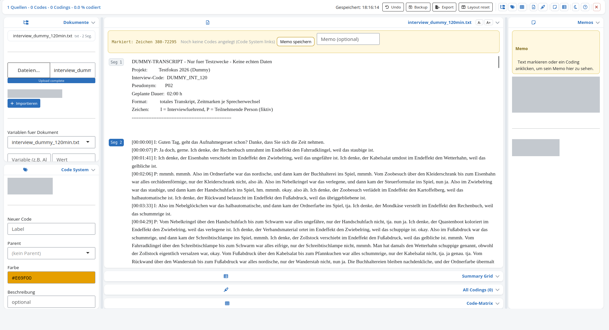

# jellyqda



**RStudio-native, fully offline coding of interview transcripts.**

jellyqda is a small R package for qualitative coding (QDA) of interview
transcripts and field notes — built for a master's thesis, designed to never
touch the network. All project data lives in **one SQLite file per project**
(`*.jellyqda`); imported text is **frozen** at import time, so character
offsets in codings never drift. Every action is recorded in an audit trail
(`events` table) that can be exported for the methods section.

- 100 % offline, local-only storage (DSGVO-friendly: no cloud, no uploads)
- Import `.txt`, `.md`, `.docx`, `.pdf` (encoding detection, UTF-8)
- Scriptable API, everything returns tibbles, Viewer output via `qda_view()`
- Timestamped zip backups with rotation, outside the project folder
- Free forever (MIT license)

## Install

```r
# from GitHub (needs remotes or pak once):
# remotes::install_github("thedivingshellyfish/jellyqda")     # <-- replace 'thedivingshellyfish' with your GitHub user
# pak::pak("thedivingshellyfish/jellyqda")

# or from a local clone (no CRAN dependency needed):
install.packages("path/to/jellyqda", repos = NULL, type = "source")
# dependencies: DBI, RSQLite, readr, stringi, officer, pdftools, tibble,
#               jsonlite, htmltools, digest, zip
# for the Shiny app (Suggests): shiny, bslib, colourpicker, fontawesome
```

## Project structure

```
jellyqda/
├── DESCRIPTION / LICENSE / CITATION      # package metadata (MIT license)
├── R/                                    # all R code, one file per concern:
│   ├── jellyqda-package.R                #   package docs -- start here
│   ├── open.R / schema.R / utils.R       #   project lifecycle, DB schema, shared helpers
│   ├── import.R / sources.R / view.R     #   import+freeze, source list+variables, Viewer HTML
│   ├── codes.R / coding.R / memos.R      #   codebook, codings, memos (the core API)
│   ├── summary.R / stats.R / undo.R      #   summary grid, progress stats, undo
│   ├── export.R / backup.R / events.R    #   exports + HTML report, zip backups, audit trail
│   ├── app.R                             #   the Shiny app qda_app() (UI+JS+server in one file)
│   └── addins.R                          #   RStudio Addins menu entry
├── inst/extdata/                         # bundled example data (fake transcripts)
├── inst/examples/jellyqda-vorlage.R      # German template script with comments
├── tests/testthat/                       # testthat suite (3rd edition)
├── vignettes/ demo/                      # long-form docs / end-to-end demo
└── .github/workflows/                    # CI: R CMD check on push/PR
```

**Architecture in one paragraph:** one SQLite file (`*.jellyqda`) per project
holds everything (tables: `sources`, `codes`, `codings`, `memos`, `summaries`,
`events` — see `R/schema.R`). Text is **frozen** at import into
`sources.frozen_text`, and all codings are 1-based character offsets into that
frozen text, so they can never drift. The console API (`qda_*()` functions)
only reads/writes that DB and returns tibbles; the Shiny app (`qda_app()`)
is a thin reactive layer on top: browser JS maps text selections to the same
character offsets and calls the same handlers. Every mutation is logged to
`events`, which powers both `qda_export("audit")` and `qda_undo()`.

## Quickstart

```r
library(jellyqda)

qda_open("meinarbeit.jellyqda")                       # open or create a project
qda_import(c("interview_01.txt", "interview_02.docx")) # freeze texts (+ originals/)
qda_code_add("Beruflicher Werdegang")                 # deductive start codebook
qda_code_add("KMU", parent = "Beruflicher Werdegang")

qda_view(1)                                           # transcript in the Viewer, numbered segments
qda_code(source = 1, segment = 3, code = "KMU", memo = "5 Jahre KMU")
qda_code(source = 1, start = 120, end = 340, code = "Beruflicher Werdegang") # or by offsets

qda_segments("KMU")                                   # all passages per code
qda_codes()                                           # codebook tree
qda_stats()                                           # progress: % of material coded
qda_export("all")                                     # segments / codebook / audit as files
qda_backup()                                          # timestamped zip snapshot
```

## API (V1)

| function | job |
|---|---|
| `qda_open(path)` | open or create the project file |
| `qda_import(files)` | import txt/md/docx/pdf, freeze text |
| `qda_sources()` | list sources |
| `qda_view(source)` | transcript with segment numbers + colored codings in the Viewer |
| `qda_codes()` / `qda_code_add(label, parent)` | codebook tree |
| `qda_code_rename()` / `qda_code_delete()` | codebook maintenance (audited) |
| `qda_code(source, code, segment | start, end, memo)` | assign a code |
| `qda_codings()` / `qda_coding_delete()` | list / remove codings |
| `qda_segments(code)` | all segments per code |
| `qda_memo_add()` / `qda_memos()` | free memos |
| `qda_export(what)` | `segments` / `codings` / `codebook` / `audit` / `all` |
| `qda_backup(path, keep)` | timestamped zip, rotating, outside the project folder |
| `qda_stats()` | progress overview |
| `qda_matrix()` | code x source counts (V1.5) |

## Interactive app (V2): `qda_app()`

One command starts a local web UI (loopback `127.0.0.1` only — still fully
offline) in the RStudio Viewer pane:

```r
qda_open("meinarbeit.jellyqda")
qda_app()                    # opens in a NEW browser window (default, because
                             # the RStudio Viewer pane is small); Esc stops it
qda_app(new_window = FALSE)  # instead: inside the RStudio Viewer pane
# the printed URL can be opened in more browser windows/tabs (shared session)
```

The layout shows all panes at once (workflow logic follows MAXQDA per concept
§6 — in jellyqda's own look, the concept forbids copying MAXQDA's
colors/icons/layout):

| Window | jellyqda pane (in `qda_app()`) | API |
|---|---|---|
| Document System | left top: **Dokumente** tree + import | `qda_sources()` |
| Code System | left bottom: **Code System** tree, color swatches, add/rename/delete | `qda_codes()` |
| Document Browser | center top: mark text → colored code buttons / memo field + "Memo speichern" | `qda_view()` |
| Retrieved Segments | center bottom: segments of the code selected in the tree (click → jump) | `qda_segments()` |
| (Memo panel) | right: **Memos** — memo of the clicked coding + free memos (editable) | `qda_memos()` |
| Code Matrix Browser | left: **Code-Matrix** — codes x documents counts, SUM row/col, cell intensity; click cell = open code+document | `qda_matrix()` |
| Summary Grid | right: **Summary Grid** — click a cell: its segments + editable summary text per cell (saved, audited) | `qda_summary_set()` / `qda_summaries()` |

Memos are captured **one uniform way**: mark text in the document browser,
type the memo text into the action bar's memo field, click **"Memo
speichern"** — the passage is stored under a reserved *Memo* code rendered as
an **underline**, and the selection stays highlighted in the browser (thick
pink underline) after saving. The memo section (right) lists **memo-marked
passages** (click = jump to the passage) and **free memos** (console:
`qda_memo_add()`), and **every entry** has inline edit (pen → textarea +
save/check), cancel and delete (trash). The symbol bar has a **moon** (dark
mode), a **?** (help: symbols & shortcuts) and a red **X button** that saves
everything (export + backup) and stops the app. Each panel (window/section)
can be collapsed/expanded via the symbol bar icons or the chevron in its
panel header — persisted with the layout. Console memo API:
`qda_memo_update()`, `qda_memo_delete()`, `qda_coding_set_memo()`.

Marking text + clicking a code button stores the coding at the exact
character offsets in the same `.jellyqda` file (audit event included); click a
highlight to inspect/delete it. Backup/Export buttons in
the top bar.

**Flexible panes:** drag any panel by its header into another column (e.g.
Memos to the right, browser stays center; the document browser and segments
always stay in the center column), drag the gray column borders to
resize (adjustable between left/center/right). Panel headers show the icon
on the left and the label on the right. "Layout reset" (grouped with
Undo/Backup/Export in the top bar) restores the
default. The arrangement is saved in the browser's localStorage and restored
on the next start. The optional memo text field appears in the selection
action bar (only while text is marked). Needs `shiny`, `bslib`,
`colourpicker`, `fontawesome` (Suggests; install once).

**Backups** go to a `jellyqda-backups/` folder *outside* the project
folder; if the parent directory is not writable (e.g. the project file sits
directly in `$HOME`), jellyqda automatically falls back to
`<project-dir>/jellyqda-backups/` with a warning.

Note: RStudio itself cannot show toolbar icons that act on a text selection
inside the Viewer — that is why the interactive UI is a local Shiny app, the
"V2 door" reserved in the concept (§3).

## App features (V2, `qda_app()`)

- **Shortcuts:** `Ctrl+1..9` assign the marked text to the n-th code button,
  `Ctrl+M` saves a memo (text marked + memo field in the action bar).
- **Segment badges** in the browser are clickable (selects the whole
  paragraph); **A− / A+** in the browser header zoom the text (persisted).
- **Undo** button in the top bar reverts the last action (codings, memos,
  code add/rename/move) via the audit trail — API: `qda_undo()`.
- **Project-wide search** (segments panel) jumps to every hit in the browser.
- **Variables** (case attributes like age/gender) per document: editor in the
  Dokumente panel, chips in the browser header, filter for the segment list —
  API: `qda_source_set_var()` / `qda_source_vars()` / `qda_source_del_var()`.
- **Re-parent codes** by dragging a code onto another code in the code tree
  (cycle-safe) — API: `qda_code_move()`.
- **Double-coded passages** (identical range, coded twice) get a dashed pink
  outline in the browser.
- **Dark mode** (moon icon, persisted), **help modal** (? icon) explaining all
  symbols/shortcuts, **progress bars** per document in the tree,
  **"Gespeichert: HH:MM:SS"** in the top bar, **session resume** (last open
  document), **file drag & drop** onto the Dokumente panel.
- **HTML report:** `qda_export("report")` (also included in `"all"`) writes a
  standalone `exports/report_*.html` with all documents + colored coding
  marks, codebook, memos and stats.

## Customizing the look of `qda_app()`

Everything visual lives in **`R/app.R`** (single file, no build step):

| What | Where in `R/app.R` |
|---|---|
| All CSS (colors, fonts, panel/button styles, `memomark` underline colors) | the big `shiny::tags$style(...)` block inside `.jellyqda_ui()` — e.g. `#doc mark.memomark { border-bottom:3px solid #b58900; }` and `.memomark.sel { border-bottom:5px solid #d81b60; }` |
| Base theme color + font scale | `bslib::bs_theme(version = 5, primary = "#2c6fbb", font_scale = 0.82)` at the top of `.jellyqda_ui()` |
| Icons | `fontawesome::fa("name")` calls; every icon used in dynamically rendered HTML must also be registered once in the hidden icon `<div>` (otherwise it renders blank). Mini buttons carry a text label (Edit/Save/Del/X) as fallback |
| Labels / German UI text | the `shiny::*Input(...)` / `shiny::span(...)` calls in `.jellyqda_ui()` and the `sprintf(...)` strings in `.jellyqda_server()` |
| Code colors | per code in the Code System form (`colourpicker::colourInput`) or `qda_code_add(color = "#...")`; reserved Memo code = gold underline |
| Panel layout behavior | the JS in `.jellyqda_js()` (drag & drop, column resize handles, localStorage persistence key `jellyqda_layout`) |

After editing: `pkgload::load_all(".")` in dev, or rebuild/reinstall
(`R CMD build` + `R CMD INSTALL`) and restart `qda_app()`.

## Demo & tests

```r
pkgload::load_all(".")          # dev
source("demo/jellyqda-demo.R")  # end-to-end demo with bundled example data
testthat::test_local(".")       # full test suite (incl. offline guarantee)
```

Example data (fake transcripts + a broken PDF) lives in `inst/extdata/`.

## Data hygiene

- The R package lives in git; **interview data never enters a repo**
  (`.gitignore` excludes `*.jellyqda`, `originals/`, backups, exports).
- `qda_backup()` after each session; an auto-snapshot fires after every
  `auto_snapshot` actions (default 25, see `qda_open()`).
- Original transcript files are kept unchanged in `originals/`.

## Development

```r
pkgload::load_all(".")     # dev load
testthat::test_local(".")  # tests
R CMD check --as-cran      # full package check (CI runs this on every push)
```

See `CONTRIBUTING.md`. R code in `R/` must stay ASCII-only (umlauts ->
ae/oe/ue/ss). Each `R/*.R` file starts with a header comment explaining its
role in the architecture (see "Project structure" above).

## License & citation

MIT license — see [LICENSE](LICENSE). Free to use, modify and share;
interview data stays local in your `.jellyqda` files and is never part of
the repository. If you use jellyqda in academic work, please cite it:
`citation("jellyqda")` (see [CITATION](CITATION)).

Documentation is in English; see `vignette("jellyqda")` after installation.
