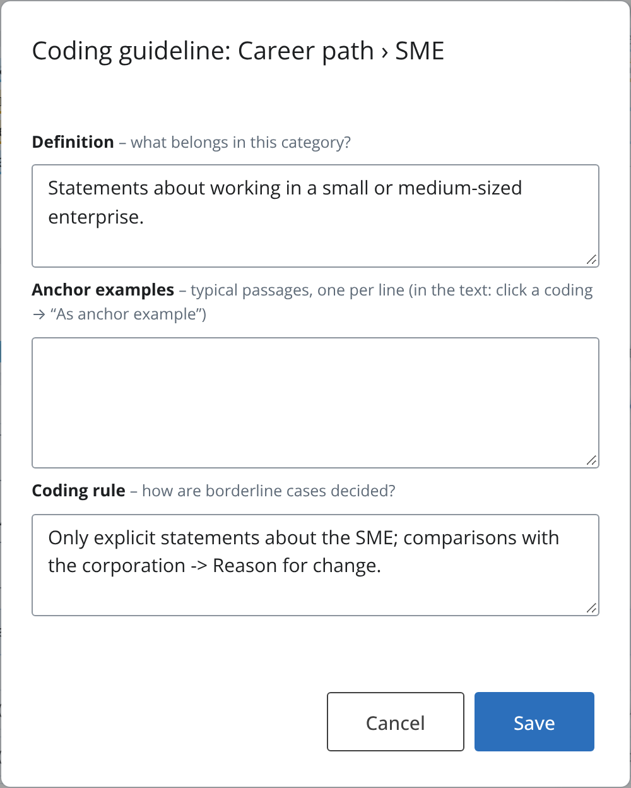
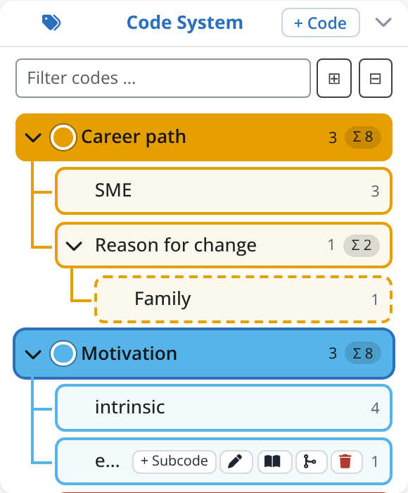
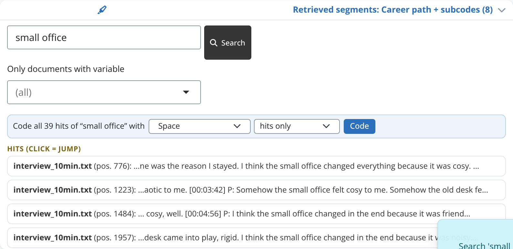
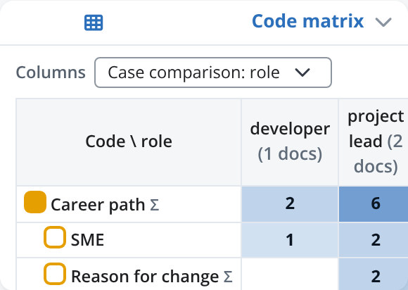
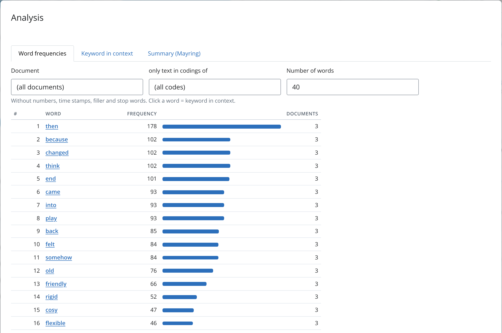
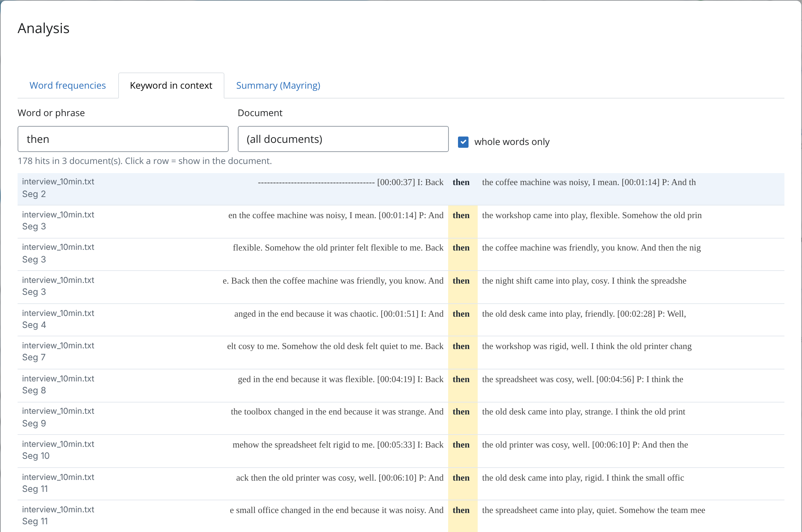
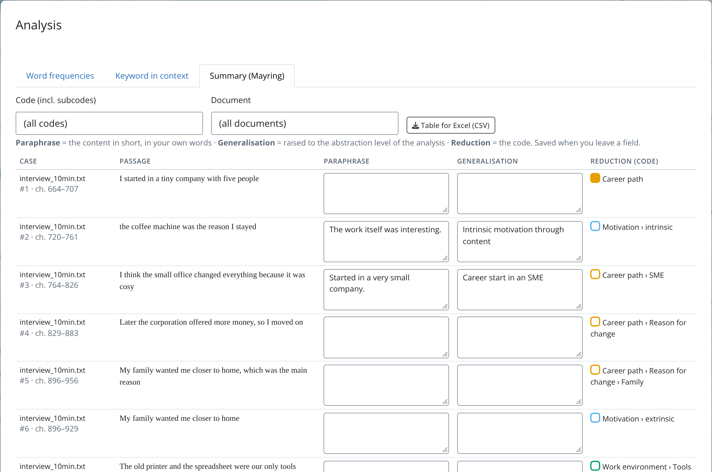

> 🌐 **English** · [Deutsch](de/Analysieren.md)

# Analysis: deductive and inductive

Tools for qualitative content analysis, e.g. after **Mayring** or
**Kuckartz**. Everything can be undone (**Ctrl+Z**) and is also available as
an R function (see [R functions](R-functions.md)).

| Tool | mainly for | Where in the app |
|---|---|---|
| [Coding guideline](#coding-guideline) | deductive | book icon on a code |
| [In-vivo codes](#in-vivo-codes) | inductive | coding bar: **In vivo** |
| [Merging codes](#merging-codes) | inductive | arrow icon on a code |
| [Code all search hits](#code-all-search-hits) | deductive | search, bottom middle |
| [Case comparison](#case-comparison) | both | code matrix: **Columns** |
| [Word frequencies](#word-frequencies) | inductive | **Analysis** at the top |
| [Keyword in context](#keyword-in-context) | both | **Analysis** at the top |
| [Summary after Mayring](#summary-after-mayring) | both | **Analysis** at the top and coding bar |

## Coding guideline

Hover over a code and click the **book icon**. The dialog has the three
columns of a coding guideline:

- **Definition:** what belongs in this category?
- **Anchor examples:** typical passages, one per line.
- **Coding rule:** how are borderline cases decided?



**Take an anchor example from the text:** click a coded passage and choose
**"As anchor example for …"** in the coding bar. The passage is appended to
the anchor examples with document and segment.

Definition and coding rule appear while coding when the mouse is over a code
in the coding bar. The [report](Evaluation-and-export.md) and the Word
codebook contain the complete guideline.

## In-vivo codes

Mark text and click **In vivo** in the coding bar: the marked text itself
(shortened to about 60 characters) becomes a new code and is assigned at
once. If the code exists already, it is assigned instead of created. In-vivo
codes can be renamed, moved or merged later.

## Merging codes

When two categories turn out to be the same: hover over the code that should
disappear, click the **arrow icon** and choose the target code.



All codings, subcodes, code memos, summaries and the coding guideline move to
the target code. A subcode with the same name is merged as well. **Ctrl+Z**
restores everything.

## Code all search hits

Search in the field **"Search the whole project …"** (bottom middle). Above
the hits you then see: *"Code all N hits of … with [code] [hits only / whole
segment]"*.



- **hits only:** codes exactly the word found.
- **whole segment:** codes the whole speaker turn or paragraph around every hit.

Places that already have this code are skipped. All new codings form **one**
step: one Ctrl+Z takes them all back. Tip: afterwards check the passages via
the code and delete unsuitable ones individually.

## Case comparison

How often do the codes occur in different groups, e.g. project leads versus
developers? This needs **variables** on the documents (documents panel, see
[Importing documents](Importing-documents.md)).

In the **code matrix**, choose e.g. "Case comparison: role" instead of
"Documents" at **Columns**. The columns are then the values of the variable,
with the number of documents per group. Codes include their subcodes.



The report contains one table per variable.

## Word frequencies

**Analysis** at the top, tab **Word frequencies**: the most frequent words,
without numbers, time stamps, stop and filler words (uh, well, yes …). You
can restrict it to one document or to the text inside the codings of a code,
e.g. "Which words do the interviewees use when it is about motivation?"



A click on a word opens it in **keyword in context**.

## Keyword in context

Tab **Keyword in context** ("KWIC"): every occurrence of a word or phrase
with the text to its left and right, across all interviews. You quickly see
in which contexts a term is used. **Whole words only** does not find
"project" inside "projects".



A click on a row jumps to the place in the document.

## Summary after Mayring

Mayring's summarising content analysis works in steps: **paraphrase** (the
content in short, in your own words) → **generalisation** (raised to the
abstraction level of the analysis) → **reduction** (the category, here: the
code).

- **One by one:** click a coded passage, unfold "Mayring: paraphrase and
  generalisation" in the coding bar, fill it in, **Enter**.
- **As a table:** **Analysis** → tab **Summary (Mayring)**. All codings
  (filterable by code and document) with the passage and one field each for
  paraphrase and generalisation. Saved when you leave a field. **Table for
  Excel (CSV)** downloads the table.



The report shows the table as a section of its own; paraphrases also appear
in the margin column next to the interview.

## Intercoder agreement

Two people code independently, jellyqda computes Cohen's kappa and
Krippendorff's alpha: tab **Intercoder** in the analysis window, see
[Intercoder agreement](Intercoder-agreement.md).

## As an R script

```r
qda_code_guide("SME", definition = "Working in a small or medium-sized enterprise",
               rule = "Only explicit statements")
qda_code_merge("Interest", into = "intrinsic")
qda_autocode("colleague", code = "Team climate", scope = "segment")
qda_coding_set_summary(12, paraphrase = "...", generalization = "...")
qda_words(n = 30, code = "Motivation")
qda_kwic("family")
qda_case_matrix("role")
```
