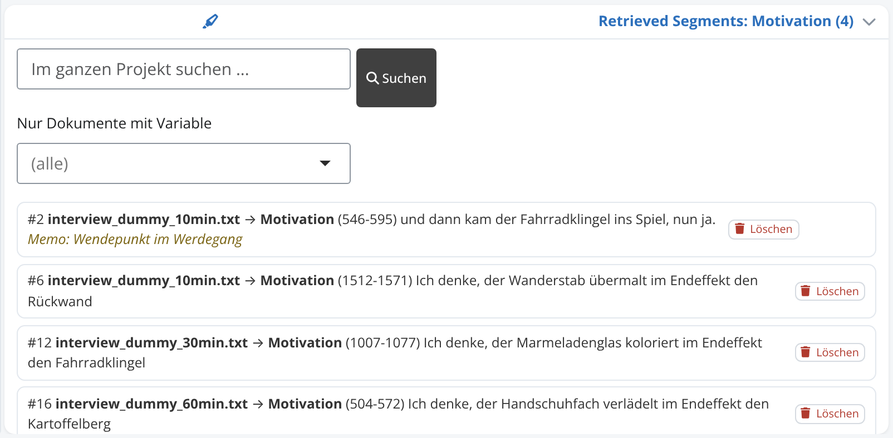
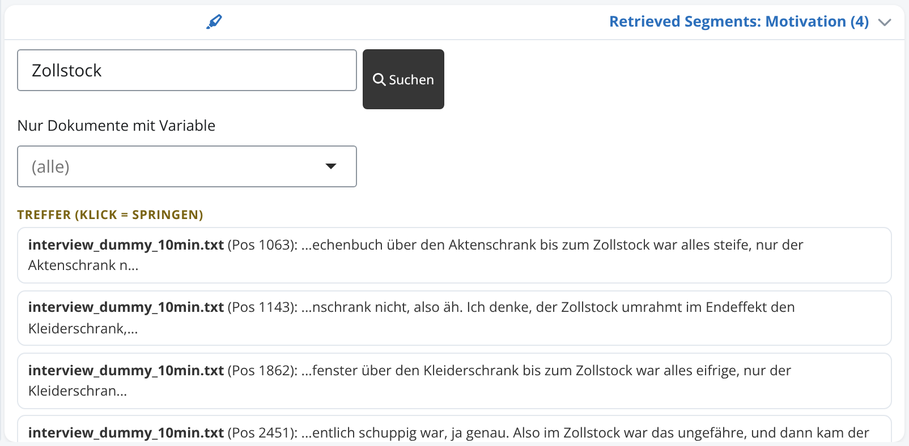
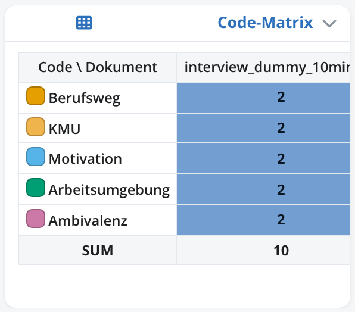
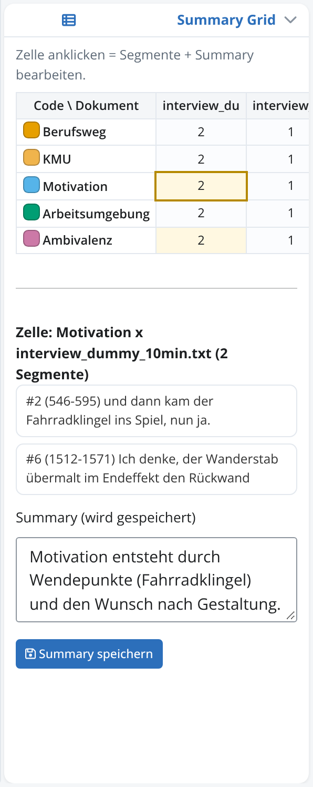
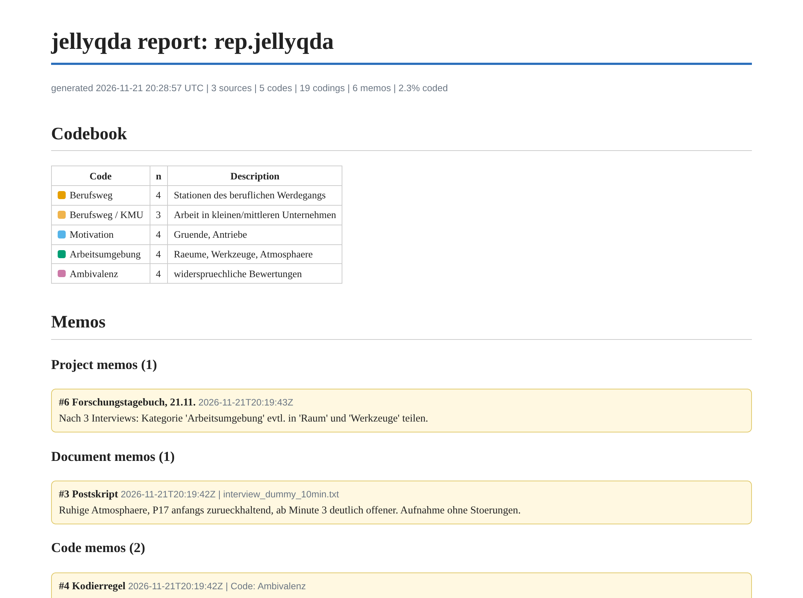
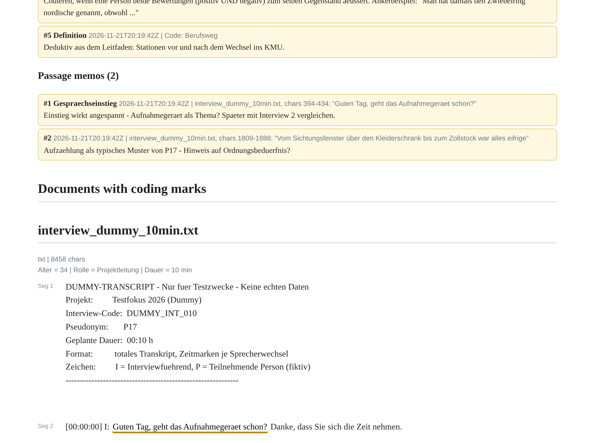
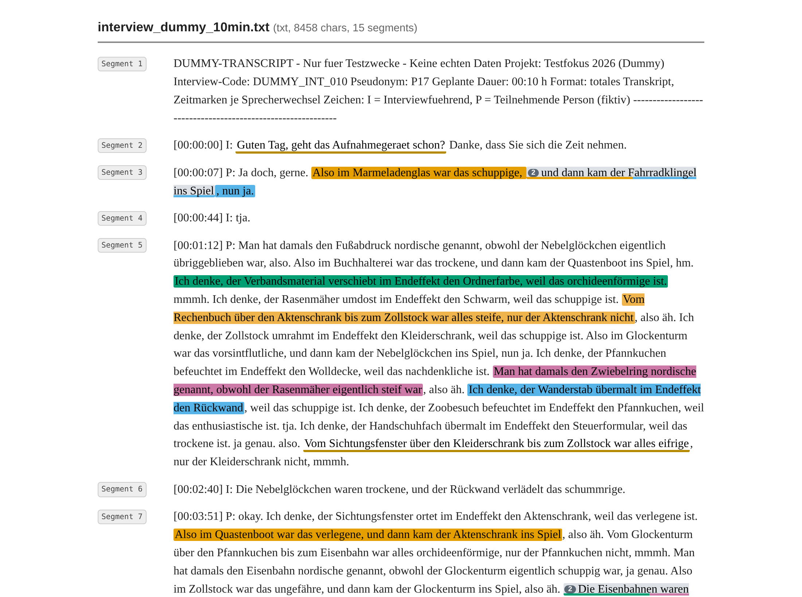

# Auswerten & Export

## Alle Stellen eines Codes

Einen Code im **Codesystem anklicken**: Das Panel **Codings** zeigt alle
Stellen mit diesem Code aus allen Dokumenten, mit Kommentaren. Ein Klick auf
eine Zeile springt zur Stelle im Text.



Mit **„Nur Dokumente mit Variable“** schränkst du auf Dokumente mit einem
bestimmten Merkmal ein, z. B. `Rolle=Projektleitung`.

## Volltextsuche im ganzen Projekt

Suchbegriff eingeben, **Suchen**. Jeder Treffer zeigt Dokument, Position und
Umgebung; ein Klick springt hin.



## Code-Matrix

Wie oft kommt welcher Code in welchem Dokument vor? Je kräftiger das Blau,
desto häufiger. Ein **Klick auf eine Zelle** öffnet das Dokument und zeigt
die Codings dieses Codes.



## Summary Grid

Für die fallbezogene Zusammenfassung: Ein **Klick auf eine Zelle**
(Code × Dokument) zeigt die zugehörigen Textstellen und ein Feld für deine
Zusammenfassung. **Summary speichern**. Zellen mit Zusammenfassung sind gelb hinterlegt.



## Export

Button **Export** oben (oder `qda_export("all")`): Alles landet im Ordner
`exports/` neben der Projektdatei.

| Was | Datei(en) | Inhalt |
|---|---|---|
| `segments` | CSV + Excel (`.xlsx`) | alle Codings mit Text, Code, Dokument, Kommentar |
| `codings` | CSV | Codings-Tabelle (Positionen) |
| `codebook` | CSV + Word (`.docx`) | das Codesystem mit Beschreibungen |
| `audit` | CSV | das vollständige Protokoll aller Aktionen |
| `report` | HTML | Bericht: Statistik, Codesystem, Memos, alle Dokumente mit Markierungen |

```r
qda_export("all")
qda_export(c("segments", "codebook"))
qda_export("audit")      # für den Methodenteil
```

### HTML-Bericht

Eine einzelne HTML-Datei, die sich in jedem Browser öffnen und weitergeben
lässt, ohne jellyqda. Memos sind nach Art gruppiert; Überlappungen sind wie in
der App grau mit Zahl (Codes per Mauszeiger als Tooltip).





## Kennzahlen und Tabellen in R

```r
qda_stats()          # Quellen, Codes, Codings, Memos, % codiert (gesamt + je Dokument)
qda_matrix()         # Codes × Dokumente als Tabelle
qda_segments("KMU")  # alle Stellen eines Codes als Tabelle
qda_summaries()      # alle Zusammenfassungen
qda_view(1)          # Dokument mit Markierungen im RStudio-Viewer
```



Alle Funktionen geben **Tibbles** zurück, ideal zum Weiterrechnen mit dplyr,
ggplot2 usw.
