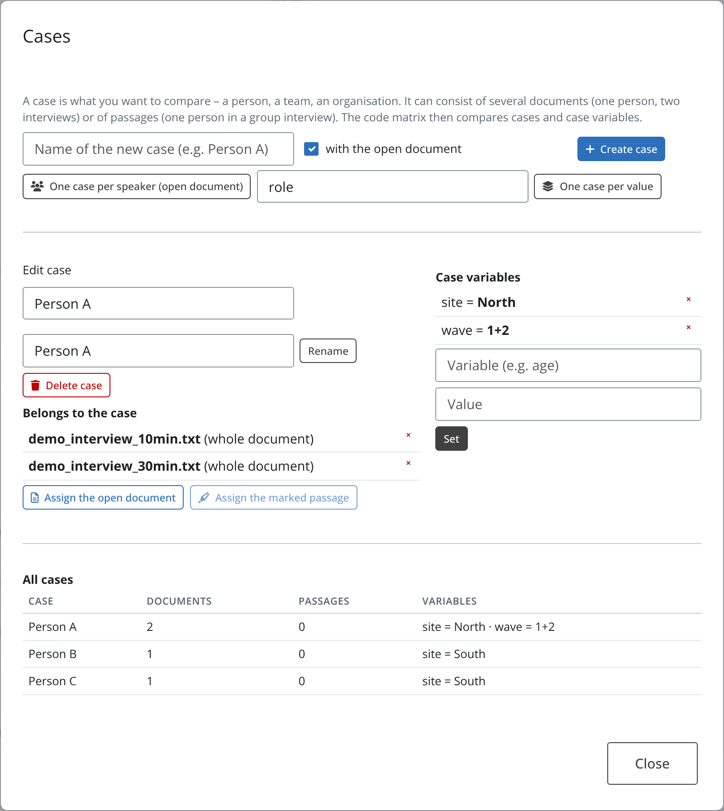
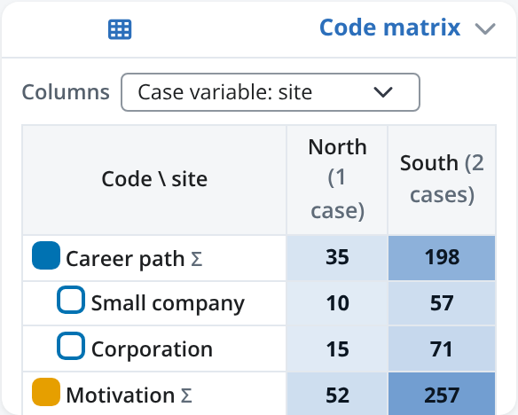

> 🌐 **English** · [Deutsch](de/Faelle.md)

# Cases

*New in version 0.10.0.*

A **case** is what you want to compare: a person, a team, an organisation, a
school. Very often a case is simply one interview – then
[document variables](Importing-documents.md#variables-case-attributes) are
all you need. Cases are for the situations where that does not fit:

| Situation | What belongs to the case |
|---|---|
| a person was interviewed twice (longitudinal study), or interview + field notes on the same team | **several whole documents** |
| a group interview or focus group: every participant is a case | **passages** of one document – the turns of each speaker |
| an organisation with several interviewees | several documents (one case "organisation") – and each person can still be compared via document variables |

A document can belong to several cases, and a case can have its own
**case variables** (e.g. *site = North*, *age group = 30–39*), independent of
the document variables. Codings count for a case when they lie in one of its
documents or passages.



## Creating cases in the app

In the documents panel: **Cases …**. The dialog has three parts:

1. **Create** – type a name, tick *with the open document* if the open
   document belongs to it, **Create case**.
2. **Build many at once**
   - **One case per speaker (open document)**: for group interviews. Every
     speaker label at the start of a segment (`B1:`, `[00:03:10] Anna:`)
     becomes a case with all turns of that person; interviewer labels (`I`,
     `Interviewer`, `Mod` …) are left out. Segment the document by speaker
     turns first ([Segments](Segments.md)).
   - **One case per value** of a document variable: give the documents a
     variable that names the case (e.g. `person = P07` on both interviews of
     P07), choose the variable, click – one case per value, with the
     documents as a whole.
3. **Edit case** – choose the case, then
   - **Assign the open document** or **Assign the marked passage** (mark the
     text in the document first, then open the dialog),
   - **×** takes a document or passage out of the case,
   - set and delete **case variables**, rename, delete the case.

Every step can be undone with **Ctrl+Z**. At the bottom, *All cases* lists
every case with its documents, passages and variables.

## Comparing cases

In the **code matrix**, *Columns* now also offers

- **Cases** – one column per case,
- **Case variable: …** – one column per value of a case variable (e.g. North
  vs. South), with the number of cases per column.



A coding that belongs to two cases of the same group counts once for the
group. The [query](Analysis.md#query-codes-combined-and--or--not) can be
limited to cases as well (in R: `qda_query(..., case = "Person A")`).

## Cases in the report and in exports

- The **report** has a section *Cases*: every case with what belongs to it
  and its variables, codes per case (up to 12 cases) and codes per value of
  each case variable.
- **Export all** writes `cases_<time>.csv`: one row per document or passage
  of a case, with the case variables as columns.
- The **REFI-QDA export** (`.qdpx`) contains the cases with their documents,
  passages and variables, so MAXQDA, ATLAS.ti or NVivo know them too.

## In R

```r
qda_case_add("Person A", sources = c("int_p01_wave1.docx", "int_p01_wave2.docx"))
qda_case_set_var("Person A", "site", "North")
qda_case_assign("Person A", "group_2.txt", segment = c(4, 9, 15))   # turns in a group interview
qda_cases()                                       # all cases with their variables
qda_case_members("Person A")                      # what belongs to a case

qda_cases_from_speakers("group_1.txt")            # group interview: one case per speaker
qda_cases_from_variable("person")                 # one case per value of a document variable

qda_case_matrix(unit = "case")                    # codes x cases
qda_case_matrix("site", unit = "case")            # codes x values of a case variable
qda_query(all = c("Workload", "Leadership"), case = "Person A")
```

Further: `qda_case_update()` (rename, description), `qda_case_unassign()`,
`qda_case_del_var()`, `qda_case_delete()`.
