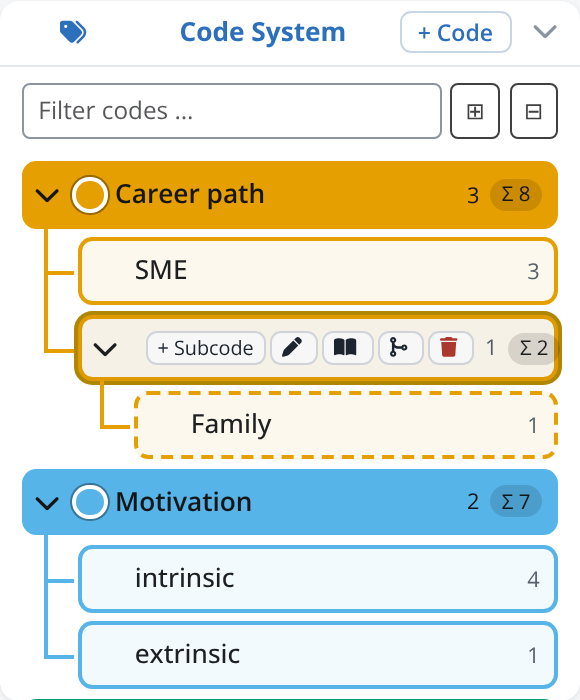
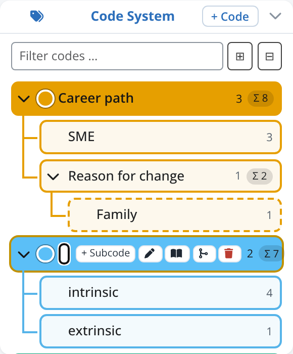
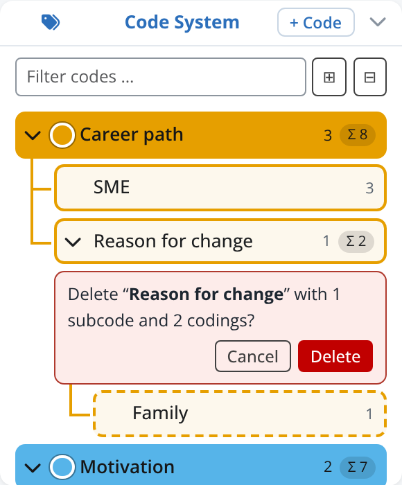
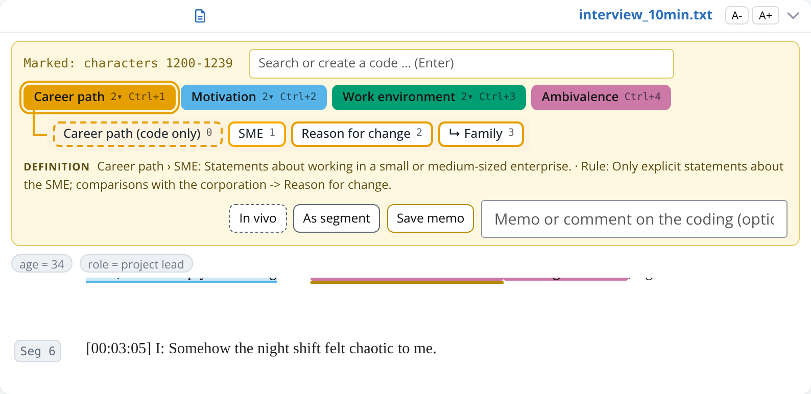
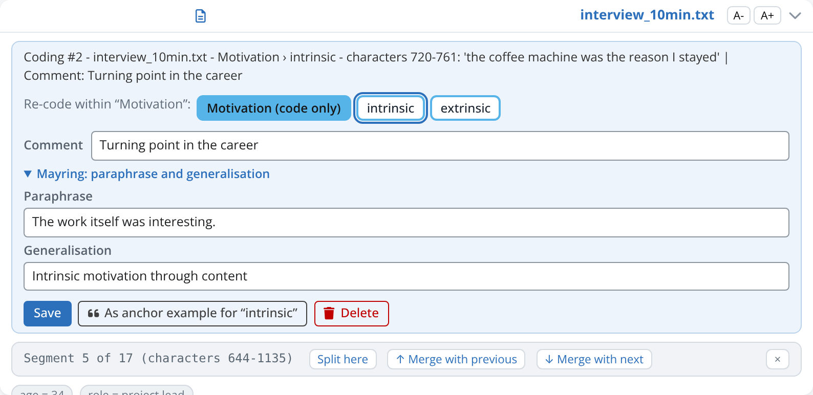
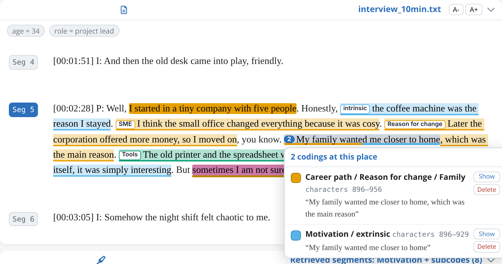

> 🌐 **English** · [Deutsch](de/Kodieren.md)

# Coding

## The code system



The code system is a **tree**: codes on the top level, subcodes below them
(up to three levels). A code is shown in **full colour**; its subcodes only
carry a **border in the same colour** and hang on a line in that colour, the
"thread". You see at a glance what belongs to which code family.

- **New code:** **"+ Code"** at the top of the panel, type the name, **Enter**.
- **New subcode:** hover over the code, **"+ Subcode"**, type the name,
  **Enter**. Subcodes take the colour of their code.
- **Expand/collapse:** arrow in front of the code; ⊞ / ⊟ at the top expand
  or collapse everything. The state survives a restart. The field **"Filter
  codes …"** shows only matching codes (with their parent codes).
- **Rename:** **double click** on the name (or the pen icon or **F2**), type
  the new name, **Enter** (Esc cancels).

  

- **Delete:** bin icon on the row. A confirmation names what is deleted as
  well (subcodes, codings); code memos and summaries go too. **Ctrl+Z** or
  "Undo" in the notification brings everything back.

  

- **Colour:** the colour dot on the code changes the colour of the whole family.
- **Move:** drag a code onto another one, it becomes its subcode. Dragged to
  the very bottom onto **"Drop here = code on the top level"**, a subcode
  becomes a code of its own again.
- **Numbers:** the number is the count of own codings, **Σ** includes all subcodes.
- **Click a code:** shows all passages with this code and its subcodes below
  (see [Evaluation](Evaluation-and-export.md)).
- The **sticky note icon** next to a code means: there is a
  [code memo](Memos.md) (e.g. definition or coding rule).
- **Book** and **arrow** icons: [coding guideline](Analysis.md#coding-guideline)
  and [merging codes](Analysis.md#merging-codes).

Deductive and inductive work mix freely: create codes from the interview
guide beforehand, add new ones while reading.

## Coding text

1. **Mark** a passage with the mouse. The yellow **coding bar** appears.
2. Click a **code**:
   - code **without** subcodes: assigned at once.
   - code **with** subcodes (shown as "2▾"): the subcodes unfold in a second
     row on the coloured thread. Choose a **subcode** there or
     **"(code only)"** to assign the code itself.



Other ways:

- **Keyboard:** **Ctrl+1…9** chooses the 1st–9th code; with unfolded
  subcodes **1…9** assigns the subcode and **0** the code itself. **Esc**
  folds up.
- **Search field:** type part of a name (e.g. "fam" finds
  "Career path › Reason for change › Family"), **Enter** assigns the first
  hit. Without a hit, **Enter** creates the name as a new code and assigns
  it, handy for inductive coding.
- **Code tree:** while text is marked, a click on a code in the tree codes
  it as well (the border turns yellow on hover).
- **Recent:** the most recently assigned codes are at the bottom of the bar.
- **In vivo:** the marked text itself becomes the code (see [Analysis](Analysis.md)).

When you hover over a code, the bar shows its **definition** and coding rule
(from the [coding guideline](Analysis.md#coding-guideline) or the newest
[code memo](Memos.md)). That keeps the coding rule in view while coding.

Optionally write a **comment on the coding** into the text field before the
click. It appears in the codings list, in the memo panel and in the report.

Further buttons in the coding bar:

- **As segment:** the marked text becomes a [segment](Segments.md) of its own.
- **Save memo:** [passage memo](Memos.md) for the marked text.

> 💡 You code a **whole speaker turn/paragraph** fastest by clicking its
> **"Seg N" badge** on the left; then the whole segment is marked.

**In the text:** codings with a code have the full colour. Codings with a
subcode are lightly tinted in the colour of the code family, underlined and
carry a small label with the name of the subcode at the start.

## Viewing, re-coding or deleting a coding

Click a coloured passage: a bar with code, position, text and comment
appears. Below it are all codes of the **same family**: a click **re-codes
the passage** (e.g. from "Career path" to the subcode "SME"); comment and
position are kept.

Also in the bar:

- **Comment:** add or change it, **Enter** saves.
- **Mayring: paraphrase and generalisation** (unfold), see
  [Analysis](Analysis.md#summary-after-mayring).
- **As anchor example:** take the passage into the coding guideline of the code.
- **Delete** removes the coding.



## Overlapping codings

A passage can have several codes. Such places are shown **grey**, with a
**number** (how many codings) and a colour stripe at the bottom in the
colours of the codes involved.

**Hovering** shows a list of all codings of this place with text excerpt and
comment, each with **Show** and **Delete**. A **click** pins the list;
**Esc** or a click next to it closes it.



Codings of exactly the same range given twice (the same place coded twice)
additionally get a dashed pink outline.

## As an R script

```r
qda_code_add("Career path", color = "#E69F00", description = "Stations of the career")
qda_code_add("SME", parent = "Career path")
qda_code(source = 1, segment = 3, code = "SME")                     # whole segment
qda_code(source = 1, start = 120, end = 340, code = "Career path",
         memo = "comment on the coding")                            # character range
qda_codings()                       # all codings with text
qda_coding_recode(5, "SME")         # re-code a coding
qda_code_set_color("Career path", "#56B4E9")   # colour of the code family
qda_coding_delete(5)
```
