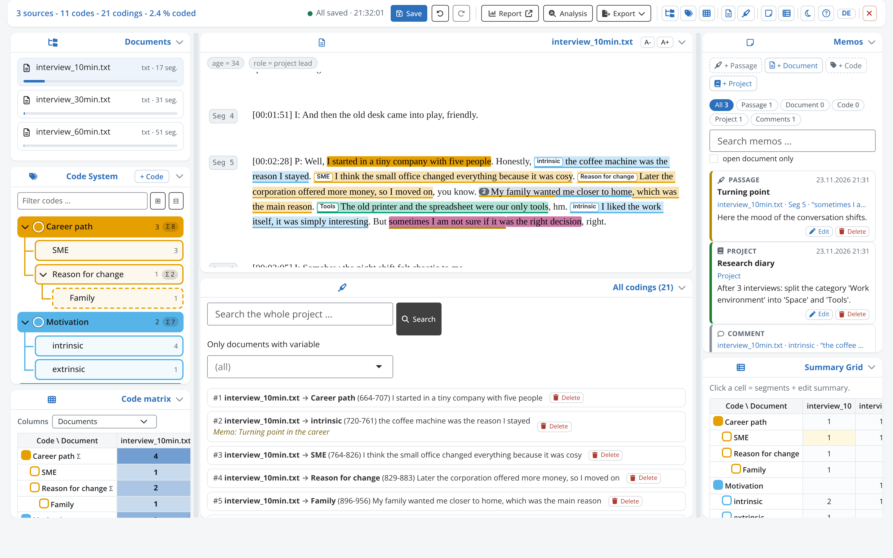
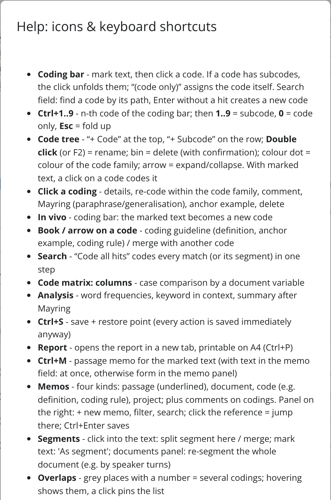
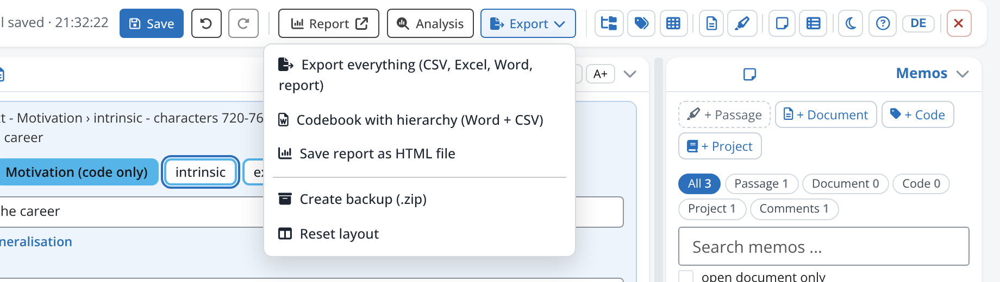
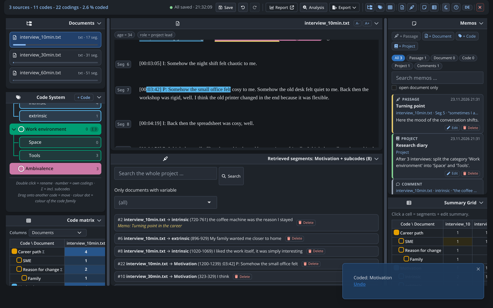

# Die Oberfläche

## Aufbau

| Bereich | Inhalt |
|---|---|
| **Oben** | Statistik (Quellen, Codes, Codings, % codiert), „Alles gespeichert · …“, **Speichern**, Rückgängig, Wiederholen, **Bericht** (neuer Tab), **Export**-Menü und die Symbolleiste |
| **Links** | **Dokumente** (Liste, Import, Variablen, Segmente), **Code System**, **Code-Matrix** |
| **Mitte oben** | **Dokument-Browser**: der Text mit Segmenten, Codings und Memos |
| **Mitte unten** | **Codings**: alle Stellen des gewählten Codes, Projektsuche, Variablen-Filter |
| **Rechts** | **Memos** und **Summary Grid** |

## Symbolleiste (oben rechts)

| Symbol | Wirkung |
|---|---|
| Ordner, Etiketten, Raster | Dokumente, Code System, Code-Matrix ein-/ausklappen |
| Dokument, Textmarker | Dokument-Browser, Codings ein-/ausklappen |
| Notizzettel, Liste | Memos, Summary Grid ein-/ausklappen |
| 🌙 Mond | Dark Mode an/aus |
| ? | Hilfe: alle Symbole und Tastenkürzel |
| ✕ (rot) | App beenden; vorher werden Export und Backup erstellt |

## Speichern, Bericht, Export

- **Speichern** (Strg+S): jede Aktion ist ohnehin sofort gespeichert; der
  Button schreibt die Datei zusätzlich fest und legt einen Sicherungspunkt
  (Backup) an.
- **Bericht**: öffnet den Bericht in einem neuen Browser-Tab, druckbar auf A4.
- **Export ▾**: alles exportieren, Codebuch (Word + CSV), Bericht als
  HTML-Datei, Backup anlegen, Layout zurücksetzen.

## Layout anpassen

- **Panels verschieben:** an der Kopfzeile in eine andere Spalte ziehen.
  (Dokument-Browser und Codings bleiben immer in der Mitte.)
- **Spaltenbreite:** die grauen Griffe zwischen den Spalten ziehen.
- **Ein-/ausklappen:** Pfeil rechts in der Kopfzeile oder Symbolleiste.
- **Schriftgröße im Text:** **A-** / **A+** in der Kopfzeile des Dokument-Browsers.
- **Export ▾ → Layout zurücksetzen** stellt die Standardanordnung wieder her.

Layout, Schriftgröße, Dark Mode und das zuletzt geöffnete Dokument merkt sich
der Browser für den nächsten Start.

## Dark Mode

Alle Beschriftungen und Buttons sind in beiden Modi gut lesbar; die Kontraste
erfüllen die WCAG-Empfehlung (AA).

## Fortschritt

Unter jedem Dokument zeigt ein Balken, wie viel Prozent des Textes schon
kodiert sind. Oben steht der Wert für das ganze Projekt. Das kleine
Notizzettel-Symbol neben einem Dokument bedeutet: Es gibt ein
[Dokument-Memo](Memos.md) dazu (Klick zeigt es an).
