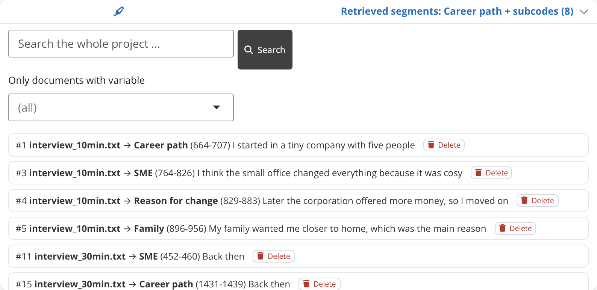
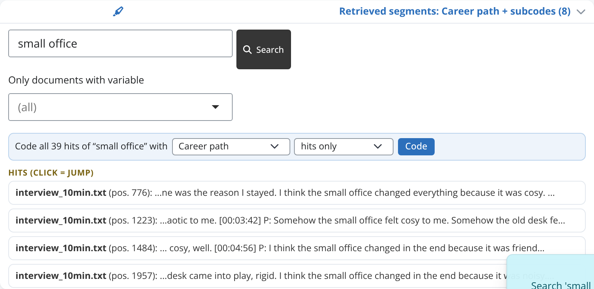
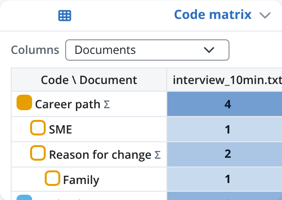
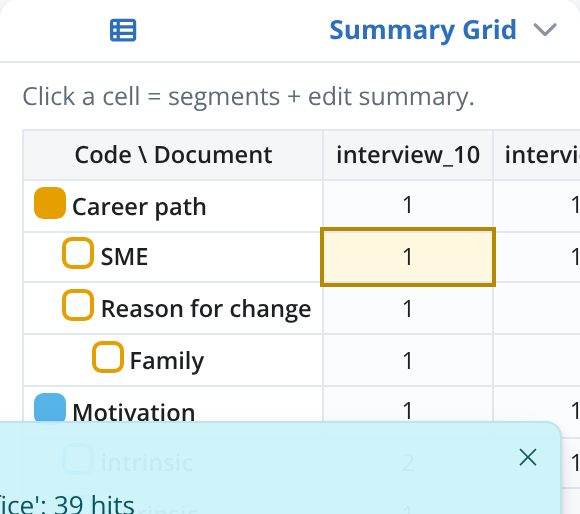
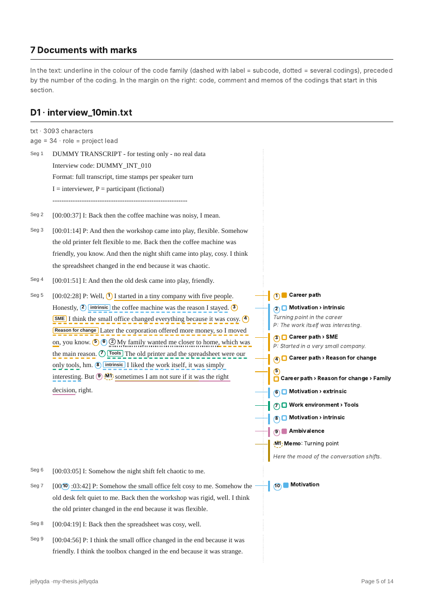
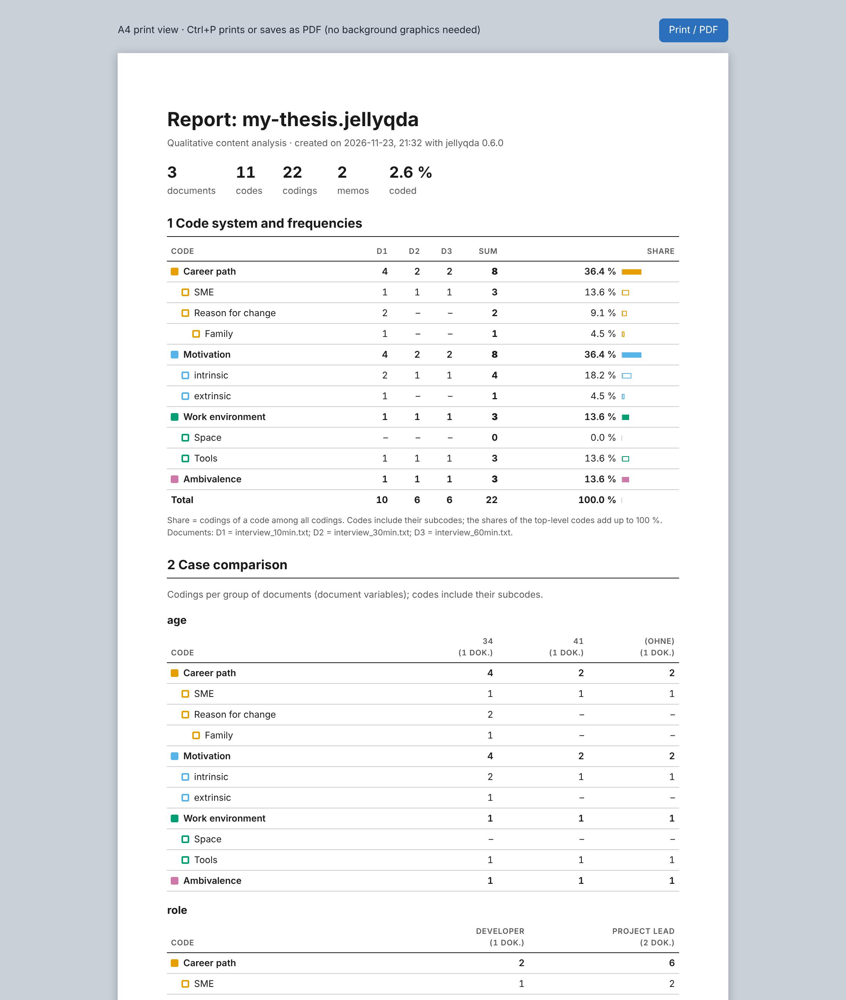
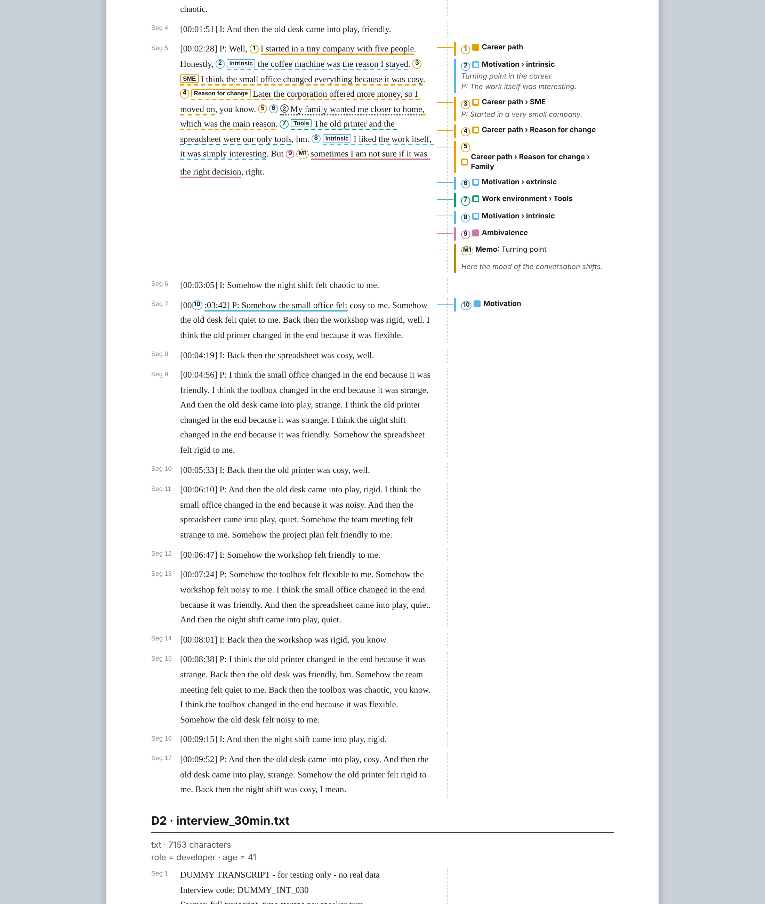
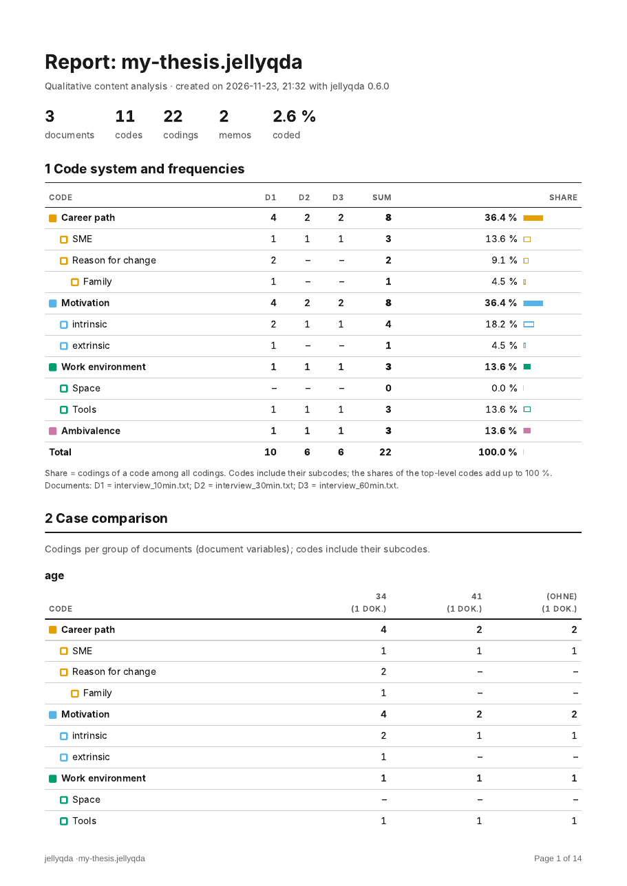
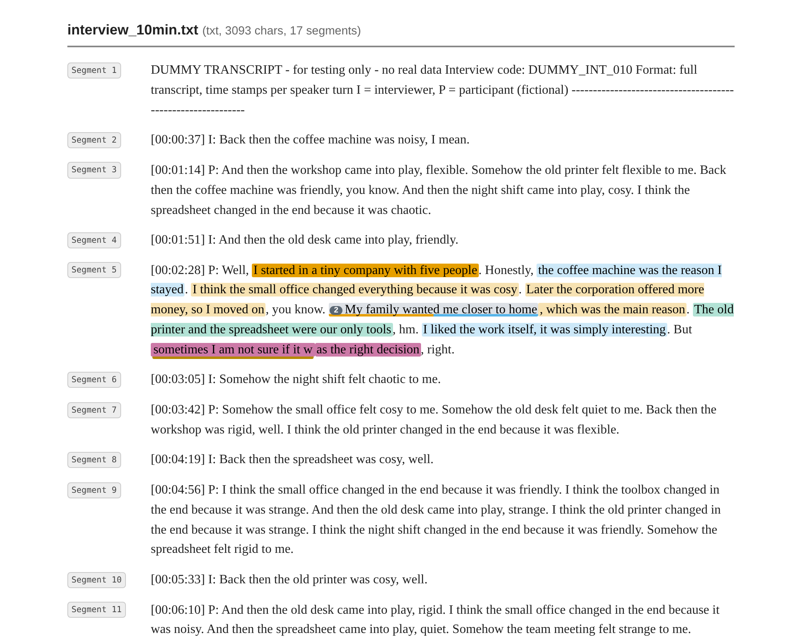

> 🌐 **English** · [Deutsch](de/Auswerten-und-Export.md)

# Evaluation & export

## All passages of a code

**Click a code in the code system**: the **Codings** panel shows all passages
with this code (and its subcodes) from all documents, with comments. A click
on a row jumps to the passage in the text.



With **"Only documents with variable"** you restrict it to documents with a
particular attribute, e.g. `role=project lead`.

## Full-text search across the project

Enter a search term, **Search**. Every hit shows document, position and
context; a click jumps there. All hits can be coded at once, see
[Analysis](Analysis.md#code-all-search-hits).



## Code matrix

How often does which code occur in which document? The stronger the blue, the
more often. Codes with subcodes show the sum incl. subcodes (Σ). A **click on
a cell** opens the document and shows the codings of this code. With
**Columns** the matrix becomes a [case comparison](Analysis.md#case-comparison).



## Summary grid

For case-based summaries: a **click on a cell** (code × document) shows the
passages and a field for your summary. **Save summary**. Cells with a summary
have a yellow background.



## Export

Menu **Export ▾** at the top → **Export everything** (or `qda_export("all")`):
everything goes into the folder `exports/` next to the project file.

| What | File(s) | Content |
|---|---|---|
| `segments` | CSV + Excel (`.xlsx`) | all codings with text, code, document, comment, paraphrase, generalisation |
| `codings` | CSV | codings table (positions) |
| `codebook` | CSV + Word (`.docx`) | the code system in tree order with level, definition, anchor example, coding rule and code memos |
| `audit` | CSV | the complete log of all actions |
| `report` | HTML | report (A4): frequencies with share in %, case comparison, codebook, memos, coded passages, Mayring table, all documents with marks and margin column |

```r
qda_export("all")
qda_export(c("segments", "codebook"))
qda_export("audit")      # for the methods section
```

### Report (A4, print-ready)

**Report** button at the top: the report opens in a **new browser tab** and
is created fresh on every click, in the language of the interface. To save
it as a file: **Export ▾ → Save report as HTML file** or
`qda_export("report")`; the file opens in every browser without jellyqda and
can be passed on.

The report is made for **A4**: **Ctrl+P** prints it or saves it as a PDF,
with page numbers. Colours only appear as lines, borders and underlines,
never as filled areas, so the print option "background graphics" does **not**
need to be switched on.

1. **Code system and frequencies:** every code and subcode per document, sum
   and **share in percent** of all codings (with bars). Codes include their
   subcodes; the top-level codes add up to 100 %. With many or long document
   names the columns are called D1, D2 … with a legend.
2. **Case comparison** (when document variables are set).
3. **Codebook (coding guideline):** definition, anchor examples, coding rule, code memos.
4. **Memos**, grouped by kind.
5. **Coded passages**, ordered by code, with comments and paraphrases.
6. **Summarising content analysis (Mayring)** (when paraphrases exist).
7. **Documents with marks and margin column:** the text is narrower, codings
   are underlined in the colour of the code family (subcodes dashed with a
   label, overlaps dotted) and carry a **number** at the start. In the margin
   on the right, under the same number on a coloured thread: code path,
   comment and paraphrase; passage memos as "M1, M2 …". Cards are placed next
   to the segment in which a coding starts, so the reference stays clear
   across page breaks.









## Figures and tables in R

```r
qda_stats()          # sources, codes, codings, memos, % coded (overall + per document)
qda_matrix()         # codes × documents as a table
qda_case_matrix("role")  # codes × values of a document variable
qda_segments("SME")  # all passages of a code as a table
qda_summaries()      # all summaries
qda_view(1)          # document with marks in the RStudio Viewer
```



All functions return **tibbles**, ideal for further work with dplyr,
ggplot2 etc.
