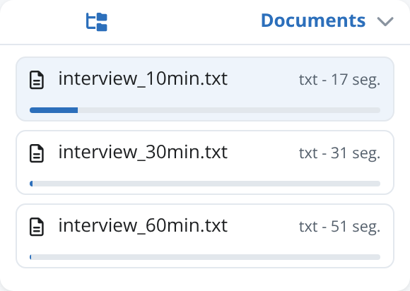
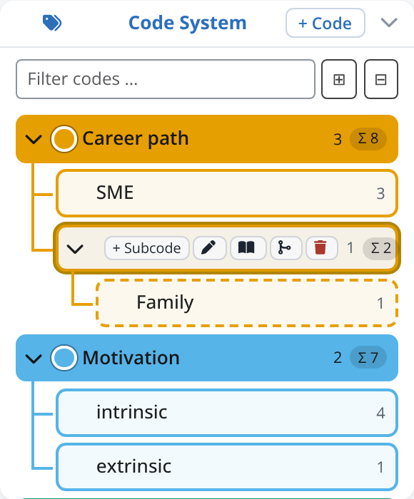
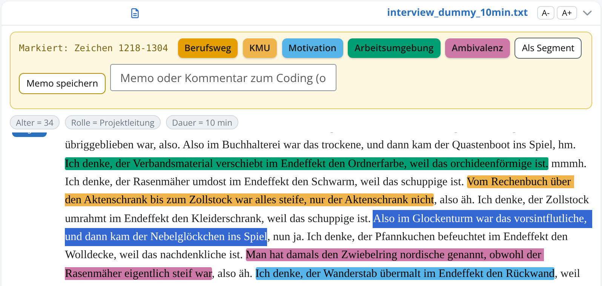

> 🌐 **English** · [Deutsch](de/Erste-Schritte.md)

# First steps

From an empty project to the first coding in ten minutes.

## 1. Create a project and start the app

In the R console:

```r
library(jellyqda)
qda_open("my-thesis.jellyqda")   # creates the project (next time: opens it)
qda_app()                        # starts the app in the browser
```

- The project file is created in R's current working directory (in RStudio:
  *Session → Set Working Directory*). You can also give a full path, e.g.
  `qda_open("~/thesis/analysis.jellyqda")`.
- The app opens in a **new browser window**. Prefer the RStudio Viewer?
  `qda_app(new_window = FALSE)`.
- The **language** follows your system (German system: German, otherwise
  English). Choose it explicitly with `qda_app(lang = "en")` or
  `qda_app(lang = "de")`, or click **DE/EN** in the toolbar.
- While the app runs, the R console is busy. **Quit:** red **X** at the top
  right of the app (creates an export + backup first) or `Esc` in the console.

## 2. Import interviews

In the **Documents** panel on the left:

1. Under **Segments on import** choose how the texts are divided. For
   transcripts with time stamps (`[00:01:12] P: …`), **speaker turns** is
   usually the best choice, see [Segments](Segments.md).
2. Click **Files…** (or drop files on the panel) and **Import**.



## 3. Create the first codes

In the **Code system** panel, click **"+ Code"** at the top right, type a
name, **Enter**. For a subcode, hover over a code and click **"+ Subcode"**.
Colours are assigned automatically (subcodes take the colour of their code)
and can be changed with the colour dot.



## 4. Coding

1. Click a document on the left; it opens in the middle.
2. **Mark** a passage with the mouse.
3. Click a code in the yellow **coding bar** (or **Ctrl+1…9**). If it has
   subcodes, they unfold: choose the subcode or **"(code only)"**.



Done, the passage now has the colour of the code. Every action is saved
**immediately**; the **Save** button (Ctrl+S) additionally creates a
restore point.

## 5. What next?

- Capture ideas: **[Memos](Memos.md)**
- See all passages of a code: click the code on the left, see
  **[Evaluation & export](Evaluation-and-export.md)**
- Made a mistake? **Ctrl+Z**, see [Undo](Undo-and-data-safety.md)

> 💡 **To practise:** `qda_import(system.file("extdata", "interview_01.txt", package = "jellyqda"))`
> or the fictional demo transcripts in the `demo/` folder of the repository (all invented, see `demo/README.md`).
