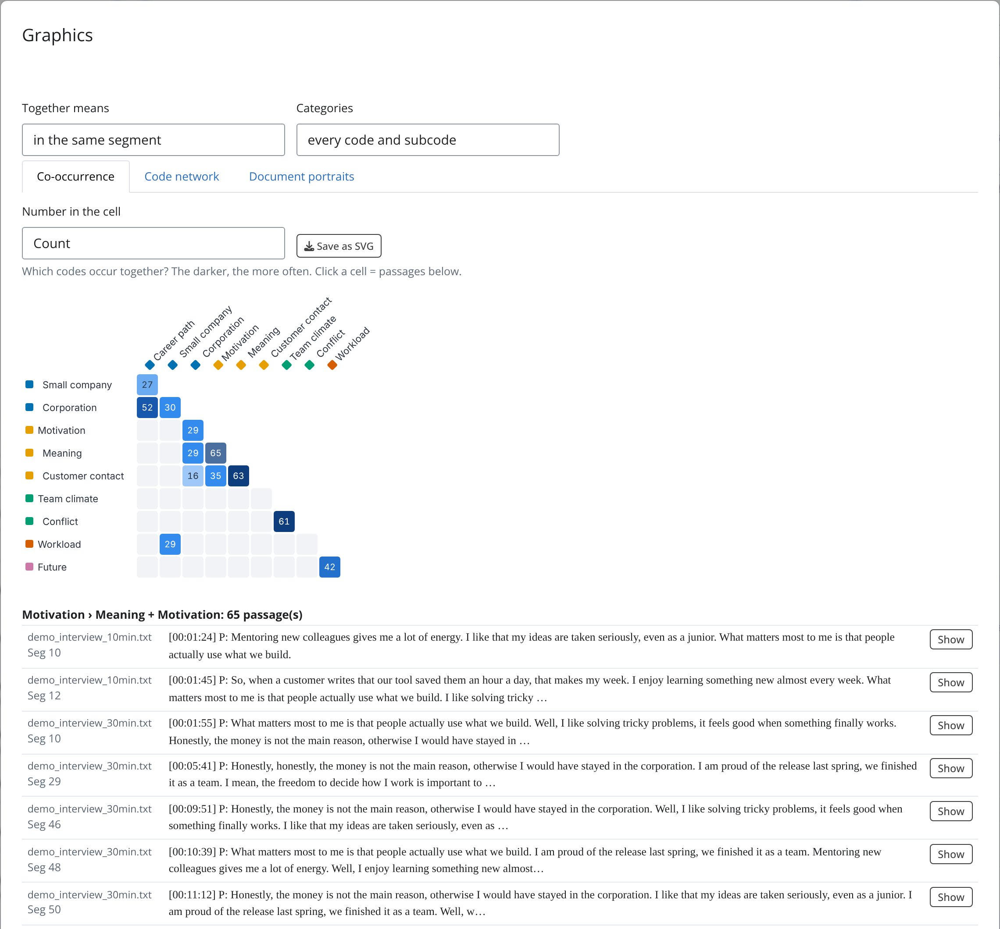
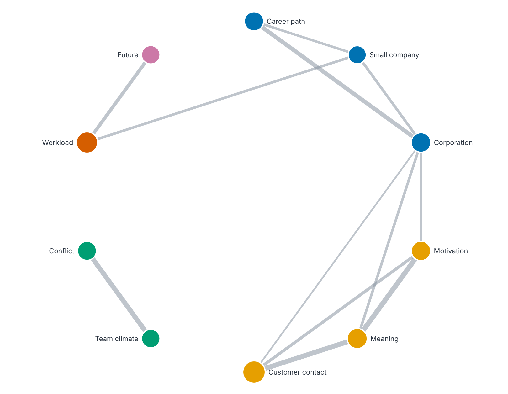
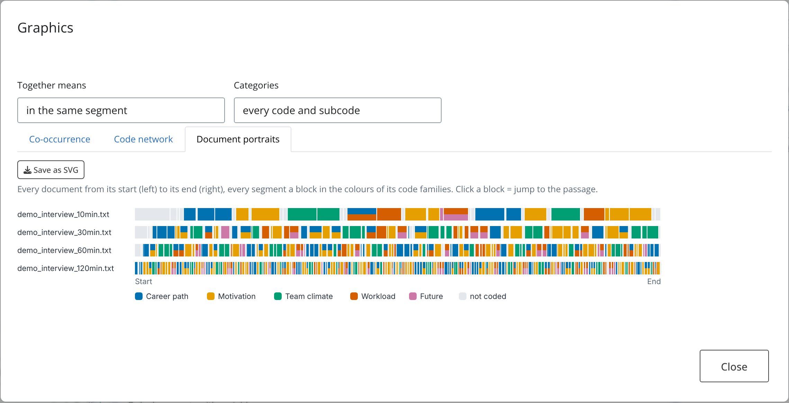

> 🌐 **English** · [Deutsch](de/Grafiken.md)

# Graphics: co-occurrence, network, portraits

*New in version 0.9.0.*

Three graphics help you see patterns in your coding. Open them with the
toolbar button **Graphics**. Two settings at the top apply to all of them:

| Setting | Meaning |
|---|---|
| **Together means: in the same segment** (default) | two codes count as "together" when both occur in the same segment, e.g. the same speaker turn |
| **… in the same document** | both codes somewhere in the same document (coarse) |
| **… codings overlap** | the two codings share text (strict) |
| **Categories: every code and subcode** | strict: every subcode on its own |
| **Categories: code families** | a code together with its subcodes (the portraits always show code families) |



## Code co-occurrence (heatmap)

A triangle of code × code cells. **The darker a cell, the more often the two
codes occur together**; the number is in the cell. Hover a cell for the
details, **click it** to list the passages underneath (with **Show** to jump
there).

- **Number in the cell: count** shows how often. Frequent codes naturally
  have high numbers.
- **Jaccard (0–1)** evens this out: share of the units with *either* code
  that contain *both*. 1 = the two codes always occur together. Useful to
  spot categories that are hard to tell apart.

Typical questions: Which themes are talked about together? Does "Workload"
come up together with "Leadership" or with "Family"? Do two subcodes always
appear together (and should perhaps be merged)?

## Code network



Every code is a **circle** (colour of its code family, size = how often it
was used), a **line** connects two codes that occur together (thicker = more
often). **Click a line** to list the passages.

- **Lines from (times together)**: hide rare connections, e.g. from 3.
- **Layout: circle** keeps the codes in code-tree order, so code families
  stay next to each other; **by connections** pulls related codes together.

## Document portraits



Every document is a strip from its **start (left)** to its **end (right)**.
Every segment is a block as wide as its share of the text, in the colours of
the codes it contains (several codes = stacked bands; grey = not coded).
**Click a block** to jump to that passage.

You see at a glance *where* in the interviews a theme comes up (at the start,
throughout, only at the end), how densely an interview is coded, and how
interviews differ.

## Saving and printing

- **Save as SVG** below every graphic: a vector graphic for your thesis
  (Word, LaTeX, Inkscape …), sharp at any size.
- The **report** contains the heatmap, the network and the portraits.

## As an R script

```r
qda_cooccurrence()                           # pairs of codes, most frequent first
qda_cooccurrence(unit = "overlap", level = "top")
qda_cooccurrence_passages("Workload", "Leadership")
qda_portrait()                               # which codes in which segment

qda_plot_cooccurrence()                      # print() shows it in the RStudio Viewer
qda_plot_cooccurrence(measure = "jaccard", file = "cooccurrence.svg")
qda_plot_network(min_n = 3, layout = "force", file = "network.svg")
qda_plot_portrait(file = "portraits.svg")
```

The tables are ordinary tibbles, so you can also draw them with ggplot2.
A complete example: [`demo/jellyqda-visuals-demo.R`](../../demo/jellyqda-visuals-demo.R).

---
[Back to the wiki home page](Home.md) · Previous: [Intercoder agreement](Intercoder-agreement.md) · Next: [Evaluation & export](Evaluation-and-export.md)
