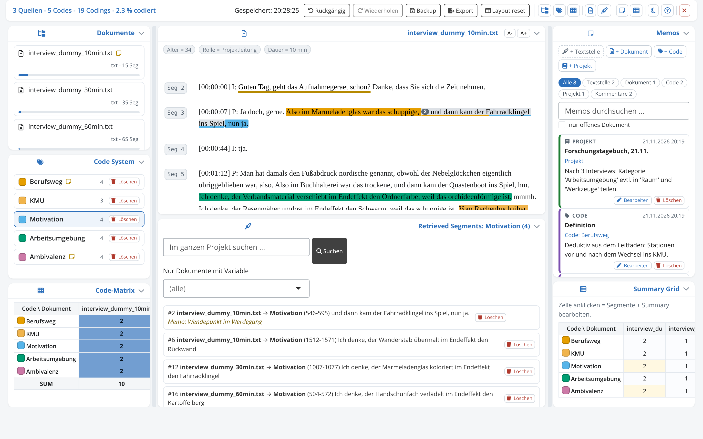

# jellyqda Wiki

**jellyqda** ist ein kleines, kostenloses Werkzeug für die **qualitative Analyse
von Interviews** in R und RStudio: komplett offline, ohne Cloud. Dieses Wiki
erklärt alle Funktionen Schritt für Schritt mit Screenshots.

## Für den Einstieg

1. **[Installation](Installation.md):** einmalig, eine Zeile in R
2. **[Erste Schritte](Erste-Schritte.md):** Projekt anlegen, App starten, erstes Interview kodieren
3. **[Die Oberfläche](Die-Oberflaeche.md):** was wo ist, Layout anpassen, Dark Mode

## Arbeiten mit jellyqda

| Thema | Worum es geht |
|---|---|
| [Dokumente importieren](Dokumente-importieren.md) | Transkripte laden (txt, md, docx, pdf), Variablen wie Alter oder Rolle |
| [Kodieren](Kodieren.md) | Codesystem aufbauen, Text markieren, Codes vergeben, Überlappungen |
| [Segmente](Segmente.md) | Absätze oder Sprecherwechsel, Segmente teilen und zusammenführen |
| [Memos](Memos.md) | Textstellen-, Dokument-, Code- und Projekt-Memos, Kommentare |
| [Auswerten & Export](Auswerten-und-Export.md) | Codings je Code, Suche, Code-Matrix, Summary Grid, Export, HTML-Bericht |
| [Rückgängig & Datensicherheit](Rueckgaengig-und-Datensicherheit.md) | Strg+Z/Strg+Y, Protokoll, Backups, Datenschutz |

## Nachschlagen

- [Tastenkürzel](Tastenkuerzel.md)
- [R-Funktionen](R-Funktionen.md): alles auch per Skript
- [Hilfe bei Problemen](Hilfe-bei-Problemen.md)

## Die Idee in drei Sätzen

Ein Projekt ist **eine einzige Datei** (`meine-arbeit.jellyqda`) auf deinem
Rechner. Beim Import wird der Text **eingefroren**; alle Codings und Memos
merken sich die genaue Zeichenposition und verrutschen nie. Jede Aktion wird
mit Zeitstempel protokolliert und kann rückgängig gemacht werden.
