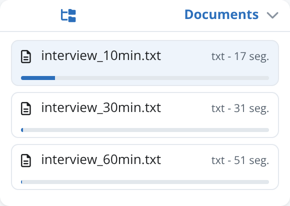
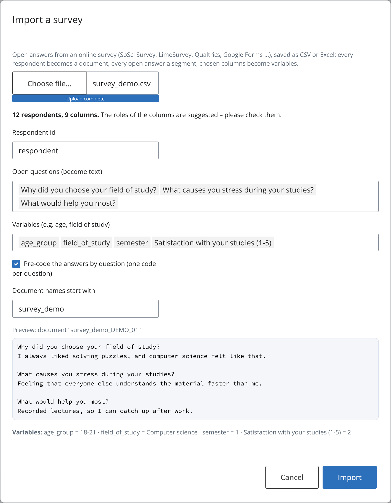
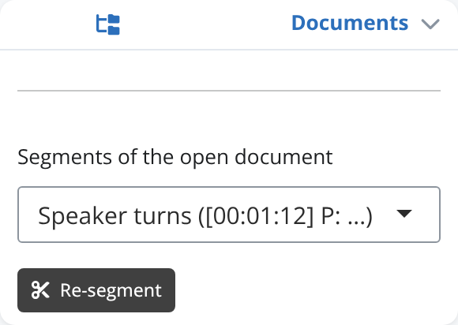

> 🌐 **English** · [Deutsch](de/Dokumente-importieren.md)

# Importing documents



## Supported formats

| Format | Note |
|---|---|
| `.txt`, `.md` | the encoding (UTF-8, Latin-1, …) is detected automatically |
| `.docx` | Word documents; the text is taken over |
| `.pdf` | only PDFs with a text layer. Scanned PDFs without text produce a warning; use OCR first |

## How to

1. Choose **Segments on import**: blank lines (paragraphs), speaker turns or
   every line. More under [Segments](Segments.md). This can be changed at any
   time later.
2. Click **Files…** or **drop files on the panel**.
3. Click **Import**.

As an R script:

```r
qda_import(c("interview_01.docx", "interview_02.txt"), segments = "speaker")
```

## What happens on import

- The text is **frozen**: read once, converted to UTF-8 and stored in the
  project file. It is never read again. That is why codings never drift, even
  if you change the original file later.
- The **original file** is copied unchanged into the folder `originals/` next
  to the project file.
- Importing the same file a second time is detected and skipped.

## Survey: open answers from an online survey

*New in version 0.9.3.* Open answers from SoSci Survey, LimeSurvey,
Qualtrics, Google Forms … saved as **CSV** or **Excel**: **Documents panel →
Import a survey …**

1. Choose the file. jellyqda suggests the role of every column: the
   **respondent id**, the **open questions** (become text) and **variables**
   (few different values, e.g. age group, field of study). Time stamps and
   similar columns are left out. Check and change the suggestion if needed.
2. **Pre-code the answers by question** (on by default): every answer gets a
   code for its question, all below one code "Questions".
3. The **preview** shows how the first document will look; then **Import**.

Every respondent becomes **one document** (e.g. `survey_DEMO_07`), every open
answer **one segment** (the question as the first line, the answer below), the
chosen columns become **document variables**. Empty answers are left out;
respondents without any answer are skipped; importing the same file again
imports nobody twice. The survey file is kept in `originals/`.



Then everything works as with interviews: code the answers, compare groups
with the case comparison, or ask **Query** for "answers to question 2 that
mention workload, only from nursing students".

In R: `qda_survey_columns("survey.csv")` and
`qda_import_survey("survey.csv", code_questions = TRUE)`. Excel files need the
package `readxl` (`install.packages("readxl")`); CSV works always. A fictional
example: `system.file("extdata", "survey_demo.csv", package = "jellyqda")`.

## Variables (case attributes)

You can give every document attributes such as *age*, *role* or *duration*.
At the bottom of the documents panel: choose the document, enter variable and
value, **Set variable**.



The variables appear as chips above the text. In the codings list you can
filter with **"Only documents with variable"**, e.g. `role=project lead`.
They are also the basis of the [case comparison](Analysis.md#case-comparison).

```r
qda_source_set_var("interview_01.docx", "age", "34")
qda_source_vars(1)
qda_source_del_var(1, "age")
```
