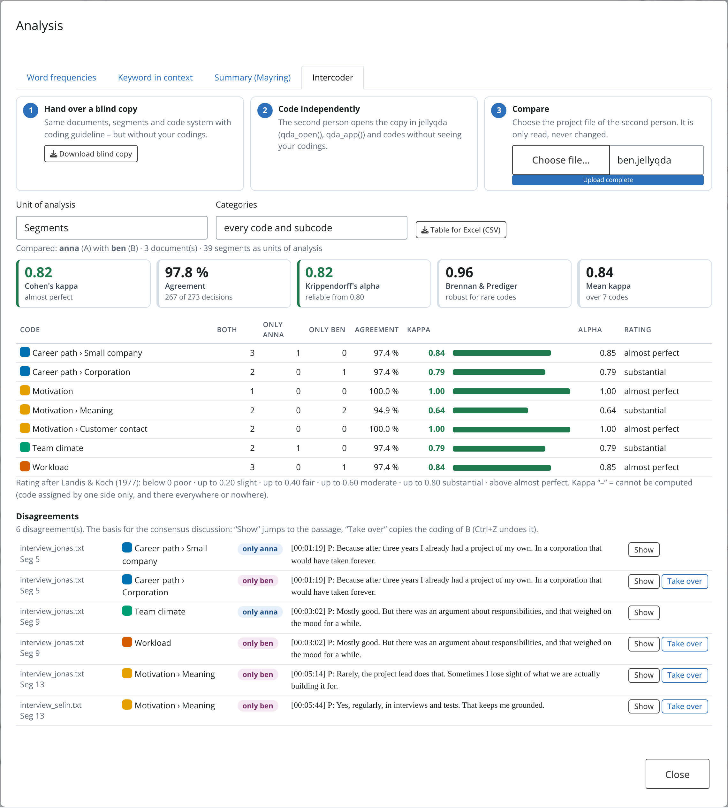
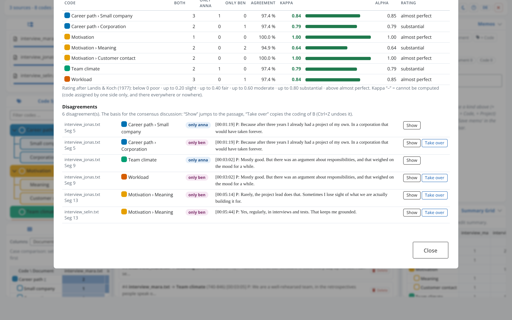
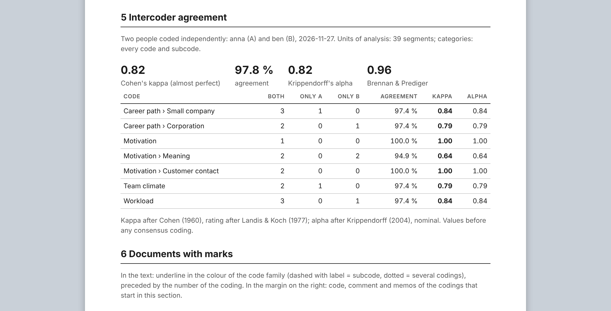

> 🌐 **English** · [Deutsch](de/Intercoder-Uebereinstimmung.md)

# Intercoder agreement (kappa)

*New in version 0.8.0.*

Do two people code the same material in the same way? The **intercoder
agreement** answers this question and is a standard quality criterion of
qualitative content analysis (e.g. Mayring, Kuckartz). jellyqda computes it
directly from two project files: everything stays offline, nobody needs a
server or an account.



## The idea

Every person codes in **their own project file**. You (person A) give the
second person (B) a **blind copy**: the same documents, segments and code
system with the coding guideline, but **without your codings**. B codes
independently. Then you load B's file into your project and jellyqda compares
the two. B's file is **only read, never changed**.

## Step by step

**In the app:** toolbar **Analysis** → tab **Intercoder**.

1. **Hand over a blind copy.** Click **Download blind copy** and save the file,
   e.g. as `ben.jellyqda`. Pass it on (USB stick, encrypted mail …).
   *Tip:* make the copy once the code system and the coding guideline are
   ready, and **before** you code, or at least do not discuss your codings.
2. **Code independently.** B installs jellyqda and opens the copy:
   ```r
   library(jellyqda)
   qda_open("ben.jellyqda")
   qda_app()
   ```
   B codes as usual. The coding guideline (book icon on a code) shows
   definitions, anchor examples and coding rules.
3. **Compare.** Back in your project: **Analysis → Intercoder → Choose
   file…** and select B's file. jellyqda shows at once:
   - five cards: **Cohen's kappa** with its rating, **percent agreement**,
     **Krippendorff's alpha**, **Brennan & Prediger** and the **mean kappa**
     over all codes,
   - a table **per code**: how often both, only A or only B coded, agreement,
     kappa (with a bar: green from 0.61, amber 0.41–0.60, red below), alpha
     and rating,
   - the list of **disagreements**.
4. **Consensus.** Discuss the disagreements together:
   - **Show** jumps to the passage in the document browser.
   - **Take over** copies B's coding into your project (it can be undone
     with **Ctrl+Z**, like everything else).
   - Codings only you made: click them in the text and delete or re-code
     them if you agree on that.



**Table for Excel (CSV)** downloads the table per code.

## Settings

| Setting | Meaning |
|---|---|
| **Unit of analysis: segments** (default) | Every segment (e.g. every speaker turn) is one decision per code: coded or not. A segment counts as coded as soon as a coding of this code touches it, so the two people do **not** have to mark exactly the same words. |
| **Unit of analysis: documents** | Did both use the code somewhere in the document? Coarse; useful for many short documents. |
| **Categories: every code and subcode** (default) | Strict: "Career path › SME" and "Career path › corporation" are different categories. |
| **Categories: code families** | A code together with its subcodes. Shows whether the main categories agree, even if the subcodes differ. |

*Tip:* if you compare by segments, segment the documents **before** making the
blind copy, e.g. by speaker turns ([Segments](Segments.md)). Both projects
then share the same units.

## Which value should I report?

| Measure | What it says | Note |
|---|---|---|
| **Percent agreement** | share of identical decisions | easy to understand, but too optimistic: segments that nobody coded (e.g. interviewer questions) always count as agreement |
| **Cohen's kappa** | agreement **corrected for chance** | the most common value; rating after Landis & Koch (1977): up to 0.20 slight, up to 0.40 fair, up to 0.60 moderate, up to 0.80 substantial, above almost perfect |
| **Krippendorff's alpha** | chance-corrected, common in content analysis | 0.80 or more is usually considered reliable, 0.667–0.80 allows tentative conclusions |
| **Brennan & Prediger** | chance agreement fixed at 50 % | stable for **rare codes**, where Cohen's kappa is low despite high agreement |
| **Mean kappa** | mean of the kappas of all codes | every code counts equally, regardless of how often it was used |

"–" means the value **cannot be computed**, e.g. if a code was used by
neither or by both everywhere in the compared units.

A sentence for the methods section might read: *"To check the reliability of
the category system, a second person coded all three interviews independently
on the basis of the coding guideline (unit of analysis: speaker turns,
n = 39). Cohen's kappa was κ = .82 overall (Krippendorff's α = .82); the
weakest category was 'Motivation › Meaning' with κ = .64. Disagreements were
resolved by consensus."*

## Audit trail and report

- Every comparison is written to the **audit trail** with its values
  (`qda_export("audit")`). **Take over** is recorded as a normal coding action.
- The **report** gets a section **Intercoder agreement** with the values of
  the **last independent comparison**. The numbers shown after **Take over**
  (consensus) are not recorded on purpose: what you report is the agreement
  *before* the consensus.



## As an R script

```r
library(jellyqda)
qda_open("anna.jellyqda")
qda_intercoder_copy("ben.jellyqda")          # 1. blind copy for the second person

# ... ben codes ben.jellyqda ...

res <- qda_intercoder("ben.jellyqda")        # 3. compare
res                                          # first row = all codes, then one row per code
qda_intercoder("ben.jellyqda", level = "top", unit = "document")
d <- qda_intercoder_diff("ben.jellyqda")     # disagreements
d[, c("source", "segment", "code", "coder", "text")]
qda_intercoder_adopt("ben.jellyqda",         # 4. consensus: take over ben's coding
                     d$source_id[1], d$start[1], d$end[1], d$code[1])
```

A complete example with three fictional interviews and two coders:
[`demo/jellyqda-intercoder-demo.R`](../../demo/jellyqda-intercoder-demo.R).

## Good to know

- Documents are matched by their **text**, not by their name: renaming in
  B's project does not matter. Documents with different text (e.g. imported
  again) are not compared and are listed.
- Codes are matched by their **path** ("Career path / SME"). Codes that only B
  created are listed separately; to take over such codings, first create the
  code in your project.
- The comparison is between **two** people. With three or more coders,
  compare pairwise (A–B, A–C, B–C).

---
[Back to the wiki home page](Home.md) · Previous: [Analysis](Analysis.md) · Next: [Graphics](Graphics.md)
