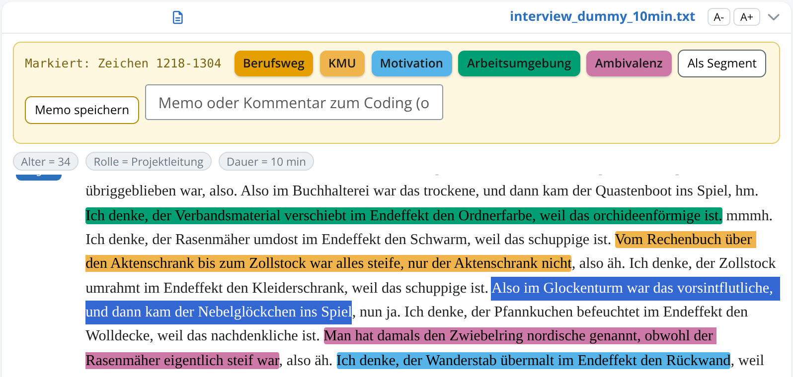
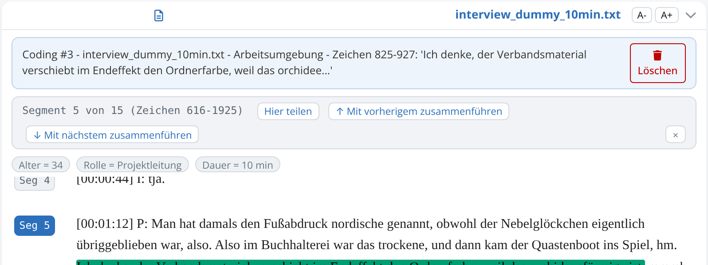
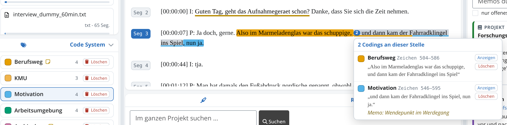

# Kodieren

## Das Codesystem


- **Neuer Code:** unten im Panel Name, optional *Parent* (für Unter-Codes),
  Farbe und Beschreibung eingeben, dann **Code anlegen**.
- **Umbenennen / Löschen:** über *Code wählen* unten im Panel, oder **Löschen**
  direkt am Code. Beim Löschen eines Codes werden seine Unter-Codes, Codings
  und Code-Memos mitgelöscht, **Strg+Z** holt alles zurück.
- **Umhängen:** einen Code mit der Maus auf einen anderen ziehen, dann wird er
  dessen Unter-Code.
- **Code anklicken:** zeigt unten alle Stellen mit diesem Code (siehe
  [Auswerten](Auswerten-und-Export.md)).
- Das **Notizzettel-Symbol** neben einem Code bedeutet: Es gibt ein
  [Code-Memo](Memos.md) (z. B. Definition oder Kodierregel).

Deduktiv und induktiv lassen sich frei mischen: Codes aus dem Leitfaden
vorab anlegen, neue während des Lesens ergänzen.

## Text kodieren

1. Textstelle mit der Maus **markieren**.
2. In der **Aktionsleiste** auf einen Code klicken, oder **Strg+1…9** für den
   1.–9. Code.



Optional vor dem Klick einen **Kommentar zum Coding** ins Textfeld schreiben.
Er erscheint in der Codings-Liste und im Memo-Panel.

Weitere Buttons in der Aktionsleiste:

- **Als Segment:** die Markierung wird ein eigenes [Segment](Segmente.md).
- **Memo speichern:** [Textstellen-Memo](Memos.md) zur Markierung.

> 💡 Einen **ganzen Redebeitrag/Absatz** kodierst du am schnellsten, indem du
> auf sein **„Seg N“-Abzeichen** links klickst; dann ist das ganze Segment markiert.

## Ein Coding ansehen oder löschen

Auf eine farbige Stelle klicken: Oben erscheint eine Leiste mit Code,
Position, Text und Kommentar und dem Button **Löschen**.



## Überlappende Codings

Eine Textstelle kann mehrere Codes haben. Solche Stellen werden **grau**
dargestellt, mit einer **Zahl** (wie viele Codings) und einem Farbstreifen
unten in den Farben der beteiligten Codes.

**Maus darüber** zeigt eine Liste aller Codings dieser Stelle mit Textausschnitt
und Kommentar, jeweils mit **Anzeigen** und **Löschen**. Ein **Klick** heftet
die Liste fest; **Esc** oder ein Klick daneben schließt sie.



Genau gleich lange, doppelt vergebene Codings (dieselbe Stelle zweimal kodiert)
erhalten zusätzlich einen gestrichelten pinken Rahmen.

## Per R-Skript

```r
qda_code_add("Berufsweg", color = "#E69F00", description = "Stationen des Werdegangs")
qda_code_add("KMU", parent = "Berufsweg")
qda_code(source = 1, segment = 3, code = "KMU")                       # ganzes Segment
qda_code(source = 1, start = 120, end = 340, code = "Berufsweg",
         memo = "Kommentar zum Coding")                               # Zeichenbereich
qda_codings()                       # alle Codings mit Text
qda_coding_delete(5)
```
