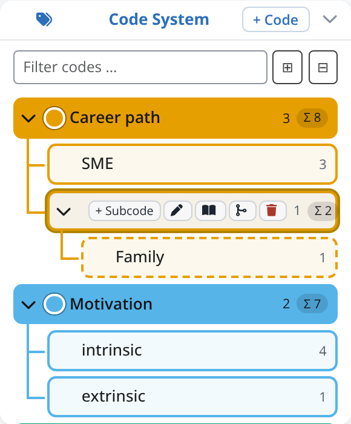

# Kodieren

## Das Codesystem



Das Codesystem ist ein **Baum**: Codes auf oberster Ebene, darunter Subcodes
(bis zu drei Ebenen). Ein Code ist **voll gefärbt**; seine Subcodes tragen nur
einen **Rahmen in derselben Farbe** und hängen an einer Linie in dieser Farbe,
dem „Faden“. So erkennt man auf einen Blick, was zu welcher Code-Familie gehört.

- **Neuer Code:** oben im Panel **„+ Code“**, Namen tippen, **Enter**.
- **Neuer Subcode:** mit der Maus über den Code fahren, **„+ Subcode“**,
  Namen tippen, **Enter**. Subcodes übernehmen die Farbe ihres Codes.
- **Ein-/ausklappen:** Pfeil vor dem Code; ⊞ / ⊟ oben klappt alle aus bzw.
  ein. Der Zustand bleibt nach einem Neustart erhalten. Das Feld **„Codes
  filtern …“** zeigt nur passende Codes (mit ihren übergeordneten Codes).
- **Umbenennen:** **Doppelklick** auf den Namen (oder Stift-Symbol bzw. **F2**),
  neuen Namen tippen, **Enter** (Esc bricht ab).

  

- **Löschen:** Papierkorb an der Zeile. Eine Rückfrage nennt, was mitgelöscht
  wird (Subcodes, Codings); Code-Memos und Summaries verschwinden ebenfalls.
  **Strg+Z** oder „Rückgängig“ im Hinweis holt alles zurück.

  

- **Farbe:** der Farbpunkt am Code ändert die Farbe der ganzen Code-Familie.
- **Umhängen:** einen Code mit der Maus auf einen anderen ziehen, dann wird er
  dessen Subcode. Ganz nach unten auf **„Hierher ziehen = Code auf oberster
  Ebene“** gezogen, wird ein Subcode wieder ein eigenständiger Code.
- **Zahlen:** die Zahl ist die Anzahl eigener Codings, **Σ** zählt alle
  Subcodes mit.
- **Code anklicken:** zeigt unten alle Stellen mit diesem Code und seinen
  Subcodes (siehe [Auswerten](Auswerten-und-Export.md)).
- Das **Notizzettel-Symbol** neben einem Code bedeutet: Es gibt ein
  [Code-Memo](Memos.md) (z. B. Definition oder Kodierregel).

Deduktiv und induktiv lassen sich frei mischen: Codes aus dem Leitfaden
vorab anlegen, neue während des Lesens ergänzen.

## Text kodieren

1. Textstelle mit der Maus **markieren**. Die gelbe **Kodier-Leiste** erscheint.
2. Auf einen **Code** klicken:
   - Code **ohne** Subcodes: wird sofort vergeben.
   - Code **mit** Subcodes (erkennbar an „2▾“): die Subcodes klappen in einer
     zweiten Zeile am farbigen Faden aus. Dort einen **Subcode** wählen oder
     **„(nur Code)“**, um den Code selbst zu vergeben.


Weitere Wege:

- **Tastatur:** **Strg+1…9** wählt den 1.–9. Code; sind Subcodes ausgeklappt,
  vergibt **1…9** den Subcode und **0** den Code selbst. **Esc** klappt zu.
- **Suchfeld:** Teil eines Namens tippen (z. B. „fam“ findet
  „Berufsweg › Wechselmotiv › Familie“), **Enter** vergibt den ersten Treffer.
  Gibt es keinen Treffer, legt **Enter** den Namen als neuen Code an und vergibt
  ihn, praktisch beim induktiven Kodieren.
- **Codebaum:** Solange Text markiert ist, kodiert auch ein Klick auf einen
  Code im Baum (der Rahmen wird beim Überfahren gelb).
- **Zuletzt:** die zuletzt vergebenen Codes stehen unten in der Leiste.
- **In vivo:** der markierte Text selbst wird zum Code (siehe [Analysieren](Analysieren.md)).

Beim Überfahren eines Codes zeigt die Leiste seine **Definition**: die
Beschreibung oder das neueste [Code-Memo](Memos.md). So bleibt die
Kodierregel beim Kodieren im Blick.

Optional vor dem Klick einen **Kommentar zum Coding** ins Textfeld schreiben.
Er erscheint in der Codings-Liste und im Memo-Panel.

Weitere Buttons in der Kodier-Leiste:

- **Als Segment:** die Markierung wird ein eigenes [Segment](Segmente.md).
- **Memo speichern:** [Textstellen-Memo](Memos.md) zur Markierung.

> 💡 Einen **ganzen Redebeitrag/Absatz** kodierst du am schnellsten, indem du
> auf sein **„Seg N“-Abzeichen** links klickst; dann ist das ganze Segment markiert.

**Darstellung im Text:** Codings mit einem Code haben die volle Farbe.
Codings mit einem Subcode sind hell in der Farbe der Code-Familie getönt,
unterstrichen und tragen am Anfang ein kleines Etikett mit dem Namen des
Subcodes.

## Ein Coding ansehen, umkodieren oder löschen

Auf eine farbige Stelle klicken: Oben erscheint eine Leiste mit Code,
Position, Text und Kommentar. Darunter stehen alle Codes **derselben Familie**:
ein Klick **kodiert die Stelle um** (z. B. von „Berufsweg“ auf den Subcode
„KMU“), Kommentar und Position bleiben erhalten.

Außerdem in der Leiste:

- **Kommentar:** hinzufügen oder ändern, **Enter** speichert.
- **Mayring: Paraphrase und Generalisierung** (aufklappen), siehe
  [Analysieren](Analysieren.md#zusammenfassung-nach-mayring).
- **Als Ankerbeispiel:** die Stelle in den Kodierleitfaden des Codes übernehmen.
- **Löschen** entfernt das Coding.


## Überlappende Codings

Eine Textstelle kann mehrere Codes haben. Solche Stellen werden **grau**
dargestellt, mit einer **Zahl** (wie viele Codings) und einem Farbstreifen
unten in den Farben der beteiligten Codes.

**Maus darüber** zeigt eine Liste aller Codings dieser Stelle mit Textausschnitt
und Kommentar, jeweils mit **Anzeigen** und **Löschen**. Ein **Klick** heftet
die Liste fest; **Esc** oder ein Klick daneben schließt sie.


Genau gleich lange, doppelt vergebene Codings (dieselbe Stelle zweimal kodiert)
erhalten zusätzlich einen gestrichelten pinken Rahmen.

## Per R-Skript

```r
qda_code_add("Berufsweg", color = "#E69F00", description = "Stationen des Werdegangs")
qda_code_add("KMU", parent = "Berufsweg")
qda_code(source = 1, segment = 3, code = "KMU")                       # ganzes Segment
qda_code(source = 1, start = 120, end = 340, code = "Berufsweg",
         memo = "Kommentar zum Coding")                               # Zeichenbereich
qda_codings()                       # alle Codings mit Text
qda_coding_recode(5, "KMU")         # Coding umkodieren
qda_code_set_color("Berufsweg", "#56B4E9")   # Farbe der Code-Familie
qda_coding_delete(5)
```
