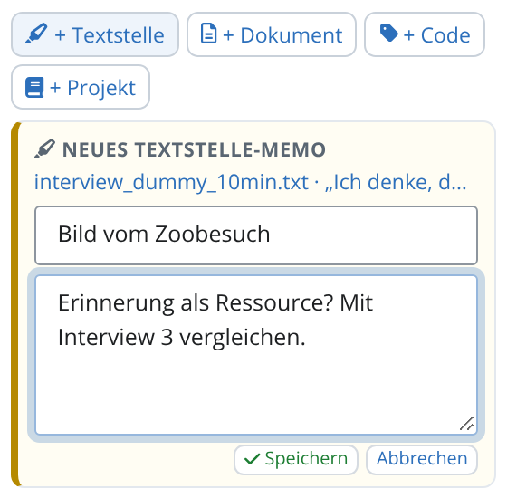

# Memos

Memos halten Gedanken fest: Interpretationen, Kodierregeln, Postskripte,
das Forschungstagebuch. jellyqda kennt **vier Arten** und zeigt zusätzlich die
**Kommentare an Codings**.

| Art | Bezug | Typischer Inhalt | Rand |
|---|---|---|---|
| **Textstelle** | eine markierte Passage (im Text unterstrichen) | Interpretationsidee zu genau dieser Stelle | gold |
| **Dokument** | ein Interview | Postskript, Gesprächssituation, Fallzusammenfassung | blau |
| **Code** | ein Code | Definition, Ankerbeispiel, Kodierregel | lila |
| **Projekt** | nichts | Forschungstagebuch, theoretische Ideen | grün |
| *Kommentar* | ein Coding | kurze Notiz beim Kodieren | grau |


## Memo anlegen

Oben im Memo-Panel gibt es einen Button pro Art. Er ist nur aktiv, wenn es den
passenden Bezug gibt:

| Button | Voraussetzung |
|---|---|
| **+ Textstelle** | Text im Dokument markiert |
| **+ Dokument** | ein Dokument ist geöffnet |
| **+ Code** | ein Code im Codesystem ist angeklickt |
| **+ Projekt** | immer |

Titel (optional) und Text eingeben, **Speichern** oder **Strg+Enter**.



**Schnellweg für Textstellen:** Text markieren, in der Aktionsleiste etwas ins
Textfeld schreiben und **Memo speichern** (oder **Strg+M**). Ohne Text öffnet
Strg+M das Formular im Memo-Panel.

## Memos im Text

Textstellen-Memos sind im Dokument **gold unterstrichen**. Ein Klick darauf
zeigt das Memo im Panel.


## Finden und ordnen

- **Filter** nach Art: *Alle, Textstelle, Dokument, Code, Projekt, Kommentare*
  (mit Anzahl).
- **Suche** in Titel, Text und Bezug.
- **nur offenes Dokument:** zeigt nur Memos und Kommentare zum geöffneten
  Dokument, in Textreihenfolge.
- **Bezug anklicken** (blaue Zeile in der Karte) springt zur Textstelle, öffnet
  das Dokument oder wählt den Code.
- Notizzettel-Symbole in **Dokumentenliste** und **Codesystem** zeigen, wo es
  Dokument- bzw. Code-Memos gibt; ein Klick darauf zeigt sie an.

## Bearbeiten und löschen

**Bearbeiten** öffnet Titel und Text direkt in der Karte. **Löschen** entfernt das
Memo; bei Kommentaren heißt der Button **Entfernen** (das Coding bleibt).
Alles mit **Strg+Z** rückgängig zu machen.

## Per R-Skript

```r
qda_memo_add("Forschungstagebuch: erster Eindruck")                     # Projekt
qda_memo_add("Ruhige Atmosphäre", source = 1, title = "Postskript")     # Dokument
qda_memo_add("Nur explizite Aussagen", code = "KMU", title = "Regel")   # Code
qda_memo_add("Metapher?", source = 1, start = 512, end = 543)           # Textstelle
qda_memos(kind = "code")                                                # filtern
qda_memo_update(3, title = "Kodierregel")
qda_coding_set_memo(5, "Kommentar")                                     # Kommentar an Coding
```

> Projekte aus älteren jellyqda-Versionen (Memo-Markierungen über einen Code
> namens „Memo“) werden beim ersten Öffnen automatisch in Textstellen-Memos
> umgewandelt.
