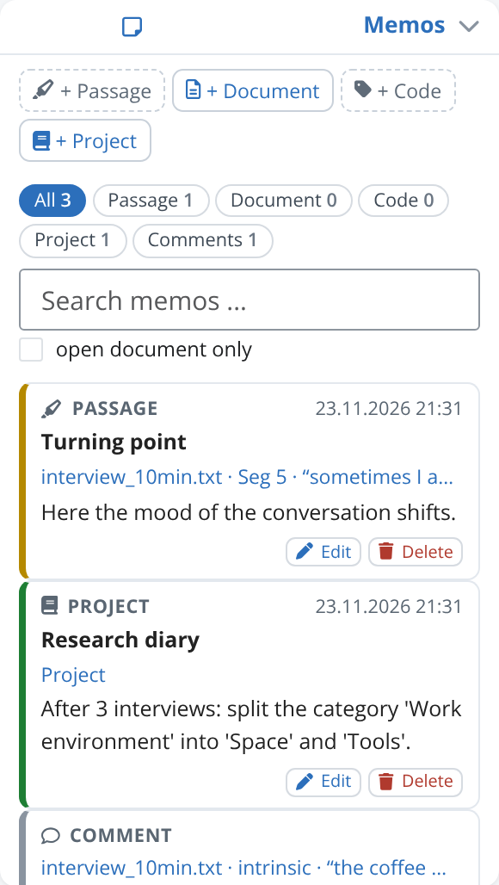
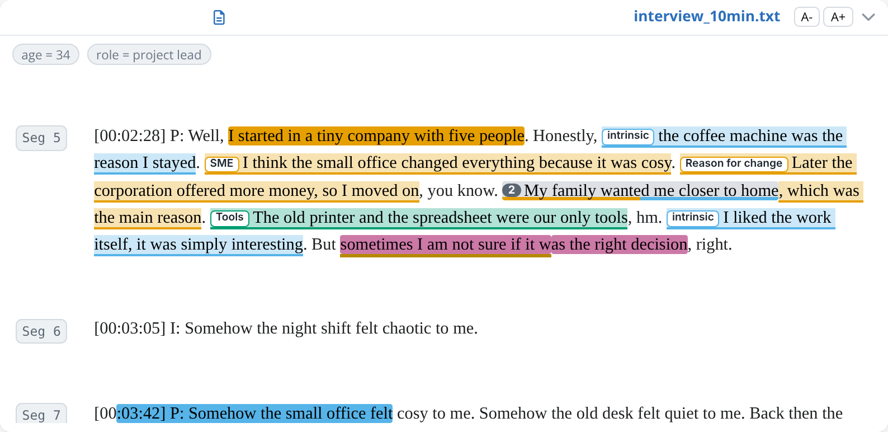

> 🌐 **English** · [Deutsch](de/Memos.md)

# Memos

Memos capture thoughts: interpretations, coding rules, postscripts, the
research diary. jellyqda knows **four kinds** and also shows the **comments
on codings**.

| Kind | Reference | Typical content | Border |
|---|---|---|---|
| **Passage** | a marked passage (underlined in the text) | an interpretation idea for exactly this place | gold |
| **Document** | an interview | postscript, interview situation, case summary | blue |
| **Code** | a code | definition, anchor example, coding rule | purple |
| **Project** | nothing | research diary, theoretical ideas | green |
| *Comment* | a coding | a short note while coding | grey |



## Creating a memo

At the top of the memo panel there is one button per kind. It is only active
when the matching reference exists:

| Button | Requires |
|---|---|
| **+ Passage** | text marked in the document |
| **+ Document** | a document is open |
| **+ Code** | a code in the code system is clicked |
| **+ Project** | always |

Enter a title (optional) and text, **Save** or **Ctrl+Enter**.


## Comment on a coding

A comment belongs directly to a coding (a short note while coding):

- **While coding:** mark text, write into the field *"Memo or comment on the
  coding"* in the coding bar, **then** click the code.
- **Later:** click the coded passage, write into the **Comment** field in
  the coding bar, **Enter** or **Save**.

Comments appear in the memo panel under "Comments", in the codings list and
in the report in the margin next to the interview.

**Shortcut for passages:** mark text, write something into the text field of
the coding bar and click **Save memo** (or **Ctrl+M**). Without text, Ctrl+M
opens the form in the memo panel.

## Memos in the text

Passage memos are **underlined in gold** in the document. A click on them
shows the memo in the panel.



## Finding and organising

- **Filter** by kind: *All, Passage, Document, Code, Project, Comments*
  (with counts).
- **Search** in title, text and reference.
- **open document only:** shows only memos and comments of the open
  document, in text order.
- **Click the reference** (blue line in the card) to jump to the passage,
  open the document or select the code.
- Sticky note icons in the **document list** and the **code system** show
  where document or code memos exist; a click shows them.

## Editing and deleting

**Edit** opens title and text directly in the card. **Delete** removes the
memo; for comments the button is called **Remove** (the coding stays).
Everything can be undone with **Ctrl+Z**.

## As an R script

```r
qda_memo_add("Research diary: first impression")                         # project
qda_memo_add("Calm atmosphere", source = 1, title = "Postscript")        # document
qda_memo_add("Only explicit statements", code = "SME", title = "Rule")   # code
qda_memo_add("Metaphor?", source = 1, start = 512, end = 543)            # passage
qda_memos(kind = "code")                                                 # filter
qda_memo_update(3, title = "Coding rule")
qda_coding_set_memo(5, "Comment")                                        # comment on a coding
```

> Projects from older jellyqda versions (memo marks via a code called
> "Memo") are converted to passage memos automatically when first opened.
