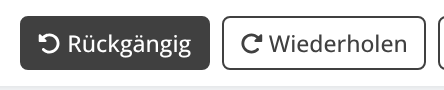
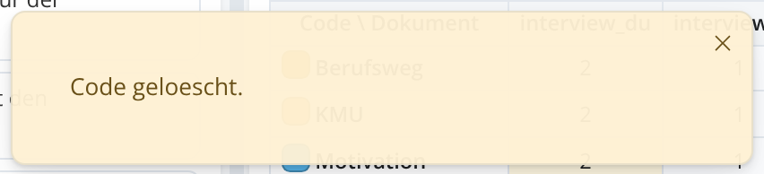

# Rückgängig & Datensicherheit

## Rückgängig und Wiederholen

**Strg+Z** macht die letzte Aktion rückgängig, **Strg+Y** (oder Strg+Umschalt+Z)
wiederholt sie. Dasselbe geht mit den Buttons oben.



Der **Tooltip** der Buttons zeigt, was passieren würde, z. B. *„Rückgängig:
Code geloescht: 'Ambivalenz' (mit 0 Unter-Codes und 4 Codings)“*. Nach jedem
Schritt bestätigt eine Meldung, was rückgängig gemacht wurde:



Rückgängig machen lässt sich **alles, was Inhalte ändert:** Codings, Kommentare,
Memos, Codes (anlegen, umbenennen, verschieben, **löschen** samt Unter-Codes,
Codings und Memos), Variablen, Summaries und Segmente. Der Verlauf bleibt auch
nach einem Neustart erhalten. Wie in jedem Editor: Nach einer neuen Aktion
ist „Wiederholen“ leer.

In Textfeldern gilt Strg+Z wie gewohnt nur für den Text im Feld.

```r
qda_undo(); qda_redo()
qda_history()      # was würde als Nächstes rückgängig gemacht / wiederholt?
```

## Speichern

Es gibt keinen Speichern-Button: **Jede Aktion wird sofort** in die
Projektdatei geschrieben. Oben steht, wann zuletzt gespeichert wurde.

## Backups

- Button **Backup** oder `qda_backup()`: ZIP mit Projektdatei und `originals/`.
- **Automatisch** nach je 25 Aktionen (einstellbar: `qda_open(..., auto_snapshot = 50)`).
- Beim Beenden über das rote **X** wird ebenfalls ein Backup angelegt.
- Ablage: `jellyqda-backups/` **außerhalb** des Projektordners (falls dort
  nicht beschreibbar: im Projektordner). Die letzten 10 bleiben erhalten.

Wiederherstellen: ZIP entpacken und die `.jellyqda`-Datei mit `qda_open()` öffnen.

## Protokoll (Audit-Trail)

Jede Aktion steht mit Zeitstempel in der Projektdatei: Import, neue Codes,
Codings, Memos, Rückgängig … Für den Methodenteil deiner Arbeit:

```r
qda_events()             # in R ansehen
qda_export("audit")      # als CSV exportieren
```

## Datenschutz

- jellyqda baut **keine Internetverbindung** auf. Die App läuft nur auf deinem
  eigenen Rechner (`127.0.0.1`), auch wenn sie im Browser angezeigt wird.
  Das wird in den automatischen Tests geprüft.
- Alle Daten liegen in **deiner** Projektdatei; nichts wird hochgeladen.
- Interviewdaten **nicht in Git** einchecken: Die `.gitignore` des Projekts
  schließt `*.jellyqda`, `originals/`, `exports/` und Backups aus.
