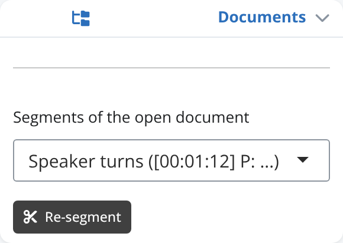
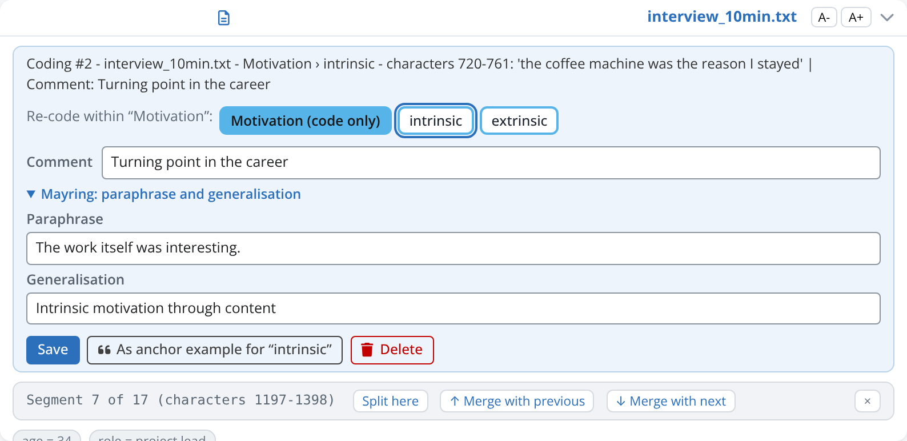

> 🌐 **English** · [Deutsch](de/Segmente.md)

# Segments

Segments are the units of a document, shown as **"Seg N"** on the left of the
text. They help with orientation and with quickly coding whole speaker turns
(a click on "Seg N" marks the whole segment).

> **Important:** codings and memos store the exact character position, not
> the segment number. Changing segments **never** changes your codings.

## Three rules

| Rule | A new segment starts … | Good for |
|---|---|---|
| **Blank lines (paragraphs)** | after every blank line | texts with paragraphs, field notes |
| **Speaker turns** | at every line like `[00:01:12] P: …`, `I: …`, `Interviewee: …` | interview transcripts |
| **Every line** | in every non-empty line | lists, line-by-line transcripts |

For **speaker turns**: if a transcript contains **time stamps**, only lines
with a time stamp count; a header like "Project: …, pseudonym: …" thus stays
one segment. Without time stamps, speaker names (one word before the colon)
are recognised. Lines without a speaker, e.g. "(inaudible)", belong to the
previous turn.

## Choosing the rule

- **On import:** *Segments on import* in the documents panel.
- **Later** for the open document: choose the rule at the bottom of the
  documents panel and click **Re-segment**.



## Editing segments by hand

**Split or merge:** **click** into the text at the desired place (without
marking). The segment bar appears:



- **Split here:** a new segment starts at the cursor position.
- **↑ Merge with previous** / **↓ Merge with next**
- **×** closes the bar.

**Define a segment of your own:** mark text, then **As segment** in the coding
bar. Adjacent segments are shortened accordingly.

All changes can be undone with **Ctrl+Z**.

## As an R script

```r
qda_segments_set("interview_01.txt", "speaker")          # re-segment
qda_segments_set(2, "speaker", pattern = "^(I|B[0-9]?):") # own pattern
qda_source_segments(1)                                    # look at segments
qda_segment_split(1, at = 512)                            # split
qda_segment_merge(1, 3)                                   # merge 3 + 4
qda_segment_define(1, start = 120, end = 340)             # own segment
qda_segments_reset(1)                                     # back to blank lines
```
