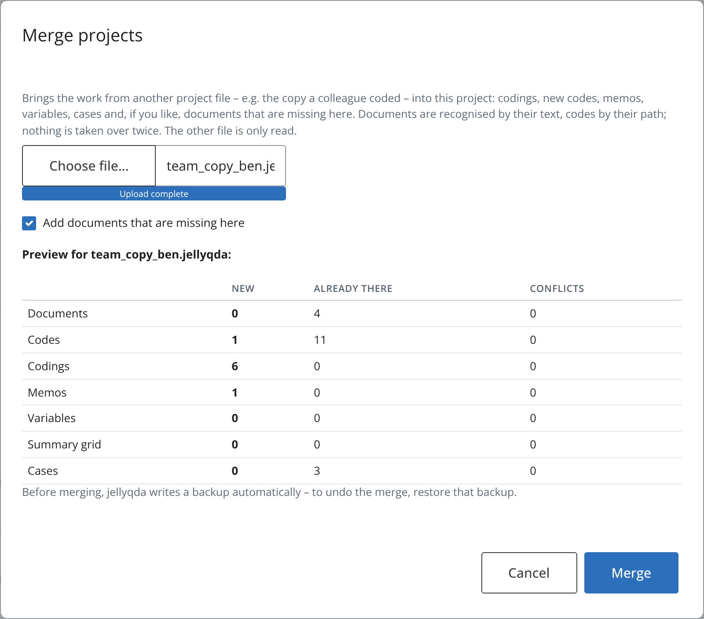

> 🌐 **English** · [Deutsch](de/Teamarbeit.md)

# Team work: merging projects

*New in version 0.10.0.*

jellyqda has no server – every person works in their **own project file**.
To analyse together, you split the work and bring it back together with
**Merge projects**.

## The workflow

1. **One person sets up the project**: imports the documents (or some of
   them), builds the code system and writes the coding guideline.
2. **Hand out copies.** Either simply copy the `.jellyqda` file, or use
   **Analysis → Intercoder → Download blind copy** – the same documents and
   code system, but without codings (see
   [Intercoder agreement](Intercoder-agreement.md)).
3. **Everyone codes their part** – e.g. interviews 1–10, 11–20, 21–30. Team
   members may also import and code their **own** interviews, add codes,
   write memos, set variables or create [cases](Cases.md).
4. **Merge**: in your project, **Export → Merge projects …**, choose the file
   of a team member. Repeat for every copy.



Before anything happens, the dialog shows a **preview**: how many documents,
codes, codings, memos, variables, summary-grid cells and cases are **new**,
**already there** or in **conflict**. Only **Merge** writes anything.

## What is taken over – and how

| Data | Recognised by | Rule |
|---|---|---|
| documents | their **text** (not the name) | documents only in the copy are added (can be switched off – then their codings are left out too) |
| codes | their **path** (`Team / Support`) | missing codes are created below the right parent; empty guideline fields (definition, anchor examples, coding rule) are filled in |
| codings | document + code + passage | added unless exactly the same coding exists |
| memos | kind, title, text, reference | added unless an identical memo exists |
| document and case variables | name | missing ones are added; a **different value is a conflict** – your project keeps its own |
| summary grid | code + document | filled in where your cell is empty; a different text is a conflict |
| cases | name | missing cases are created; documents, passages and variables as above |

Merging the same copy twice adds nothing the second time. The other file is
only **read**, never changed.

## Undoing a merge

Merging is a big step, so it is **not** undone with Ctrl+Z. Instead jellyqda
writes a **backup** of your project right before merging
([Undo & data safety](Undo-and-data-safety.md#backups)). To undo, restore
this backup.

## Tips

- Agree on the **code system before** handing out copies. New codes are fine,
  but if two people create "Support" and "support", you get two codes – tidy
  up afterwards with *merge codes*.
- Check agreement on a few interviews first with
  [intercoder agreement](Intercoder-agreement.md), then split the rest.
- Merge one copy at a time and look at the preview: many conflicts usually
  mean that variables were entered differently.

## In R

```r
qda_merge("anna.jellyqda", dry_run = TRUE)   # preview: what would be added?
qda_merge("anna.jellyqda")                   # merge (writes a backup first)
qda_merge("ben.jellyqda", add_documents = FALSE)
```
