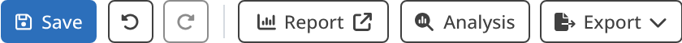
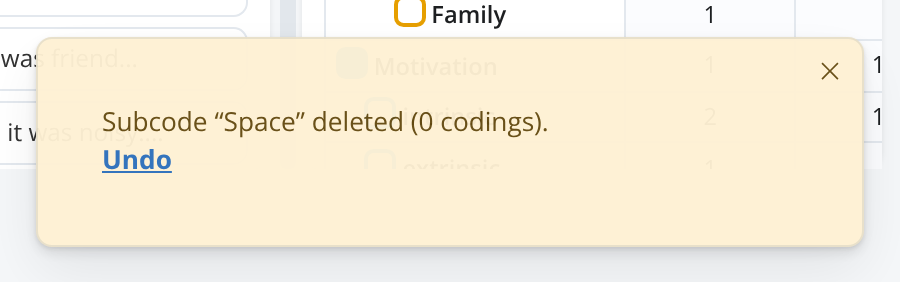

> 🌐 **English** · [Deutsch](de/Rueckgaengig-und-Datensicherheit.md)

# Undo & data safety

## Undo and redo

**Ctrl+Z** undoes the last action, **Ctrl+Y** (or Ctrl+Shift+Z) redoes it.
The buttons at the top do the same.



The **tooltip** of the buttons shows what would happen, e.g. *"Undo: Code
deleted: 'Ambivalence' (with 0 subcodes and 4 codings)"*. After deleting,
coding, renaming or re-coding, a notification with an **Undo** link appears:



**Everything that changes content** can be undone: codings, comments, memos,
codes (create, rename, move, merge, **delete** with subcodes, codings and
memos), variables, summaries, segments, coding guidelines, Mayring fields
and automatic coding (one step). The history survives a restart. As in every
editor: after a new action, "redo" is empty.

In text fields Ctrl+Z works as usual for the text in the field only.

```r
qda_undo(); qda_redo()
qda_history()      # what would be undone / redone next?
```

## Saving

**Every action is written to the project file immediately**; the top bar
shows "All saved · time". The **Save** button (Ctrl+S) additionally writes the
file to disk and creates a restore point (backup), e.g. before closing your
laptop.

## Backups

- **Save** button, **Export ▾ → Create backup** or `qda_backup()`: ZIP with the project file and `originals/`.
- **Automatically** after every 25 actions (adjustable: `qda_open(..., auto_snapshot = 50)`).
- Quitting with the red **X** also creates a backup.
- Location: `jellyqda-backups/` **outside** the project folder (if that is not
  writable: inside the project folder). The last 10 are kept.

To restore: unzip and open the `.jellyqda` file with `qda_open()`.

## Audit trail

Every action is stored with a time stamp in the project file: import, new
codes, codings, memos, undo … For the methods section of your thesis:

```r
qda_events()             # look at it in R
qda_export("audit")      # export as CSV
```

The descriptions are written in the language of the interface at the time
of the action.

## Privacy

- jellyqda makes **no internet connection**. The app only runs on your own
  computer (`127.0.0.1`), even though it is shown in the browser. This is
  checked by the automatic tests.
- All data stays in **your** project file; nothing is uploaded.
- Do **not** commit interview data to git: the project's `.gitignore`
  excludes `*.jellyqda`, `originals/`, `exports/` and backups.
