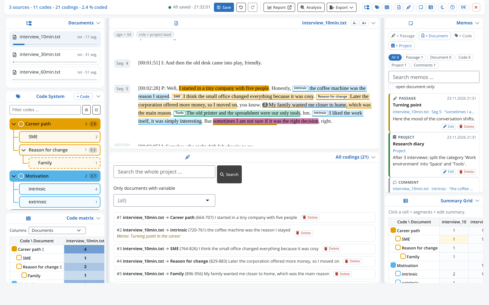
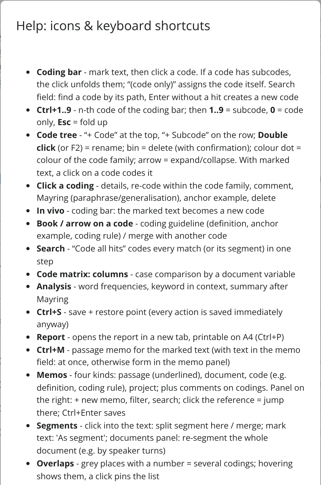
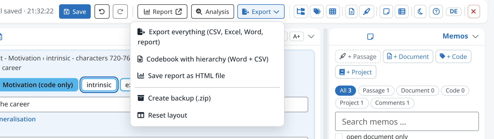
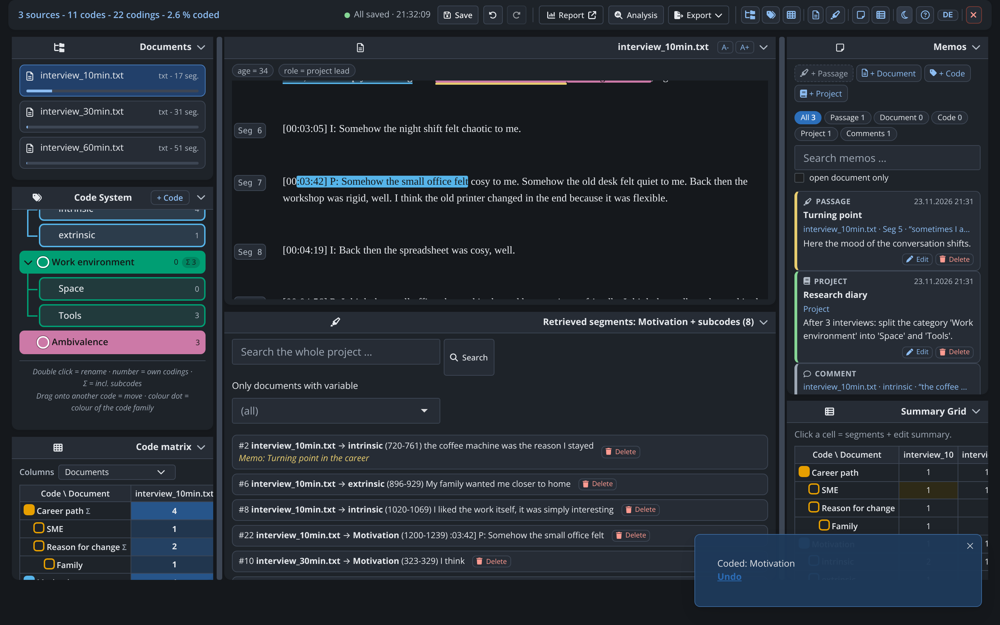

> 🌐 **English** · [Deutsch](de/Die-Oberflaeche.md)

# The user interface

## Layout

| Area | Content |
|---|---|
| **Top** | statistics (sources, codes, codings, % coded), "All saved · …", **Save**, undo, redo, **Report** (new tab), **Analysis**, **Export** menu and the toolbar |
| **Left** | **Documents** (list, import, variables, segments), **Code system**, **Code matrix** |
| **Middle top** | **Document browser**: the text with segments, codings and memos |
| **Middle bottom** | **Codings**: all passages of the selected code, project search, variable filter |
| **Right** | **Memos** and **Summary grid** |

## Toolbar (top right)

| Icon | Effect |
|---|---|
| folder, tags, grid | show/hide documents, code system, code matrix |
| document, highlighter | show/hide document browser, codings |
| sticky note, list | show/hide memos, summary grid |
| 🌙 moon | dark mode on/off |
| ? | help: all icons and keyboard shortcuts |
| **DE / EN** | switch the language (German/English); remembered by the browser |
| ✕ (red) | quit the app; an export and a backup are created first |

## Save, report, export

- **Save** (Ctrl+S): every action is saved immediately anyway; the button
  additionally writes the file to disk and creates a restore point (backup).
- **Report**: opens the report in a new browser tab, printable on A4.
- **Analysis**: word frequencies, keyword in context, Mayring table, see
  [Analysis](Analysis.md).
- **Export ▾**: export everything, codebook (Word + CSV), report as an HTML
  file, create a backup, reset the layout.

## Adjusting the layout

- **Move panels:** drag them by their header into another column. (Document
  browser and codings always stay in the middle.)
- **Column width:** drag the grey handles between the columns.
- **Show/hide:** arrow on the right of the header, or the toolbar.
- **Font size in the text:** **A-** / **A+** in the header of the document browser.
- **Export ▾ → Reset layout** restores the default arrangement.

The browser remembers layout, font size, dark mode, language and the last
opened document for the next start.

## Dark mode

All labels and buttons are easy to read in both modes; the contrasts meet the
WCAG recommendation (AA).

## Language

The interface is available in **English** and **German**. By default it
follows your system; switch it with **DE / EN** in the toolbar, with
`qda_app(lang = "en")` / `qda_app(lang = "de")`, or for the whole R session
with `qda_language("en")`. The report uses the same language. Your codes,
memos and texts are of course never translated.

## Progress

Below every document a bar shows the share of the text that is already
coded. At the top you see the value for the whole project. The small sticky
note icon next to a document means: there is a [document memo](Memos.md)
(a click shows it).
