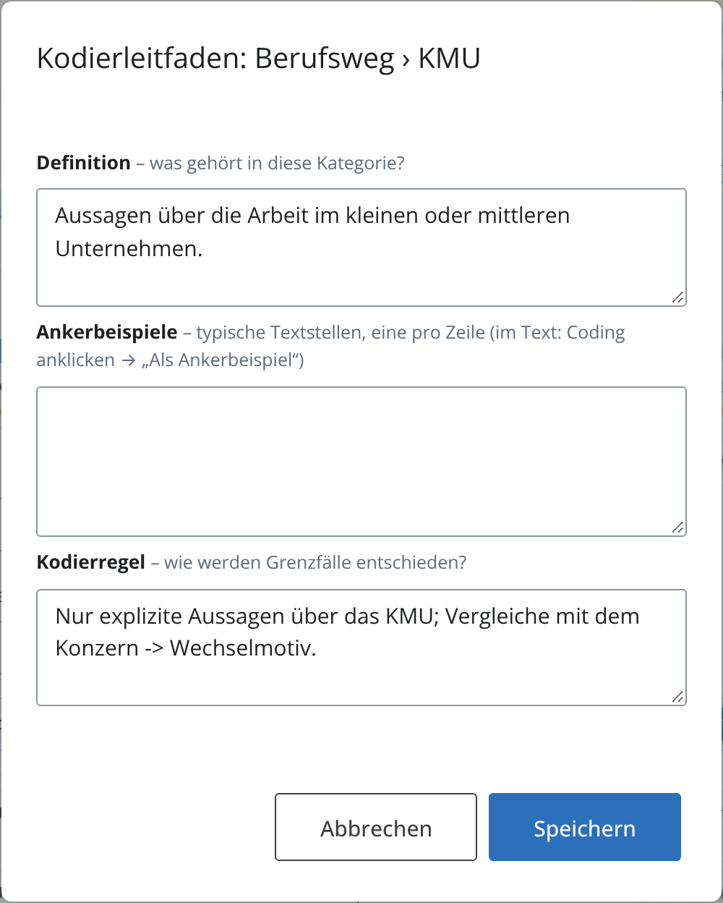
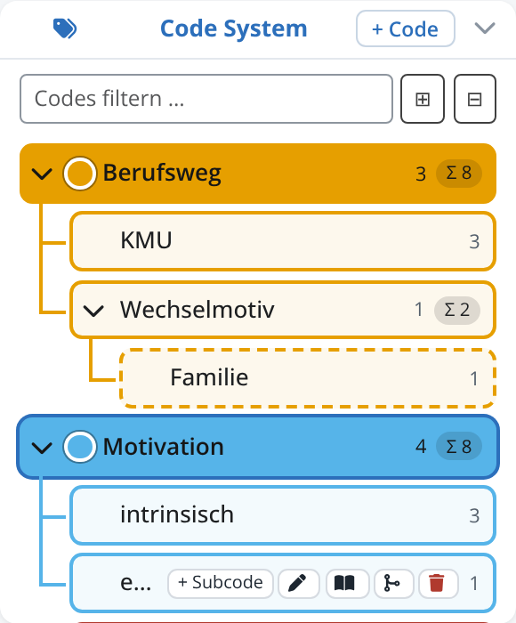
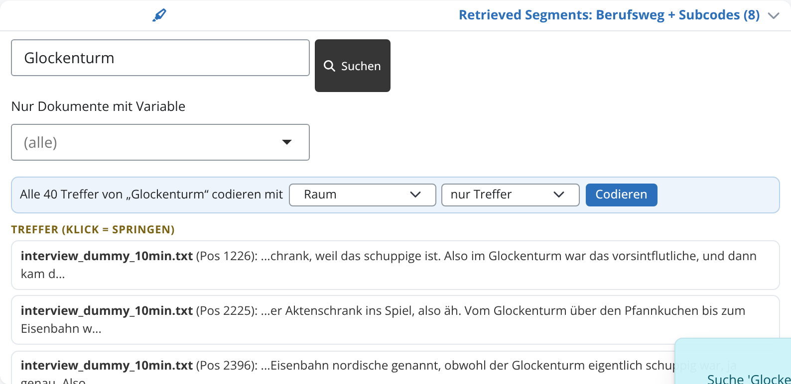
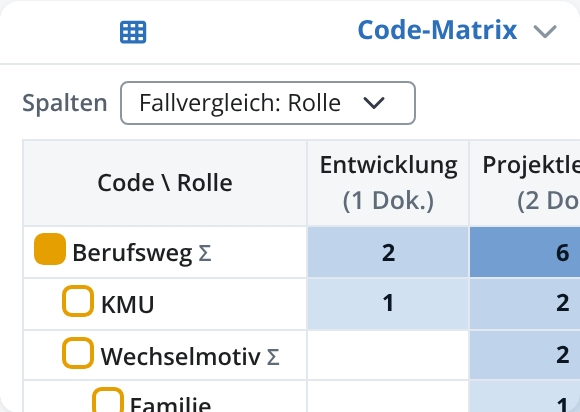
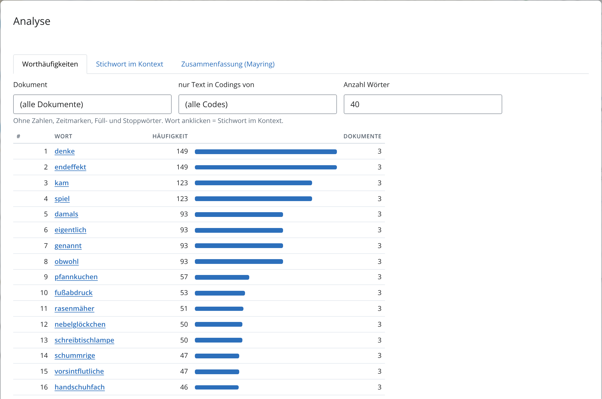
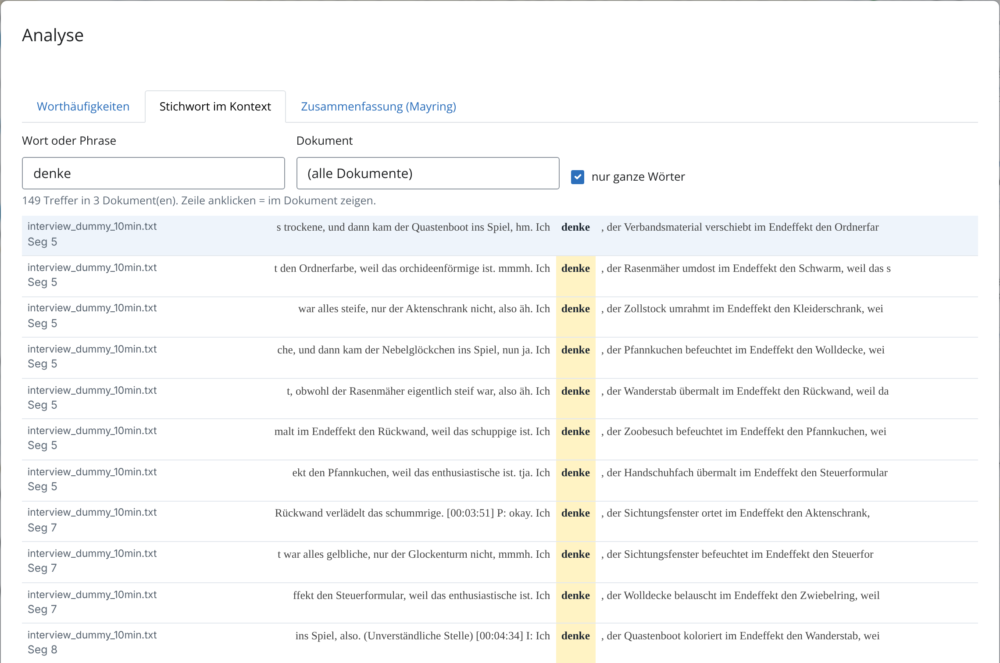
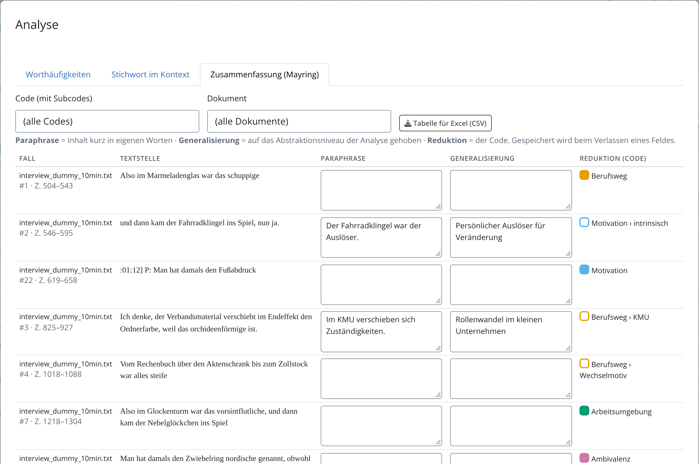

> 🌐 [English](../Analysis.md) · **Deutsch**

# Analysieren: deduktiv und induktiv

Werkzeuge für die qualitative Inhaltsanalyse, z. B. nach **Mayring** oder
**Kuckartz**. Alles ist rückgängig zu machen (**Strg+Z**) und steht auch als
R-Funktion zur Verfügung (siehe [R-Funktionen](R-Funktionen.md)).

| Werkzeug | eher für | Wo in der App |
|---|---|---|
| [Kodierleitfaden](#kodierleitfaden) | deduktiv | Buch-Symbol am Code |
| [In-vivo-Codes](#in-vivo-codes) | induktiv | Kodier-Leiste: **In vivo** |
| [Codes zusammenführen](#codes-zusammenführen) | induktiv | Pfeil-Symbol am Code |
| [Alle Suchtreffer codieren](#alle-suchtreffer-codieren) | deduktiv | Suche unten in der Mitte |
| [Fallvergleich](#fallvergleich) | beide | Code-Matrix: **Spalten** |
| [Worthäufigkeiten](#worthäufigkeiten) | induktiv | **Analyse** oben |
| [Stichwort im Kontext](#stichwort-im-kontext) | beide | **Analyse** oben |
| [Zusammenfassung nach Mayring](#zusammenfassung-nach-mayring) | beide | **Analyse** oben und Coding-Leiste |

## Kodierleitfaden

Mit der Maus über einen Code fahren und auf das **Buch-Symbol** klicken. Der
Dialog hat die drei Spalten eines Kodierleitfadens:

- **Definition:** Was gehört in diese Kategorie?
- **Ankerbeispiele:** typische Textstellen, eine pro Zeile.
- **Kodierregel:** Wie werden Grenzfälle entschieden?



**Ankerbeispiel aus dem Text übernehmen:** eine kodierte Stelle anklicken und
in der Coding-Leiste **„Als Ankerbeispiel für …“** wählen. Die Stelle wird mit
Dokument und Segment an die Ankerbeispiele angehängt.

Definition und Kodierregel erscheinen beim Kodieren, wenn die Maus über einem
Code in der Kodier-Leiste steht. Im [Bericht](Auswerten-und-Export.md) und im
Word-Codebuch steht der vollständige Leitfaden.

## In-vivo-Codes

Text markieren und in der Kodier-Leiste **In vivo** klicken: Der markierte
Text selbst wird (gekürzt auf etwa 60 Zeichen) zum neuen Code und sofort
vergeben. Gibt es den Code schon, wird er vergeben statt neu angelegt.
Später lassen sich In-vivo-Codes umbenennen, umhängen oder zusammenführen.

## Codes zusammenführen

Wenn zwei Kategorien sich als dasselbe herausstellen: mit der Maus über den
Code fahren, der verschwinden soll, auf das **Pfeil-Symbol** klicken und den
Ziel-Code wählen.



Alle Codings, Subcodes, Code-Memos, Summaries und der Kodierleitfaden wandern
zum Ziel-Code. Ein Subcode mit gleichem Namen wird ebenfalls zusammengeführt.
**Strg+Z** stellt alles wieder her.

## Alle Suchtreffer codieren

Unten in der Mitte im Feld **„Im ganzen Projekt suchen …“** suchen. Über den
Treffern steht dann: *„Alle N Treffer von … codieren mit [Code] [nur Treffer /
ganzes Segment]“*.



- **nur Treffer:** codiert genau das gefundene Wort.
- **ganzes Segment:** codiert den ganzen Redebeitrag bzw. Absatz um jeden Treffer.

Stellen, die diesen Code schon haben, werden übersprungen. Alle neuen Codings
bilden **einen** Schritt: ein Strg+Z nimmt sie alle zurück. Tipp: danach die
Stellen über den Code durchsehen und unpassende einzeln löschen.

## Fallvergleich

Wie oft kommen die Codes bei verschiedenen Gruppen vor, z. B. Projektleitung
gegenüber Entwicklung? Voraussetzung sind **Variablen** an den Dokumenten
(Dokumente-Panel, siehe [Dokumente importieren](Dokumente-importieren.md)).

In der **Code-Matrix** oben bei **Spalten** statt „Dokumente“ z. B.
„Fallvergleich: Rolle“ wählen. Die Spalten sind dann die Werte der Variable,
mit der Zahl der Dokumente je Gruppe. Codes zählen ihre Subcodes mit.



Im Bericht steht für jede Variable eine eigene Tabelle.

## Worthäufigkeiten

Oben auf **Analyse**, Reiter **Worthäufigkeiten**: die häufigsten Wörter, ohne
Zahlen, Zeitmarken, Stopp- und Füllwörter (äh, also, ja …). Einschränken lässt
sich auf ein Dokument oder auf den Text in den Codings eines Codes, z. B.
„Welche Wörter benutzen die Befragten, wenn es um Motivation geht?“



Ein Klick auf ein Wort öffnet es im **Stichwort im Kontext**.

## Stichwort im Kontext

Reiter **Stichwort im Kontext** (auch „KWIC“): jedes Vorkommen eines Wortes
oder einer Phrase mit dem Text links und rechts davon, über alle Interviews.
So sieht man schnell, in welchen Zusammenhängen ein Begriff verwendet wird.
**Nur ganze Wörter** findet „Projekt“ nicht in „Projektleitung“.



Ein Klick auf eine Zeile springt zur Stelle im Dokument.

## Zusammenfassung nach Mayring

Die zusammenfassende Inhaltsanalyse nach Mayring arbeitet in Schritten:
**Paraphrase** (Inhalt kurz in eigenen Worten) → **Generalisierung** (auf das
Abstraktionsniveau der Analyse gehoben) → **Reduktion** (Kategorie, hier: der
Code).

- **Einzeln:** eine kodierte Stelle anklicken, in der Coding-Leiste
  „Mayring: Paraphrase und Generalisierung“ aufklappen, ausfüllen, **Enter**.
- **Als Tabelle:** **Analyse** → Reiter **Zusammenfassung (Mayring)**. Alle
  Codings (filterbar nach Code und Dokument) mit Textstelle und je einem Feld
  für Paraphrase und Generalisierung. Gespeichert wird beim Verlassen eines
  Feldes. **Tabelle für Excel (CSV)** lädt die Tabelle herunter.



Im Bericht erscheint die Tabelle als eigener Abschnitt; Paraphrasen stehen
auch in der Randspalte neben dem Interview.

## Intercoder-Übereinstimmung

Zwei Personen kodieren unabhängig, jellyqda berechnet Cohens Kappa und
Krippendorffs Alpha: Reiter **Intercoder** im Analyse-Fenster, siehe
[Intercoder-Übereinstimmung](Intercoder-Uebereinstimmung.md).

## Per R-Skript

```r
qda_code_guide("KMU", definition = "Arbeit im kleinen oder mittleren Unternehmen",
               rule = "Nur explizite Aussagen")
qda_code_merge("Interesse", into = "intrinsisch")
qda_autocode("Kollegen", code = "Teamklima", scope = "segment")
qda_coding_set_summary(12, paraphrase = "...", generalization = "...")
qda_words(n = 30, code = "Motivation")
qda_kwic("Familie")
qda_case_matrix("Rolle")
```
