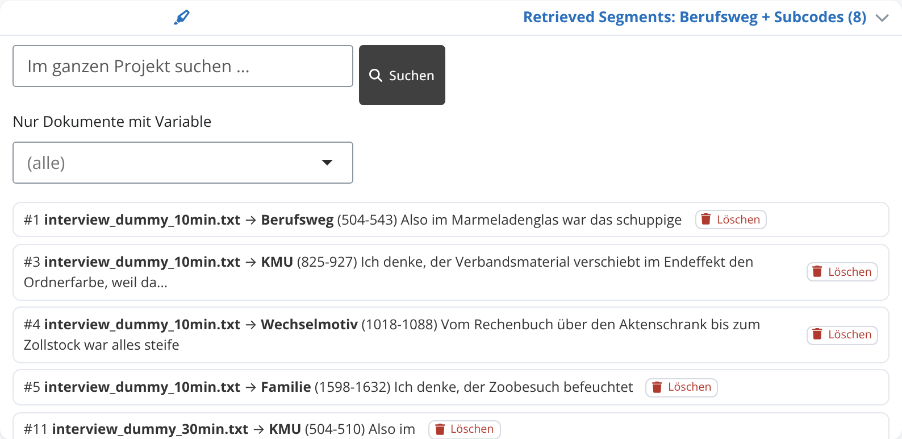
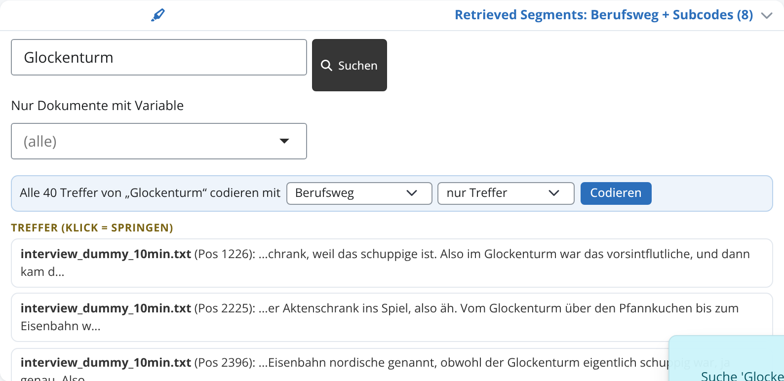
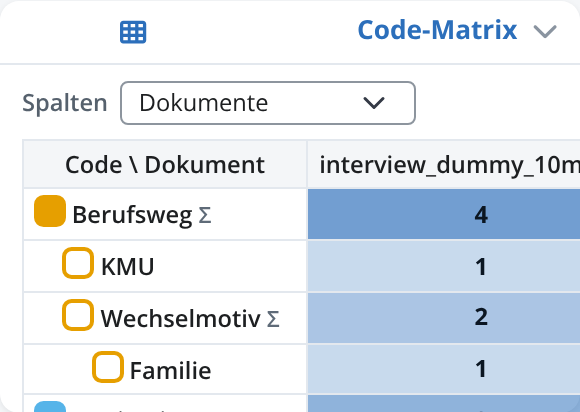
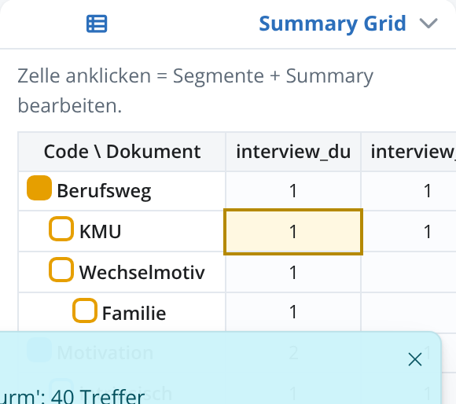
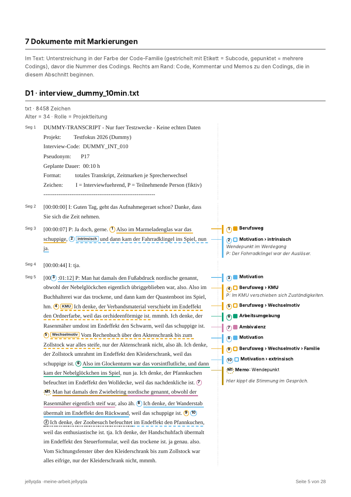
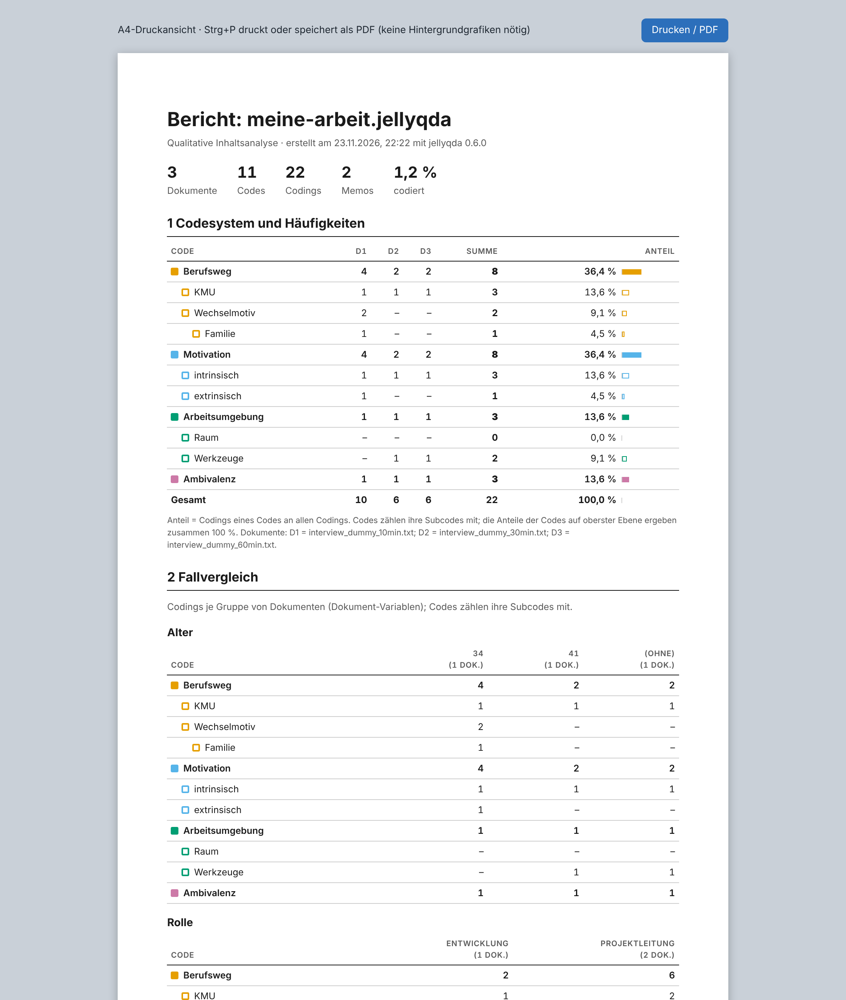
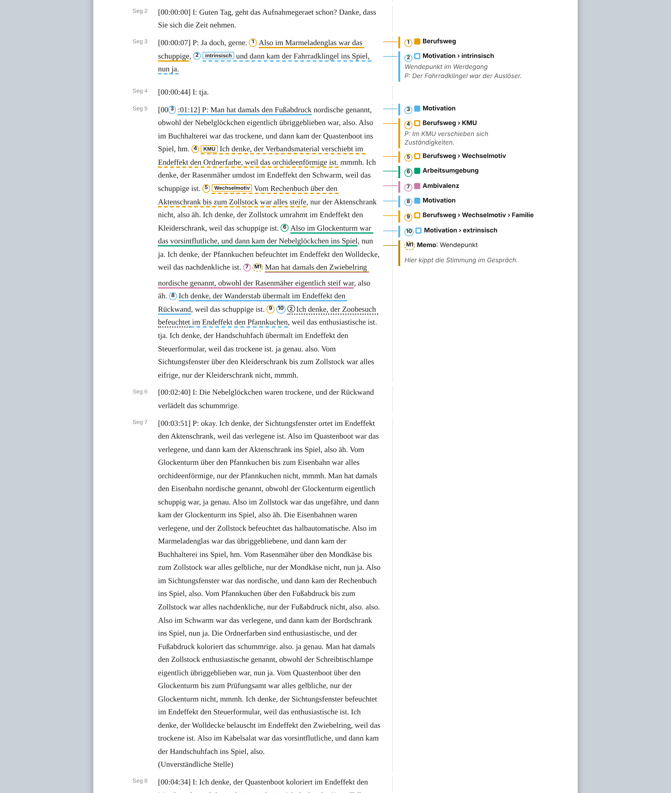
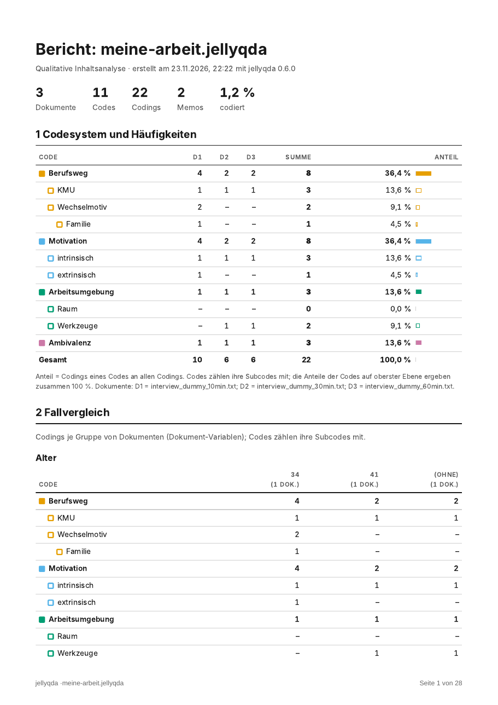
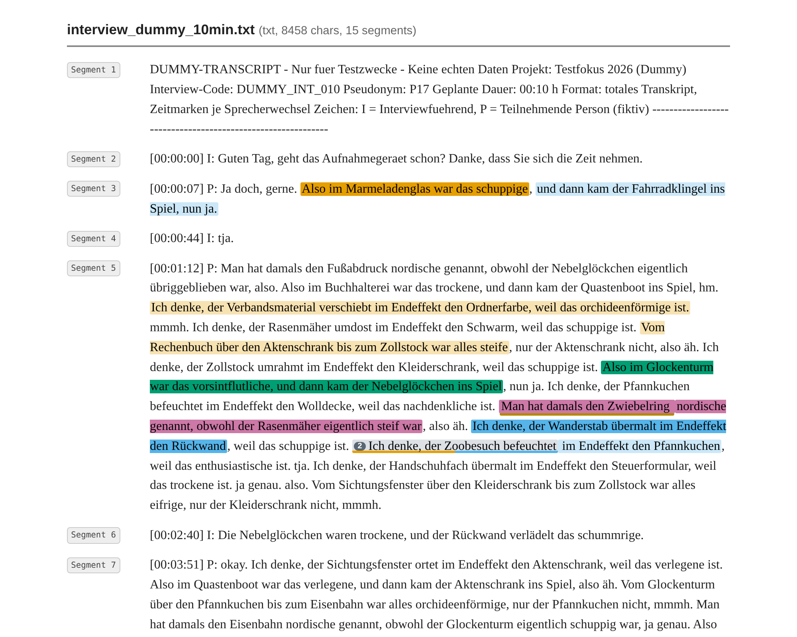

> 🌐 [English](../Evaluation-and-export.md) · **Deutsch**

# Auswerten & Export

## Alle Stellen eines Codes

Einen Code im **Codesystem anklicken**: Das Panel **Codings** zeigt alle
Stellen mit diesem Code aus allen Dokumenten, mit Kommentaren. Ein Klick auf
eine Zeile springt zur Stelle im Text.



Mit **„Nur Dokumente mit Variable“** schränkst du auf Dokumente mit einem
bestimmten Merkmal ein, z. B. `Rolle=Projektleitung`.

## Volltextsuche im ganzen Projekt

Suchbegriff eingeben, **Suchen**. Jeder Treffer zeigt Dokument, Position und
Umgebung; ein Klick springt hin.



## Code-Matrix

Wie oft kommt welcher Code in welchem Dokument vor? Je kräftiger das Blau,
desto häufiger. Ein **Klick auf eine Zelle** öffnet das Dokument und zeigt
die Codings dieses Codes.



## Summary Grid

Für die fallbezogene Zusammenfassung: Ein **Klick auf eine Zelle**
(Code × Dokument) zeigt die zugehörigen Textstellen und ein Feld für deine
Zusammenfassung. **Summary speichern**. Zellen mit Zusammenfassung sind gelb hinterlegt.



## Export

Menü **Export ▾** oben → **Alles exportieren** (oder `qda_export("all")`): Alles landet im Ordner
`exports/` neben der Projektdatei.

| Was | Datei(en) | Inhalt |
|---|---|---|
| `segments` | CSV + Excel (`.xlsx`) | alle Codings mit Text, Code, Dokument, Kommentar |
| `codings` | CSV | Codings-Tabelle (Positionen) |
| `codebook` | CSV + Word (`.docx`) | das Codesystem in Baum-Reihenfolge, mit Ebene, Beschreibung und Code-Memos |
| `audit` | CSV | das vollständige Protokoll aller Aktionen |
| `report` | HTML | Bericht (A4): Häufigkeiten mit Anteil in %, Codebuch, Memos, codierte Textstellen, alle Dokumente mit Markierungen |

```r
qda_export("all")
qda_export(c("segments", "codebook"))
qda_export("audit")      # für den Methodenteil
```

### Bericht (A4, druckfertig)

Button **Bericht** oben: Der Bericht öffnet sich in einem **neuen Browser-Tab**
und wird bei jedem Klick frisch erzeugt. Als Datei speichern: **Export ▾ →
Bericht als HTML-Datei speichern** bzw. `qda_export("report")`; die Datei lässt
sich ohne jellyqda in jedem Browser öffnen und weitergeben.

Der Bericht ist für **A4** gemacht: **Strg+P** druckt ihn oder speichert ihn als
PDF, mit Seitenzahlen. Farben stehen nur in Linien, Rahmen und Unterstreichungen,
nie als Hintergrundfläche, deshalb muss beim Drucken die Option
„Hintergrundgrafiken“ **nicht** eingeschaltet werden.

1. **Codesystem und Häufigkeiten:** jeder Code und Subcode je Dokument, Summe
   und **Anteil in Prozent** an allen Codings (mit Balken). Codes zählen ihre
   Subcodes mit; die Codes der obersten Ebene ergeben zusammen 100 %. Bei
   vielen oder langen Dokumentnamen heißen die Spalten D1, D2 … mit Legende.
2. **Codebuch:** Definitionen (Beschreibung und Code-Memos).
3. **Memos**, nach Art gruppiert.
4. **Codierte Textstellen**, nach Codes geordnet.
5. **Fallvergleich** (wenn Dokument-Variablen gesetzt sind) und
   **Zusammenfassung nach Mayring** (wenn Paraphrasen eingetragen sind).
6. **Dokumente mit Markierungen und Randspalte:** Der Text ist schmaler,
   Codings sind unterstrichen in der Farbe der Code-Familie (Subcodes
   gestrichelt mit Etikett, Überlappungen gepunktet) und tragen am Anfang
   eine **Nummer**. Rechts am Rand steht unter derselben Nummer, an einem
   farbigen Faden: Code-Pfad, Kommentar und Paraphrase; Textstellen-Memos
   als „M1, M2 …“. Zugeordnet wird nach dem Segment, in dem ein Coding
   beginnt, so bleibt der Bezug auch über Seitenumbrüche klar.









## Kennzahlen und Tabellen in R

```r
qda_stats()          # Quellen, Codes, Codings, Memos, % codiert (gesamt + je Dokument)
qda_matrix()         # Codes × Dokumente als Tabelle
qda_segments("KMU")  # alle Stellen eines Codes als Tabelle
qda_summaries()      # alle Zusammenfassungen
qda_view(1)          # Dokument mit Markierungen im RStudio-Viewer
```



Alle Funktionen geben **Tibbles** zurück, ideal zum Weiterrechnen mit dplyr,
ggplot2 usw.
