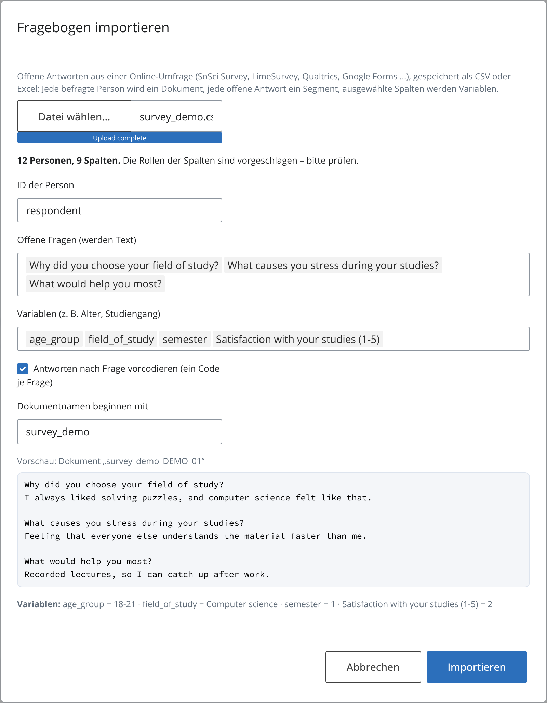
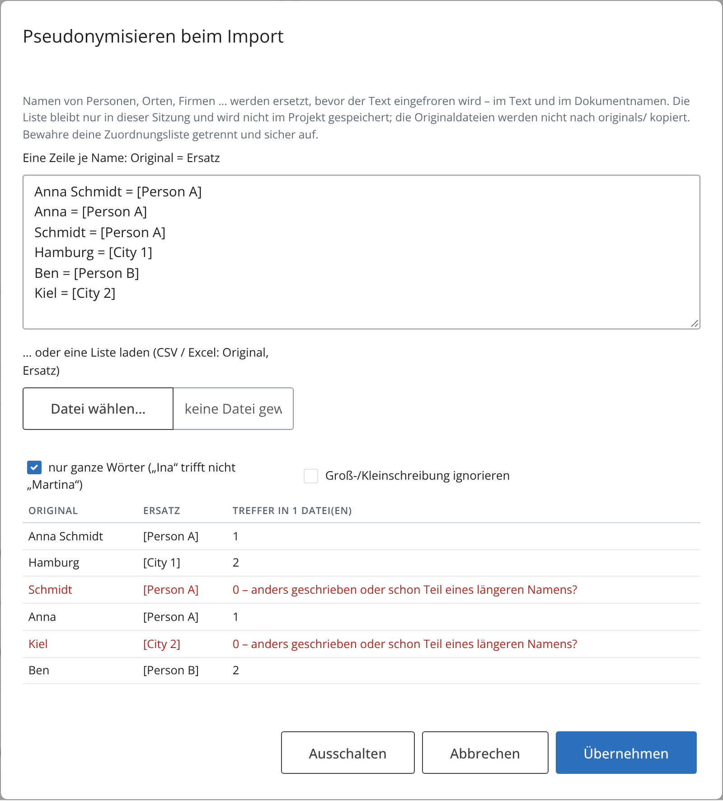
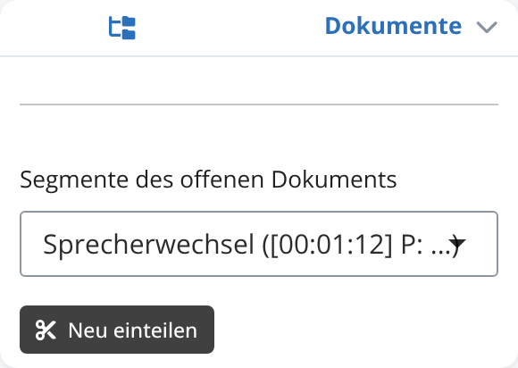

> 🌐 [English](../Importing-documents.md) · **Deutsch**

# Dokumente importieren


## Unterstützte Formate

| Format | Hinweis |
|---|---|
| `.txt`, `.md` | Kodierung (UTF-8, Latin-1, …) wird automatisch erkannt |
| `.docx` | Word-Dokumente; der Text wird übernommen |
| `.pdf` | nur PDFs mit Textebene. Gescannte PDFs ohne Text erzeugen eine Warnung; dann vorher OCR verwenden |

## So geht's

1. **Segmente beim Import** wählen: Leerzeilen (Absätze), Sprecherwechsel
   oder jede Zeile. Mehr dazu unter [Segmente](Segmente.md). Das lässt sich
   später jederzeit ändern.
2. **Dateien…** anklicken oder Dateien **in das Panel ziehen**.
3. **Importieren** klicken.

Per R-Skript:

```r
qda_import(c("interview_01.docx", "interview_02.txt"), segments = "speaker")
```

## Was beim Import passiert

- Der Text wird **eingefroren**: einmal ausgelesen, in UTF-8 umgewandelt und
  in der Projektdatei gespeichert. Danach wird er nie wieder neu gelesen.
  Deshalb verrutschen Codings nie, auch wenn du die Originaldatei später änderst.
- Die **Originaldatei** wird unverändert in den Ordner `originals/` neben der
  Projektdatei kopiert.
- Dieselbe Datei ein zweites Mal zu importieren wird erkannt und übersprungen.

## Fragebogen: offene Antworten aus einer Online-Umfrage

*Neu in Version 0.9.3.* Offene Antworten aus SoSci Survey, LimeSurvey,
Qualtrics, Google Forms … gespeichert als **CSV** oder **Excel**:
**Dokumente-Panel → Fragebogen importieren …**

1. Datei wählen. jellyqda schlägt für jede Spalte eine Rolle vor: die **ID der
   Person**, die **offenen Fragen** (werden Text) und **Variablen** (wenige
   verschiedene Werte, z. B. Altersgruppe, Studiengang). Zeitstempel und
   Ähnliches bleiben außen vor. Den Vorschlag bei Bedarf prüfen und ändern.
2. **Antworten nach Frage vorcodieren** (voreingestellt): Jede Antwort bekommt
   einen Code für ihre Frage, alle unter einem Code „Fragen“.
3. Die **Vorschau** zeigt, wie das erste Dokument aussieht; dann **Importieren**.

Jede befragte Person wird **ein Dokument** (z. B. `umfrage_DEMO_07`), jede
offene Antwort **ein Segment** (die Frage als erste Zeile, darunter die
Antwort), die gewählten Spalten werden **Dokument-Variablen**. Leere Antworten
fallen weg, Personen ganz ohne Antwort werden übersprungen, und dieselbe Datei
ein zweites Mal importiert niemanden doppelt. Die Umfrage-Datei bleibt in
`originals/`.



Danach geht alles wie bei Interviews: Antworten kodieren, Gruppen im
Fallvergleich vergleichen oder per **Abfrage** etwa „Antworten auf Frage 2, die
Belastung ansprechen, nur von Pflege-Studierenden“ finden.

In R: `qda_survey_columns("umfrage.csv")` und
`qda_import_survey("umfrage.csv", code_questions = TRUE)`. Excel-Dateien
brauchen das Paket `readxl` (`install.packages("readxl")`); CSV geht immer. Ein
fiktives Beispiel: `system.file("extdata", "survey_demo.csv", package = "jellyqda")`.

## Pseudonymisieren beim Import

*Neu in Version 0.10.0.* Der Text eines Dokuments wird beim Import
eingefroren und lässt sich danach nicht mehr ändern. Namen von Personen,
Orten und Organisationen müssen also **vorher** ersetzt werden – das kann
jellyqda für dich übernehmen.

Unter dem Import-Knopf: **Pseudonymisieren …**. Trag eine Zeile je Name ein,
`Original = Ersatz`, oder lade eine Liste (CSV / Excel mit zwei Spalten:
Original, Ersatz). Wähl vorher unter **Dateien…** die Transkripte – dann zeigt
der Dialog, wie oft jeder Name ersetzt wird. Ein Name mit 0 Treffern ist
vielleicht im Transkript anders geschrieben (oder schon Teil eines längeren
Namens, z. B. „Schmidt“ in „Anna Schmidt“; längere Namen werden zuerst
ersetzt).



Klick **Übernehmen**: Solange der grüne Hinweis *Pseudonymisierung aktiv* zu
sehen ist, ersetzen **Importieren** (und der Fragebogen-Import) die Namen im
Text **und im Dokumentnamen**. Optionen: nur ganze Wörter (Standard: „Ina“
trifft nicht „Martina“), Groß-/Kleinschreibung ignorieren.

Was jellyqda **nicht** aufbewahrt: die Zuordnungsliste (nur für diese
App-Sitzung), die Originaldateien (sie werden nicht nach `originals/`
kopiert) und die echten Namen (das Protokoll hält nur fest, wie viele
Ersetzungen es gab). Bewahre deine Zuordnungsliste getrennt und sicher auf –
sie ist die einzige Verbindung zu den echten Namen.

```r
key <- qda_pseudonyms("zuordnung.csv")               # oder c("Anna Schmidt" = "[Person A]", ...)
qda_pseudonymise_preview(c("int_01.docx", "int_02.docx"), key)   # erst prüfen
qda_import(c("int_01.docx", "int_02.docx"), pseudonyms = key)
```

## Variablen (Fallmerkmale)

Jedem Dokument kannst du Merkmale wie *Alter*, *Rolle* oder *Dauer* geben.
Unten im Dokumente-Panel: Dokument wählen, Variable und Wert eintragen,
**Variable setzen**.



Die Variablen erscheinen als Chips über dem Text. In der Codings-Liste kannst
du mit **„Nur Dokumente mit Variable“** auf z. B. `Rolle=Projektleitung` filtern.
Ist ein Fall nicht ein Dokument – eine Person, zweimal interviewt, die
Teilnehmenden eines Gruppeninterviews –, nimm [Fälle](Faelle.md) mit eigenen
Fallvariablen.

```r
qda_source_set_var("interview_01.docx", "Alter", "34")
qda_source_vars(1)
qda_source_del_var(1, "Alter")
```
