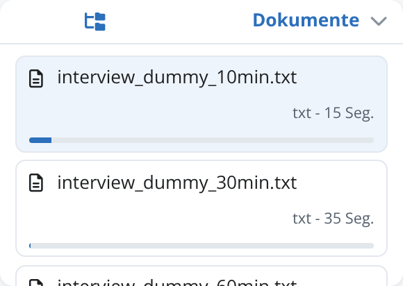

> 🌐 [English](../Importing-documents.md) · **Deutsch**

# Dokumente importieren



## Unterstützte Formate

| Format | Hinweis |
|---|---|
| `.txt`, `.md` | Kodierung (UTF-8, Latin-1, …) wird automatisch erkannt |
| `.docx` | Word-Dokumente; der Text wird übernommen |
| `.pdf` | nur PDFs mit Textebene. Gescannte PDFs ohne Text erzeugen eine Warnung; dann vorher OCR verwenden |

## So geht's

1. **Segmente beim Import** wählen: Leerzeilen (Absätze), Sprecherwechsel
   oder jede Zeile. Mehr dazu unter [Segmente](Segmente.md). Das lässt sich
   später jederzeit ändern.
2. **Dateien…** anklicken oder Dateien **in das Panel ziehen**.
3. **Importieren** klicken.

Per R-Skript:

```r
qda_import(c("interview_01.docx", "interview_02.txt"), segments = "speaker")
```

## Was beim Import passiert

- Der Text wird **eingefroren**: einmal ausgelesen, in UTF-8 umgewandelt und
  in der Projektdatei gespeichert. Danach wird er nie wieder neu gelesen.
  Deshalb verrutschen Codings nie, auch wenn du die Originaldatei später änderst.
- Die **Originaldatei** wird unverändert in den Ordner `originals/` neben der
  Projektdatei kopiert.
- Dieselbe Datei ein zweites Mal zu importieren wird erkannt und übersprungen.

## Variablen (Fallmerkmale)

Jedem Dokument kannst du Merkmale wie *Alter*, *Rolle* oder *Dauer* geben.
Unten im Dokumente-Panel: Dokument wählen, Variable und Wert eintragen,
**Variable setzen**.


Die Variablen erscheinen als Chips über dem Text. In der Codings-Liste kannst
du mit **„Nur Dokumente mit Variable“** auf z. B. `Rolle=Projektleitung` filtern.

```r
qda_source_set_var("interview_01.docx", "Alter", "34")
qda_source_vars(1)
qda_source_del_var(1, "Alter")
```
