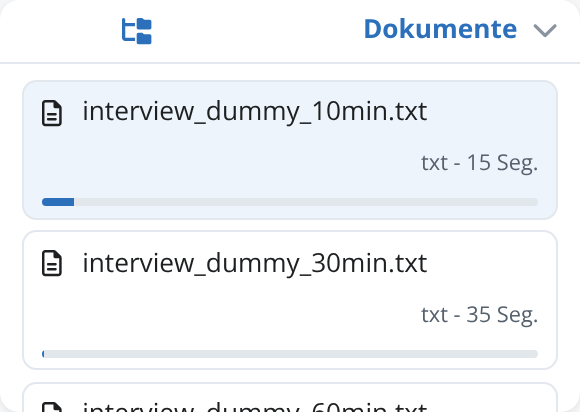
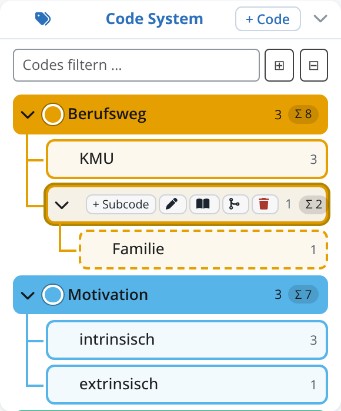
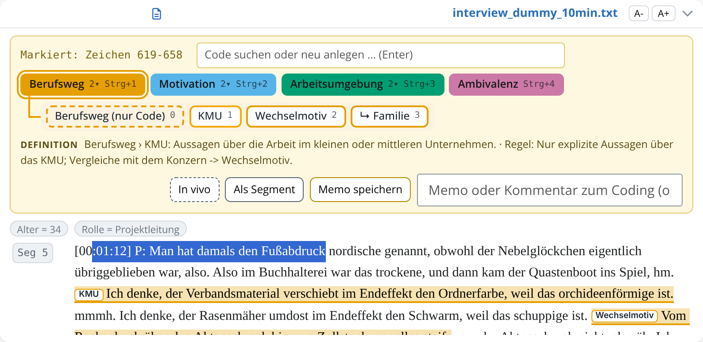

> 🌐 [English](../First-steps.md) · **Deutsch**

# Erste Schritte

In zehn Minuten vom leeren Projekt zum ersten Coding.

## 1. Projekt anlegen und App starten

In der R-Konsole:

```r
library(jellyqda)
qda_open("meine-arbeit.jellyqda")   # legt das Projekt an (beim nächsten Mal: öffnet es)
qda_app()                           # startet die App im Browser
```

- Die Projektdatei entsteht im aktuellen Arbeitsverzeichnis von R
  (in RStudio: *Session → Set Working Directory*). Du kannst auch einen
  vollständigen Pfad angeben, z. B. `qda_open("~/Masterarbeit/analyse.jellyqda")`.
- Die App öffnet sich in einem **neuen Browserfenster**. Lieber im
  RStudio-Viewer? `qda_app(new_window = FALSE)`.
- Die **Sprache** richtet sich nach deinem System. Ausdrücklich wählen:
  `qda_app(lang = "de")` oder `qda_app(lang = "en")`, oder in der
  Symbolleiste auf **DE/EN** klicken.
- Solange die App läuft, ist die R-Konsole belegt. **Beenden:** rotes **X**
  oben rechts in der App (speichert vorher Export + Backup) oder `Esc` in der Konsole.

## 2. Interviews importieren

Links im Panel **Dokumente**:

1. Unter **Segmente beim Import** wählen, wie die Texte eingeteilt werden.
   Für Transkripte mit Zeitmarken (`[00:01:12] P: …`) ist
   **Sprecherwechsel** meist die beste Wahl, siehe [Segmente](Segmente.md).
2. **Dateien…** anklicken (oder Dateien in das Panel ziehen) und **Importieren**.



## 3. Erste Codes anlegen

Im Panel **Code System** oben rechts auf **„+ Code“** klicken, Namen tippen,
**Enter**. Für einen Subcode mit der Maus über einen Code fahren und
**„+ Subcode“** anklicken. Die Farbe wird automatisch vergeben (Subcodes
erben die Farbe ihres Codes) und lässt sich über den Farbpunkt ändern.



## 4. Kodieren

1. Links ein Dokument anklicken; es öffnet sich in der Mitte.
2. Mit der Maus eine Textstelle **markieren**.
3. In der gelben **Kodier-Leiste** auf einen Code klicken (oder **Strg+1…9**).
   Hat er Subcodes, klappen sie aus: dann den Subcode wählen oder
   **„(nur Code)“**.



Fertig, die Stelle ist jetzt in der Farbe des Codes hinterlegt. Gespeichert
wird **sofort** bei jeder Aktion; der Button **Speichern** (Strg+S) legt
zusätzlich einen Sicherungspunkt an.

## 5. Und dann?

- Ideen festhalten: **[Memos](Memos.md)**
- Alle Stellen eines Codes ansehen: Code links anklicken, siehe
  **[Auswerten & Export](Auswerten-und-Export.md)**
- Vertippt? **Strg+Z**, siehe [Rückgängig](Rueckgaengig-und-Datensicherheit.md)

> 💡 **Zum Üben:** `qda_import(system.file("extdata", "interview_01.txt", package = "jellyqda"))`
> oder die fiktiven Demo-Transkripte aus dem Ordner `demo/` des Repositorys (alle erfunden, siehe `demo/README.md`).
