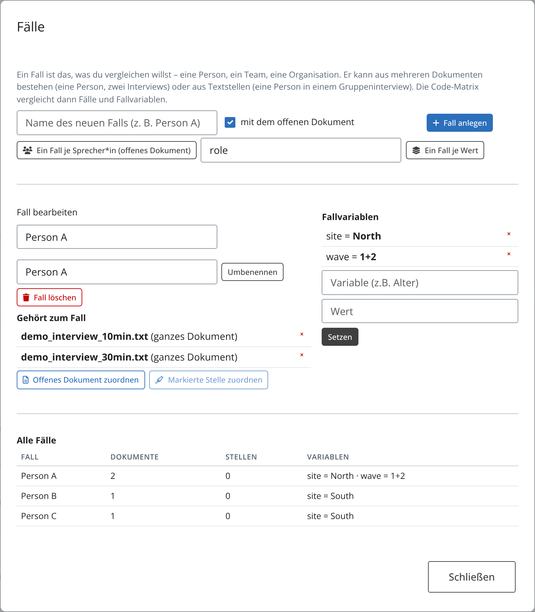
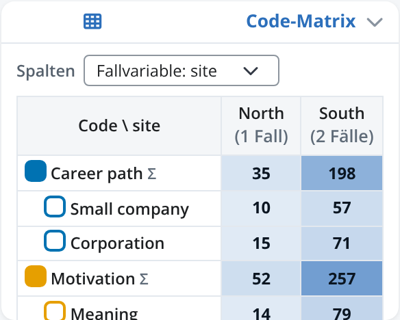

> 🌐 [English](../Cases.md) · **Deutsch**

# Fälle

*Neu in Version 0.10.0.*

Ein **Fall** ist das, was du vergleichen willst: eine Person, ein Team, eine
Organisation, eine Schule. Sehr oft ist ein Fall einfach ein Interview – dann
reichen [Dokument-Variablen](Dokumente-importieren.md#variablen-fallmerkmale).
Fälle brauchst du, wenn das nicht passt:

| Situation | Was zum Fall gehört |
|---|---|
| eine Person wurde zweimal interviewt (Längsschnitt), oder Interview + Feldnotizen zum selben Team | **mehrere ganze Dokumente** |
| ein Gruppeninterview oder eine Fokusgruppe: jede Person ist ein Fall | **Textstellen** eines Dokuments – die Beiträge jeder Person |
| eine Organisation mit mehreren Befragten | mehrere Dokumente (ein Fall „Organisation“) – die einzelnen Personen vergleichst du weiter über Dokument-Variablen |

Ein Dokument kann zu mehreren Fällen gehören, und ein Fall hat eigene
**Fallvariablen** (z. B. *Standort = Nord*, *Altersgruppe = 30–39*),
unabhängig von den Dokument-Variablen. Codings zählen für einen Fall, wenn sie
in einem seiner Dokumente oder einer seiner Textstellen liegen.



## Fälle in der App anlegen

Im Dokumente-Bereich: **Fälle …**. Der Dialog hat drei Teile:

1. **Anlegen** – Namen eintippen, *mit dem offenen Dokument* anhaken, wenn
   das offene Dokument dazugehört, **Fall anlegen**.
2. **Viele auf einmal**
   - **Ein Fall je Sprecher*in (offenes Dokument)**: für Gruppeninterviews.
     Jedes Sprecherkürzel am Anfang eines Segments (`B1:`,
     `[00:03:10] Anna:`) wird ein Fall mit allen Beiträgen dieser Person;
     Kürzel der Interviewenden (`I`, `Interviewer`, `Mod` …) werden
     ausgelassen. Teil das Dokument vorher nach Sprecherwechseln ein
     ([Segmente](Segmente.md)).
   - **Ein Fall je Wert** einer Dokument-Variable: Gib den Dokumenten eine
     Variable, die den Fall benennt (z. B. `Person = P07` an beiden
     Interviews von P07), wähl die Variable, klick – ein Fall je Wert, mit
     den ganzen Dokumenten.
3. **Fall bearbeiten** – Fall wählen, dann
   - **Offenes Dokument zuordnen** oder **Markierte Stelle zuordnen** (erst
     im Dokument Text markieren, dann den Dialog öffnen),
   - **×** nimmt ein Dokument oder eine Stelle aus dem Fall,
   - **Fallvariablen** setzen und löschen, umbenennen, Fall löschen.

Jeder Schritt lässt sich mit **Strg+Z** rückgängig machen. Unten listet *Alle
Fälle* jeden Fall mit Dokumenten, Stellen und Variablen.

## Fälle vergleichen

In der **Code-Matrix** bietet *Spalten* jetzt auch

- **Fälle** – eine Spalte je Fall,
- **Fallvariable: …** – eine Spalte je Wert einer Fallvariable (z. B. Nord
  gegen Süd), mit der Zahl der Fälle je Spalte.



Ein Coding, das zu zwei Fällen derselben Gruppe gehört, zählt für die Gruppe
einmal. Auch die [Abfrage](Analysieren.md#abfrage-codes-kombiniert-und--oder--nicht)
lässt sich auf Fälle beschränken (in R: `qda_query(..., case = "Person A")`).

## Fälle im Bericht und im Export

- Der **Bericht** hat einen Abschnitt *Fälle*: jeder Fall mit seinen
  Bestandteilen und Variablen, Codes je Fall (bis 12 Fälle) und Codes je Wert
  jeder Fallvariable.
- **Alles exportieren** schreibt `cases_<Zeit>.csv`: eine Zeile je Dokument
  oder Textstelle eines Falls, mit den Fallvariablen als Spalten.
- Der **REFI-QDA-Export** (`.qdpx`) enthält die Fälle mit Dokumenten,
  Textstellen und Variablen – MAXQDA, ATLAS.ti oder NVivo kennen sie dann
  auch.

## In R

```r
qda_case_add("Person A", sources = c("int_p01_welle1.docx", "int_p01_welle2.docx"))
qda_case_set_var("Person A", "Standort", "Nord")
qda_case_assign("Person A", "gruppe_2.txt", segment = c(4, 9, 15))   # Beiträge im Gruppeninterview
qda_cases()                                       # alle Fälle mit Variablen
qda_case_members("Person A")                      # was zu einem Fall gehört

qda_cases_from_speakers("gruppe_1.txt")           # Gruppeninterview: ein Fall je Sprecher*in
qda_cases_from_variable("Person")                 # ein Fall je Wert einer Dokument-Variable

qda_case_matrix(unit = "case")                    # Codes x Fälle
qda_case_matrix("Standort", unit = "case")        # Codes x Werte einer Fallvariable
qda_query(all = c("Belastung", "Führung"), case = "Person A")
```

Außerdem: `qda_case_update()` (umbenennen, Beschreibung),
`qda_case_unassign()`, `qda_case_del_var()`, `qda_case_delete()`.
