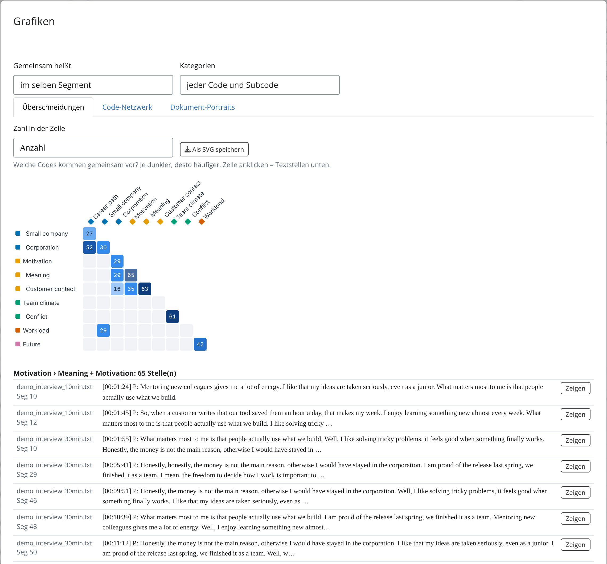
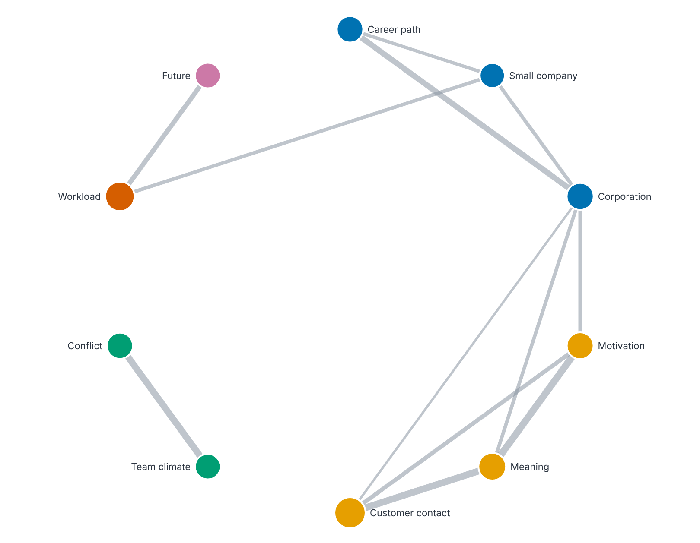
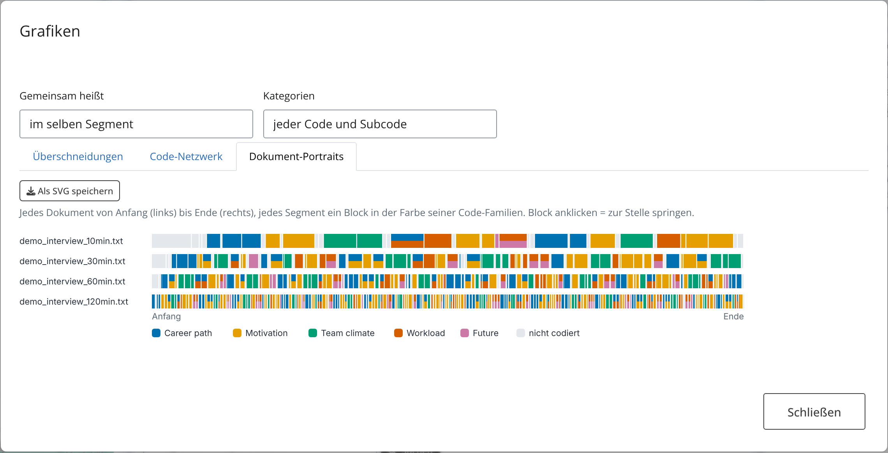

> 🌐 [English](../Graphics.md) · **Deutsch**

# Grafiken: Überschneidungen, Netzwerk, Portraits

*Neu in Version 0.9.0.*

Drei Grafiken helfen, Muster in der Kodierung zu sehen. Sie öffnen sich über
den Knopf **Grafiken** in der Symbolleiste. Zwei Einstellungen oben gelten
für alle drei:

| Einstellung | Bedeutung |
|---|---|
| **Gemeinsam heißt: im selben Segment** (Standard) | zwei Codes gelten als „gemeinsam“, wenn beide im selben Segment vorkommen, z. B. im selben Sprecherwechsel |
| **… im selben Dokument** | beide Codes irgendwo im selben Dokument (grob) |
| **… Codings überlappen** | die beiden Codings teilen sich Text (streng) |
| **Kategorien: jeder Code und Subcode** | streng: jeder Subcode für sich |
| **Kategorien: Code-Familien** | ein Code zusammen mit seinen Subcodes (die Portraits zeigen immer Code-Familien) |



## Code-Überschneidungen (Heatmap)

Ein Dreieck aus Code × Code-Zellen. **Je dunkler eine Zelle, desto häufiger
kommen die beiden Codes gemeinsam vor**; die Zahl steht in der Zelle. Mit der
Maus über eine Zelle zeigt die Details, **ein Klick** listet die Textstellen
darunter auf (mit **Zeigen** springen Sie hin).

- **Zahl in der Zelle: Anzahl** zeigt, wie oft. Häufige Codes haben
  natürlich hohe Zahlen.
- **Jaccard (0–1)** gleicht das aus: Anteil der Einheiten mit *einem* der
  beiden Codes, die *beide* enthalten. 1 = die Codes kommen immer gemeinsam
  vor. Hilfreich, um Kategorien zu finden, die schwer zu trennen sind.

Typische Fragen: Welche Themen werden zusammen angesprochen? Kommt
„Belastung“ eher mit „Führung“ oder mit „Familie“ vor? Treten zwei Subcodes
immer gemeinsam auf (und sollten vielleicht zusammengeführt werden)?

## Code-Netzwerk



Jeder Code ist ein **Kreis** (Farbe seiner Code-Familie, Größe = wie oft
vergeben), eine **Linie** verbindet zwei Codes, die gemeinsam vorkommen
(dicker = häufiger). **Linie anklicken** listet die Textstellen auf.

- **Linien ab (mal gemeinsam)**: seltene Verbindungen ausblenden, z. B. ab 3.
- **Anordnung: Kreis** behält die Reihenfolge des Codebaums, Code-Familien
  bleiben nebeneinander; **nach Verbindungen** zieht verwandte Codes
  zusammen.

## Dokument-Portraits



Jedes Dokument ist ein Streifen von seinem **Anfang (links)** bis zum
**Ende (rechts)**. Jedes Segment ist ein Block, so breit wie sein Anteil am
Text, in den Farben seiner Codes (mehrere Codes = übereinanderliegende
Bänder; grau = nicht codiert). **Block anklicken** springt zur Stelle.

So sehen Sie auf einen Blick, *wo* im Interview ein Thema auftaucht (am
Anfang, durchgehend, erst am Ende), wie dicht ein Interview kodiert ist und
wie sich Interviews unterscheiden.

## Speichern und Drucken

- **Als SVG speichern** unter jeder Grafik: eine Vektorgrafik für die Arbeit
  (Word, LaTeX, Inkscape …), in jeder Größe scharf.
- Der **Bericht** enthält Heatmap, Netzwerk und Portraits.

## Als R-Skript

```r
qda_cooccurrence()                           # Code-Paare, häufigste zuerst
qda_cooccurrence(unit = "overlap", level = "top")
qda_cooccurrence_passages("Workload", "Leadership")
qda_portrait()                               # welche Codes in welchem Segment

qda_plot_cooccurrence()                      # print() zeigt sie im RStudio-Viewer
qda_plot_cooccurrence(measure = "jaccard", file = "ueberschneidungen.svg")
qda_plot_network(min_n = 3, layout = "force", file = "netzwerk.svg")
qda_plot_portrait(file = "portraits.svg")
```

Die Tabellen sind normale Tibbles, Sie können sie also auch mit ggplot2
zeichnen. Ein vollständiges Beispiel:
[`demo/jellyqda-visuals-demo.R`](../../../demo/jellyqda-visuals-demo.R).

---
[Zurück zur Wiki-Startseite](Home.md) · Zurück: [Intercoder-Übereinstimmung](Intercoder-Uebereinstimmung.md) · Weiter: [Auswerten & Export](Auswerten-und-Export.md)
