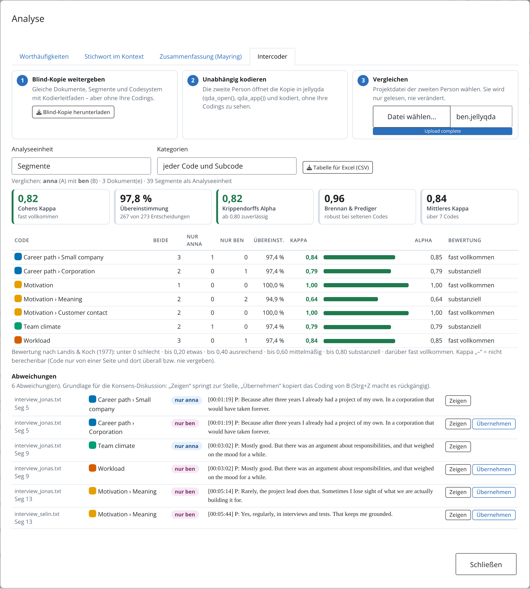
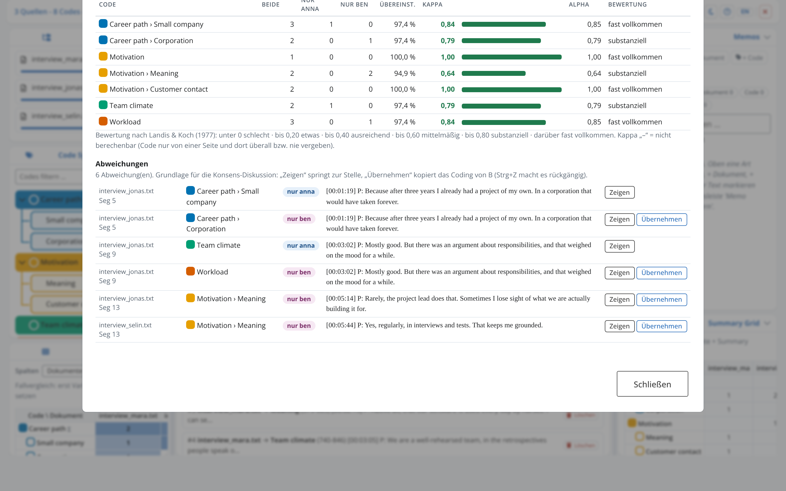
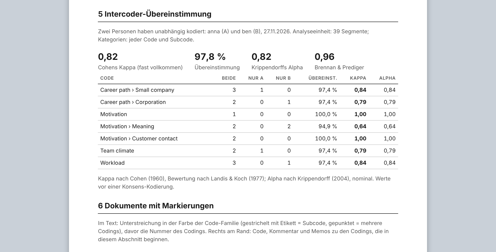

> 🌐 [English](../Intercoder-agreement.md) · **Deutsch**

# Intercoder-Übereinstimmung (Kappa)

*Neu in Version 0.8.0.*

Kodieren zwei Personen dasselbe Material gleich? Das beantwortet die
**Intercoder-Übereinstimmung**, ein Standard-Gütekriterium der qualitativen
Inhaltsanalyse (z. B. nach Mayring oder Kuckartz). jellyqda berechnet sie
direkt aus zwei Projektdateien: alles bleibt offline, niemand braucht einen
Server oder ein Konto.



## Die Idee

Jede Person kodiert in **ihrer eigenen Projektdatei**. Sie (Person A) geben
der zweiten Person (B) eine **Blind-Kopie**: dieselben Dokumente, Segmente und
dasselbe Codesystem mit Kodierleitfaden, aber **ohne Ihre Codings**. B kodiert
unabhängig. Danach laden Sie die Datei von B in Ihr Projekt, und jellyqda
vergleicht. Die Datei von B wird dabei **nur gelesen, nie verändert**.

## Schritt für Schritt

**In der App:** Symbolleiste **Analyse** → Reiter **Intercoder**.

1. **Blind-Kopie weitergeben.** **Blind-Kopie herunterladen** anklicken und
   die Datei speichern, z. B. als `ben.jellyqda`. Weitergeben (USB-Stick,
   verschlüsselte Mail …).
   *Tipp:* Die Kopie anlegen, wenn Codesystem und Kodierleitfaden stehen, und
   **bevor** Sie kodieren – oder zumindest ohne über Ihre Codings zu sprechen.
2. **Unabhängig kodieren.** B installiert jellyqda und öffnet die Kopie:
   ```r
   library(jellyqda)
   qda_open("ben.jellyqda")
   qda_app()
   ```
   B kodiert wie gewohnt. Der Kodierleitfaden (Buch-Symbol am Code) zeigt
   Definitionen, Ankerbeispiele und Kodierregeln.
3. **Vergleichen.** Zurück in Ihrem Projekt: **Analyse → Intercoder → Datei
   wählen…** und die Datei von B auswählen. jellyqda zeigt sofort:
   - fünf Kacheln: **Cohens Kappa** mit Bewertung, **prozentuale
     Übereinstimmung**, **Krippendorffs Alpha**, **Brennan & Prediger** und
     das **mittlere Kappa** über alle Codes,
   - eine Tabelle **je Code**: wie oft beide, nur A oder nur B kodiert haben,
     Übereinstimmung, Kappa (mit Balken: grün ab 0,61, orange 0,41–0,60, rot
     darunter), Alpha und Bewertung,
   - die Liste der **Abweichungen**.
4. **Konsens.** Gehen Sie die Abweichungen gemeinsam durch:
   - **Zeigen** springt zur Stelle im Dokument-Browser.
   - **Übernehmen** kopiert das Coding von B in Ihr Projekt (rückgängig mit
     **Strg+Z**, wie alles).
   - Codings, die nur Sie vergeben haben: im Text anklicken und löschen oder
     umkodieren, wenn Sie sich darauf einigen.



**Tabelle für Excel (CSV)** lädt die Tabelle je Code herunter.

## Einstellungen

| Einstellung | Bedeutung |
|---|---|
| **Analyseeinheit: Segmente** (Standard) | Jedes Segment (z. B. jeder Sprecherwechsel) ist pro Code eine Entscheidung: kodiert oder nicht. Ein Segment gilt als kodiert, sobald ein Coding dieses Codes es berührt – beide müssen also **nicht** exakt dieselben Wörter markieren. |
| **Analyseeinheit: Dokumente** | Haben beide den Code irgendwo im Dokument vergeben? Grob; nützlich bei vielen kurzen Dokumenten. |
| **Kategorien: jeder Code und Subcode** (Standard) | Streng: „Berufsweg › KMU“ und „Berufsweg › Konzern“ sind verschiedene Kategorien. |
| **Kategorien: Code-Familien** | Ein Code zusammen mit seinen Subcodes. Zeigt, ob die Hauptkategorien übereinstimmen, auch wenn die Subcodes abweichen. |

*Tipp:* Wer nach Segmenten vergleicht, sollte die Dokumente **vor** der
Blind-Kopie einteilen, z. B. nach Sprecherwechsel ([Segmente](Segmente.md)).
Dann haben beide Projekte dieselben Einheiten.

## Welchen Wert berichte ich?

| Maß | Was es aussagt | Hinweis |
|---|---|---|
| **Prozentuale Übereinstimmung** | Anteil gleicher Entscheidungen | anschaulich, aber zu optimistisch: Segmente, die niemand kodiert (z. B. Fragen der Interviewerin), zählen immer als Übereinstimmung |
| **Cohens Kappa** | Übereinstimmung **bereinigt um Zufall** | der gängigste Wert; Bewertung nach Landis & Koch (1977): bis 0,20 etwas, bis 0,40 ausreichend, bis 0,60 mittelmäßig, bis 0,80 substanziell, darüber fast vollkommen |
| **Krippendorffs Alpha** | zufallsbereinigt, in der Inhaltsanalyse verbreitet | ab 0,80 gilt meist als zuverlässig, 0,667–0,80 erlaubt vorsichtige Schlüsse |
| **Brennan & Prediger** | Zufallsübereinstimmung fest bei 50 % | stabil bei **seltenen Codes**, bei denen Cohens Kappa trotz hoher Übereinstimmung niedrig ausfällt |
| **Mittleres Kappa** | Mittelwert der Kappas aller Codes | jeder Code zählt gleich, egal wie oft er vergeben wurde |

„–“ heißt: Der Wert ist **nicht berechenbar**, z. B. wenn ein Code in den
verglichenen Einheiten von niemandem oder von beiden überall vergeben wurde.

Ein Satz für das Methodenkapitel könnte so lauten: *„Zur Prüfung der
Zuverlässigkeit des Kategoriensystems kodierte eine zweite Person alle drei
Interviews unabhängig auf Grundlage des Kodierleitfadens (Analyseeinheit:
Sprecherwechsel, n = 39). Cohens Kappa betrug insgesamt κ = .82
(Krippendorffs α = .82); am schwächsten war die Kategorie ‚Motivation › Meaning‘
mit κ = .64. Abweichungen wurden konsensuell geklärt.“*

## Protokoll und Bericht

- Jeder Vergleich steht mit seinen Werten im **Audit-Trail**
  (`qda_export("audit")`). **Übernehmen** wird als normale Kodier-Aktion
  protokolliert.
- Der **Bericht** bekommt einen Abschnitt **Intercoder-Übereinstimmung** mit
  den Werten des **letzten unabhängigen Vergleichs**. Die Zahlen nach
  **Übernehmen** (Konsens) werden bewusst nicht protokolliert: Berichtet wird
  die Übereinstimmung *vor* dem Konsens.



## Als R-Skript

```r
library(jellyqda)
qda_open("anna.jellyqda")
qda_intercoder_copy("ben.jellyqda")          # 1. Blind-Kopie für die zweite Person

# ... ben kodiert ben.jellyqda ...

res <- qda_intercoder("ben.jellyqda")        # 3. vergleichen
res                                          # erste Zeile = alle Codes, dann je Code
qda_intercoder("ben.jellyqda", level = "top", unit = "document")
d <- qda_intercoder_diff("ben.jellyqda")     # Abweichungen
d[, c("source", "segment", "code", "coder", "text")]
qda_intercoder_adopt("ben.jellyqda",         # 4. Konsens: Coding von ben übernehmen
                     d$source_id[1], d$start[1], d$end[1], d$code[1])
```

Ein vollständiges Beispiel mit drei fiktiven Interviews und zwei
Kodierenden: [`demo/jellyqda-intercoder-demo.R`](../../../demo/jellyqda-intercoder-demo.R).

## Gut zu wissen

- Dokumente werden über ihren **Text** zugeordnet, nicht über den Namen:
  Umbenennen im Projekt von B schadet nicht. Dokumente mit anderem Text (z. B.
  neu importiert) werden nicht verglichen und aufgelistet.
- Codes werden über ihren **Pfad** zugeordnet („Berufsweg / KMU“). Codes, die
  nur B angelegt hat, werden eigens aufgeführt; um solche Codings zu
  übernehmen, legen Sie den Code zuerst in Ihrem Projekt an.
- Verglichen werden **zwei** Personen. Bei drei oder mehr Kodierenden
  paarweise vergleichen (A–B, A–C, B–C).

---
[Zurück zur Wiki-Startseite](Home.md) · Zurück: [Analysieren](Analysieren.md) · Weiter: [Grafiken](Grafiken.md)
