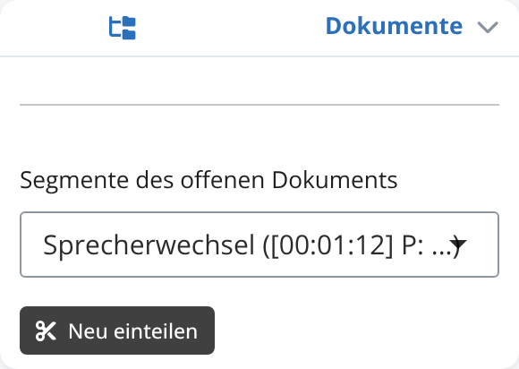
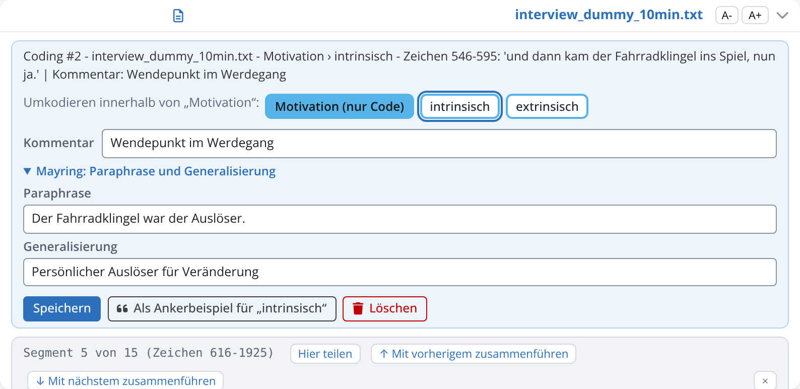

> 🌐 [English](../Segments.md) · **Deutsch**

# Segmente

Segmente sind die Einheiten eines Dokuments, im Text links als **„Seg N“**
angezeigt. Sie helfen beim Orientieren und beim schnellen Kodieren ganzer
Redebeiträge (Klick auf „Seg N“ markiert das ganze Segment).

> **Wichtig:** Codings und Memos speichern die genaue Zeichenposition, nicht
> die Segmentnummer. Segmente zu ändern verändert **nie** deine Codings.

## Drei Regeln

| Regel | Neues Segment beginnt … | Gut für |
|---|---|---|
| **Leerzeilen (Absätze)** | nach jeder Leerzeile | Texte mit Absätzen, Feldnotizen |
| **Sprecherwechsel** | bei jeder Zeile wie `[00:01:12] P: …`, `I: …`, `Befragte: …` | Interview-Transkripte |
| **Jede Zeile** | in jeder nicht leeren Zeile | Listen, Zeilen-Transkripte |

Bei **Sprecherwechsel** gilt: Enthält ein Transkript **Zeitmarken**, zählen
nur Zeilen mit Zeitmarke; so bleibt ein Kopfbereich wie „Projekt: …,
Pseudonym: …“ ein einziges Segment. Ohne Zeitmarken werden Sprechernamen
(ein Wort vor dem Doppelpunkt) erkannt. Zeilen ohne Sprecher, z. B.
„(Unverständliche Stelle)“, gehören zum vorherigen Redebeitrag.

## Regel wählen

- **Beim Import:** im Dokumente-Panel *Segmente beim Import*.
- **Nachträglich** für das offene Dokument: unten im Dokumente-Panel Regel
  wählen und **Neu einteilen**.



## Segmente von Hand bearbeiten

**Teilen oder zusammenführen:** an der gewünschten Stelle in den Text
**klicken** (ohne zu markieren). Die Segment-Leiste erscheint:



- **Hier teilen:** Ab der Cursorposition beginnt ein neues Segment.
- **↑ Mit vorherigem zusammenführen** / **↓ Mit nächstem zusammenführen**
- **×** schließt die Leiste.

**Eigenes Segment festlegen:** Text markieren, in der Kodier-Leiste **Als Segment**.
Angrenzende Segmente werden passend gekürzt.

Alle Änderungen lassen sich mit **Strg+Z** rückgängig machen.

## Per R-Skript

```r
qda_segments_set("interview_01.txt", "speaker")          # neu einteilen
qda_segments_set(2, "speaker", pattern = "^(I|B[0-9]?):") # eigenes Muster
qda_source_segments(1)                                    # Segmente ansehen
qda_segment_split(1, at = 512)                            # teilen
qda_segment_merge(1, 3)                                   # 3 + 4 zusammenführen
qda_segment_define(1, start = 120, end = 340)             # eigenes Segment
qda_segments_reset(1)                                     # zurück zu Leerzeilen
```
