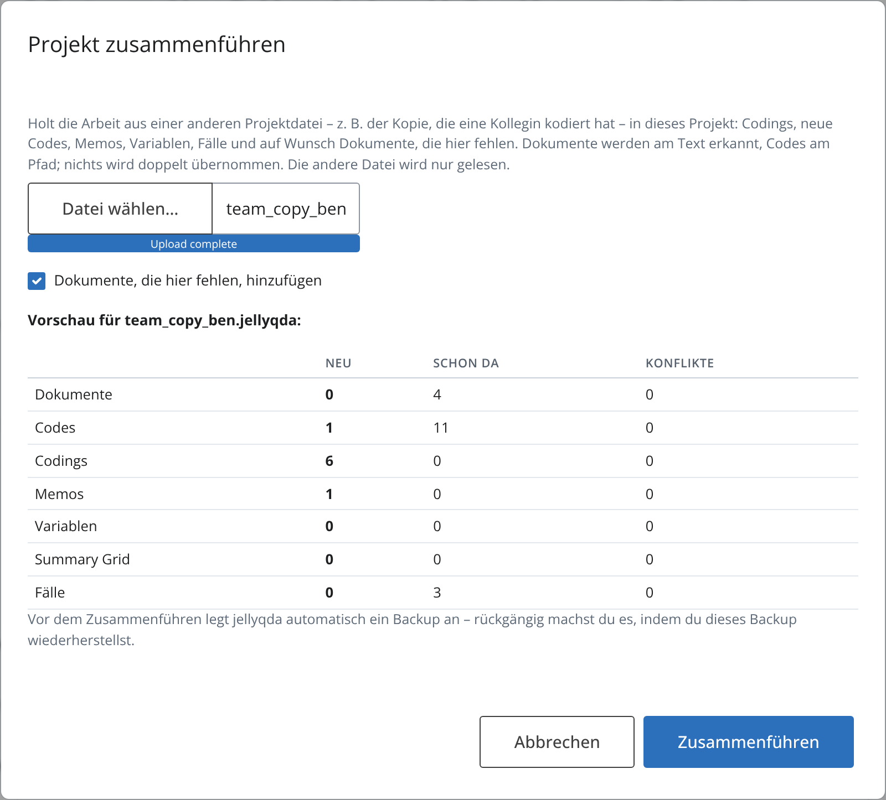

> 🌐 [English](../Team-work.md) · **Deutsch**

# Teamarbeit: Projekte zusammenführen

*Neu in Version 0.10.0.*

jellyqda hat keinen Server – jede Person arbeitet in ihrer **eigenen
Projektdatei**. Um gemeinsam auszuwerten, teilt ihr die Arbeit auf und holt
sie mit **Projekt zusammenführen** wieder zusammen.

## Der Ablauf

1. **Eine Person legt das Projekt an**: importiert die Dokumente (oder einen
   Teil), baut das Codesystem auf und schreibt den Kodierleitfaden.
2. **Kopien weitergeben.** Entweder einfach die `.jellyqda`-Datei kopieren
   oder **Analyse → Intercoder → Blind-Kopie herunterladen** – dieselben
   Dokumente und dasselbe Codesystem, aber ohne Codings (siehe
   [Intercoder-Übereinstimmung](Intercoder-Uebereinstimmung.md)).
3. **Alle kodieren ihren Teil** – z. B. Interviews 1–10, 11–20, 21–30.
   Teammitglieder dürfen auch **eigene** Interviews importieren und kodieren,
   Codes ergänzen, Memos schreiben, Variablen setzen oder [Fälle](Faelle.md)
   anlegen.
4. **Zusammenführen**: in deinem Projekt **Export → Projekt zusammenführen …**,
   die Datei eines Teammitglieds wählen. Für jede Kopie wiederholen.



Bevor etwas passiert, zeigt der Dialog eine **Vorschau**: wie viele
Dokumente, Codes, Codings, Memos, Variablen, Summary-Grid-Zellen und Fälle
**neu**, **schon da** oder im **Konflikt** sind. Erst **Zusammenführen**
schreibt etwas.

## Was übernommen wird – und wie

| Daten | Erkannt an | Regel |
|---|---|---|
| Dokumente | ihrem **Text** (nicht am Namen) | Dokumente, die nur in der Kopie sind, kommen dazu (abschaltbar – dann fallen auch ihre Codings weg) |
| Codes | ihrem **Pfad** (`Team / Unterstützung`) | fehlende Codes werden unter dem richtigen Obercode angelegt; leere Felder im Kodierleitfaden (Definition, Ankerbeispiele, Kodierregel) werden ergänzt |
| Codings | Dokument + Code + Textstelle | kommen dazu, außer es gibt genau dasselbe Coding schon |
| Memos | Art, Titel, Text, Bezug | kommen dazu, außer es gibt ein gleiches Memo schon |
| Dokument- und Fallvariablen | Name | fehlende kommen dazu; ein **anderer Wert ist ein Konflikt** – dein Projekt behält seinen |
| Summary Grid | Code + Dokument | wird ergänzt, wo deine Zelle leer ist; ein anderer Text ist ein Konflikt |
| Fälle | Name | fehlende Fälle werden angelegt; Dokumente, Stellen und Variablen wie oben |

Wer dieselbe Kopie zweimal zusammenführt, bekommt beim zweiten Mal nichts
Neues. Die andere Datei wird nur **gelesen**, nie verändert.

## Zusammenführen rückgängig machen

Zusammenführen ist ein großer Schritt und wird deshalb **nicht** mit Strg+Z
rückgängig gemacht. Stattdessen legt jellyqda direkt davor ein **Backup**
deines Projekts an ([Rückgängig & Datensicherheit](Rueckgaengig-und-Datensicherheit.md#backups)).
Zum Rückgängigmachen stellst du dieses Backup wieder her.

## Tipps

- Einigt euch **vor** dem Weitergeben auf das Codesystem. Neue Codes sind
  kein Problem, aber wenn zwei Leute „Unterstützung“ und „unterstützung“
  anlegen, gibt es zwei Codes – danach mit *Codes zusammenführen* aufräumen.
- Prüft erst an wenigen Interviews die
  [Intercoder-Übereinstimmung](Intercoder-Uebereinstimmung.md), dann teilt
  ihr den Rest auf.
- Führ eine Kopie nach der anderen zusammen und schau dir die Vorschau an:
  Viele Konflikte heißen meist, dass Variablen unterschiedlich eingetragen
  wurden.

## In R

```r
qda_merge("anna.jellyqda", dry_run = TRUE)   # Vorschau: was käme dazu?
qda_merge("anna.jellyqda")                   # zusammenführen (vorher Backup)
qda_merge("ben.jellyqda", add_documents = FALSE)
```
